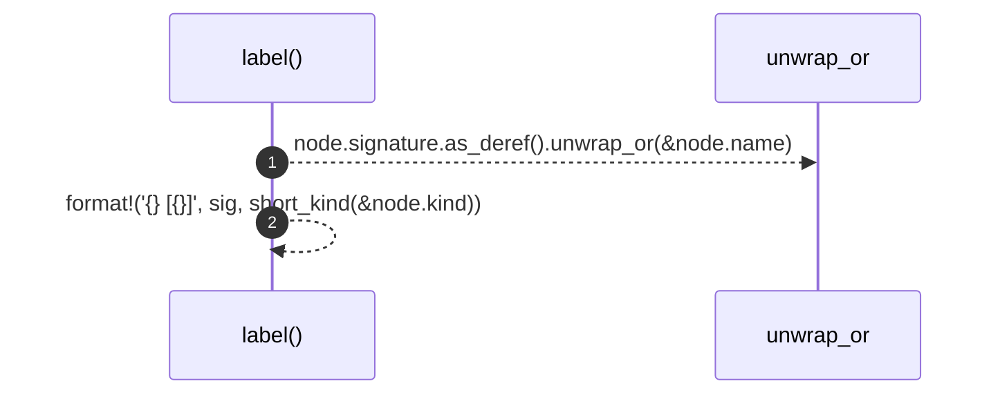

# `robby_render::label`

[Self-model](../README.md) · [robby_render](index.md)

| | |
|---|---|
| kind | `code.function` |
| signature | `fn label(node: &Node) -> String` |
| location | [`crates/robby-render/src/lib.rs:189`](../../../crates/robby-render/src/lib.rs#L189) |
| provenance | extractor · confidence 1.00 |

```rust
fn label(node: &Node) -> String {
    let sig = node.signature.as_deref().unwrap_or(&node.name);
    format!("{}  [{}]", sig, short_kind(&node.kind))
}
```



2 steps · 0 observed · 2 possible only

