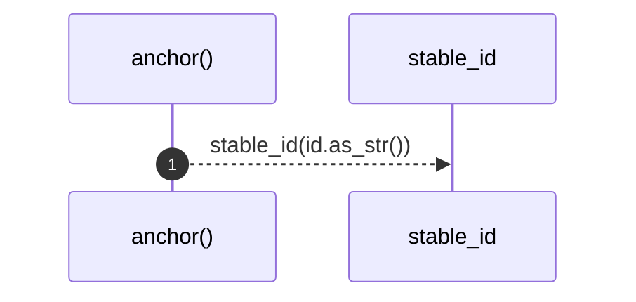

# `robby_render::markdown::anchor`

[Self-model](../../README.md) · [markdown](index.md)

| | |
|---|---|
| kind | `code.function` |
| signature | `fn anchor(id: &NodeId) -> String` |
| location | [`crates/robby-render/src/markdown.rs:255`](../../../../crates/robby-render/src/markdown.rs#L255) |
| provenance | extractor · confidence 1.00 |

> Sanity check used by tests: every id has a deterministic short form.

```rust
/// Sanity check used by tests: every id has a deterministic short form.
pub fn anchor(id: &NodeId) -> String {
    stable_id(id.as_str())
}
```



1 steps · 0 observed · 1 possible only

**Edges**

- calls → [`robby_render::stable_id`](../stable-id.md)

