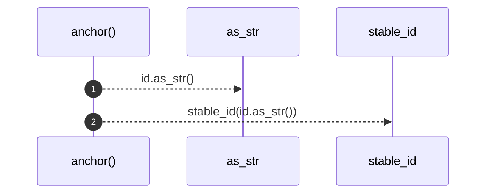

# `robby_render::markdown::anchor`

[Self-model](../../README.md) · [markdown](index.md)

| | |
|---|---|
| kind | `code.function` |
| signature | `fn anchor(id: &NodeId) -> String` |
| location | [`crates/robby-render/src/markdown.rs:298`](../../../../crates/robby-render/src/markdown.rs#L298) |
| provenance | extractor · confidence 1.00 |

> Sanity check used by tests: every id has a deterministic short form.

```rust
/// Sanity check used by tests: every id has a deterministic short form.
pub fn anchor(id: &NodeId) -> String {
    stable_id(id.as_str())
}
```



2 steps · 0 observed · 2 possible only

**Edges**

- calls → [`robby_render::view::comments::impl NoteKind::as_str`](../view/comments/index.md)
- calls → [`robby_render::stable_id`](../stable-id.md)

## References

- calls → [`robby_render`](../index.md) — stable_id
- calls → [`robby_render::view::comments`](../view/comments/index.md) — as_str

