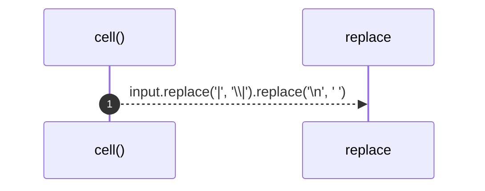

# `robby_render::markdown::cell`

[Self-model](../../README.md) · [markdown](index.md)

| | |
|---|---|
| kind | `code.function` |
| signature | `fn cell(input: &str) -> String` |
| location | [`crates/robby-render/src/markdown.rs:205`](../../../../crates/robby-render/src/markdown.rs#L205) |
| provenance | extractor · confidence 1.00 |

```rust
pub(crate) fn cell(input: &str) -> String {
    input.replace('|', "\\|").replace('\n', " ")
}
```



1 steps · 0 observed · 1 possible only

