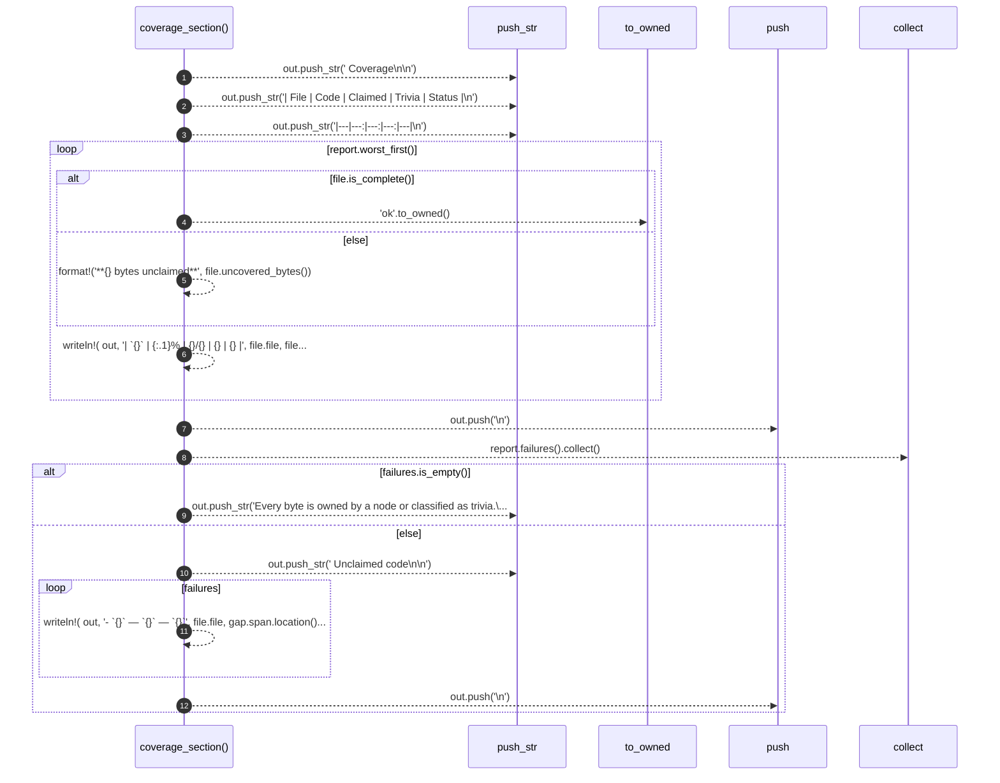

# `robby_render::markdown::coverage_section`

[Self-model](../../README.md) · [markdown](index.md)

| | |
|---|---|
| kind | `code.function` |
| signature | `fn coverage_section(out: &mut String, report: &CoverageReport)` |
| location | [`crates/robby-render/src/markdown.rs:60`](../../../../crates/robby-render/src/markdown.rs#L60) |
| provenance | extractor · confidence 1.00 |

```rust
pub(crate) fn coverage_section(out: &mut String, report: &CoverageReport) {
    out.push_str("## Coverage\n\n");
    out.push_str("| File | Code | Claimed | Trivia | Status |\n");
    out.push_str("|---|---:|---:|---:|---|\n");

    for file in report.worst_first() {
        let status = if file.is_complete() {
            "ok".to_owned()
        } else {
            format!("**{} bytes unclaimed**", file.uncovered_bytes())
        };
        let _ = writeln!(
            out,
            "| `{}` | {:.1}% | {}/{} | {} | {} |",
            file.file,
            file.code_ratio() * 100.0,
            file.covered_bytes,
            file.covered_bytes + file.uncovered_bytes(),
            file.trivia_bytes(),
            status
        );
    }
    out.push('\n');

    let failures: Vec<_> = report.failures().collect();
    if failures.is_empty() {
        out.push_str("Every byte is owned by a node or classified as trivia.\n\n");
    } else {
        out.push_str("### Unclaimed code\n\n");
        for (file, gap) in failures {
            let _ = writeln!(
                out,
                "- `{}` — `{}` — `{}`",
                file.file,
                gap.span.location(),
                gap.preview
            );
        }
        out.push('\n');
    }
}
```



12 steps · 0 observed · 12 possible only

