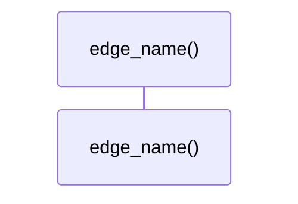

# `robby_render::markdown::edge_name`

[Self-model](../../README.md) · [markdown](index.md)

| | |
|---|---|
| kind | `code.function` |
| signature | `fn edge_name(kind: EdgeKind) -> &'static str` |
| location | [`crates/robby-render/src/markdown.rs:262`](../../../../crates/robby-render/src/markdown.rs#L262) |
| provenance | extractor · confidence 1.00 |

```rust
pub(crate) fn edge_name(kind: EdgeKind) -> &'static str {
    match kind {
        EdgeKind::Contains => "contains",
        EdgeKind::Calls => "calls",
        EdgeKind::Uses => "uses",
        EdgeKind::Imports => "imports",
        EdgeKind::Implements => "implements",
        EdgeKind::Extends => "extends",
        EdgeKind::Returns => "returns",
        EdgeKind::Field => "field",
        EdgeKind::References => "references",
    }
}
```



0 steps · 0 observed · 0 possible only

