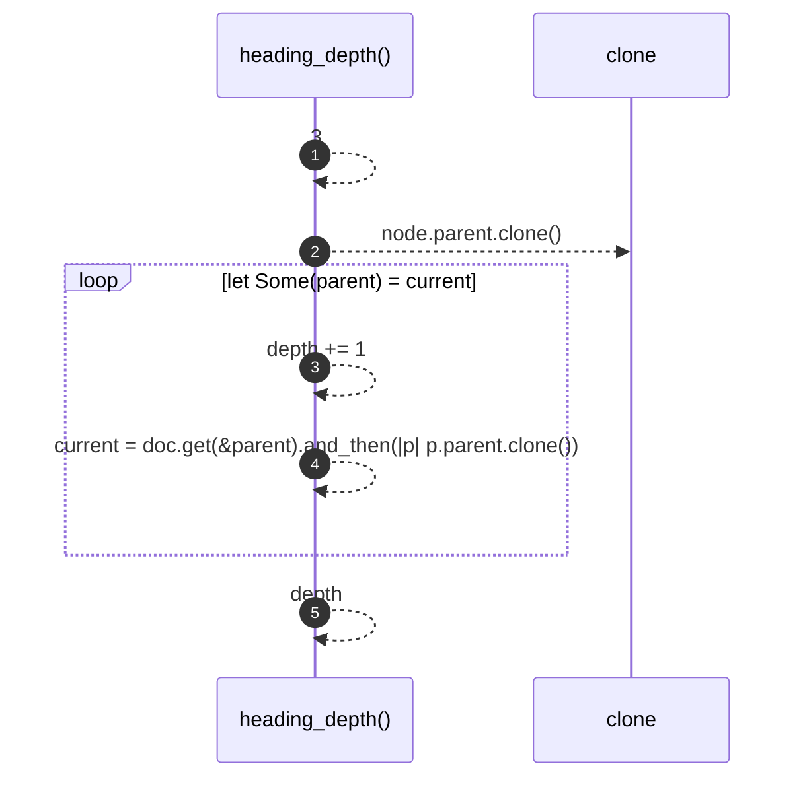

# `robby_render::markdown::heading_depth`

[Self-model](../../README.md) · [markdown](index.md)

| | |
|---|---|
| kind | `code.function` |
| signature | `fn heading_depth(doc: &Document, node: &Node) -> usize` |
| location | [`crates/robby-render/src/markdown.rs:195`](../../../../crates/robby-render/src/markdown.rs#L195) |
| provenance | extractor · confidence 1.00 |

```rust
fn heading_depth(doc: &Document, node: &Node) -> usize {
    let mut depth = 3;
    let mut current = node.parent.clone();
    while let Some(parent) = current {
        depth += 1;
        current = doc.get(&parent).and_then(|p| p.parent.clone());
    }
    depth
}
```



5 steps · 0 observed · 5 possible only

