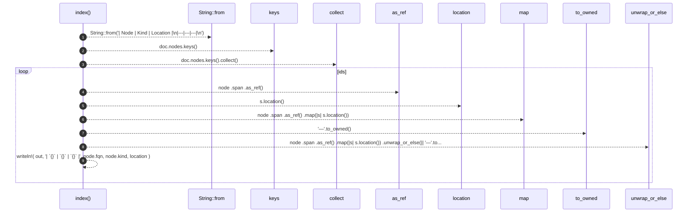

# `robby_render::markdown::index`

[Self-model](../../README.md) · [markdown](index.md)

| | |
|---|---|
| kind | `code.function` |
| signature | `fn index(doc: &Document) -> String` |
| location | [`crates/robby-render/src/markdown.rs:276`](../../../../crates/robby-render/src/markdown.rs#L276) |
| provenance | extractor · confidence 1.00 |

> A compact index of every node, for the top of the report.

```rust
/// A compact index of every node, for the top of the report.
pub fn index(doc: &Document) -> String {
    let mut out = String::from("| Node | Kind | Location |\n|---|---|---|\n");
    let ids: Vec<&NodeId> = doc.nodes.keys().collect();
    for id in ids {
        let node = &doc.nodes[id];
        let location = node
            .span
            .as_ref()
            .map(|s| s.location())
            .unwrap_or_else(|| "—".to_owned());
        let _ = writeln!(
            out,
            "| `{}` | `{}` | `{}` |",
            node.fqn,
            node.kind,
            location
        );
    }
    out
}
```



9 steps · 0 observed · 9 possible only

**Edges**

- calls → [`robby_ir::kind::impl From<&str> for Kind::from`](../../robby_ir/kind/index.md)
- calls → [`robby_render::view::select::collect`](../view/select/collect.md)
- calls → [`robby_ir::span::impl Span::location`](../../robby_ir/span/index.md)

## References

- calls → [`robby_ir::kind`](../../robby_ir/kind/index.md) — from
- calls → [`robby_ir::span`](../../robby_ir/span/index.md) — location
- calls → [`robby_render::view::select`](../view/select/index.md) — collect

