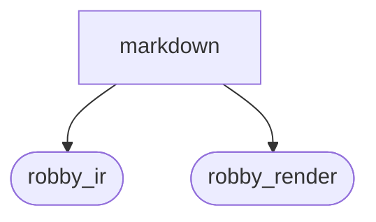
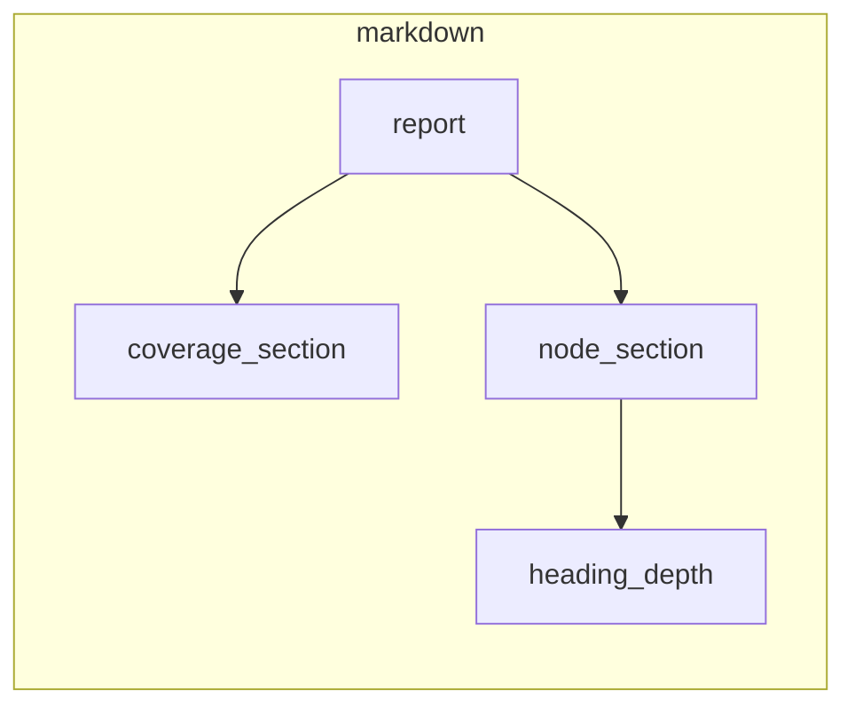

# `robby_render::markdown`

[Self-model](../../README.md) · [robby_render](../index.md)

| | |
|---|---|
| kind | `code.module` |
| declared at | [`crates/robby-render/src/lib.rs:10`](../../../../crates/robby-render/src/lib.rs#L10) |
| provenance | extractor · confidence 1.00 |
| nodes | 15 |

## Package diagram



## Module coupling



## Dependency matrix

| | markdown | robby_ir | robby_render |
|---|---:|---:|---:|
| **markdown** | · | 11 | 32 |
| **robby_ir** | | · | |
| **robby_render** | | | · |

## Comments

- `crates/robby-render/src/markdown.rs:17:1` (docs, `robby_render::markdown::report`): "Render a complete Markdown report artifact. When `sources` is provided, each node's exact source slice is embedded next…"
  ```
  /// Render a complete Markdown report artifact.
  ///
  /// When `sources` is provided, each node's exact source slice is embedded next
  /// to its diagram. That makes the file self-contained: one segment, its
  /// process, and its provenance in the same place.
  pub fn report(
      doc: &Document,
      coverage: Option<&CoverageReport>,
      sources: Option<&BTreeMap<String, String>>,
  ) -> String {
      let mut artifact = Report::new();
      let mut header = String::new();
      header.push_str("# Robby self-model\n\n");
      let _ = writeln!(
          header,
          "> Generated by `{}` · schema v{} · {} nodes\n",
          doc.generator,
          doc.schema_version,
          doc.nodes.len()
      );
      header.push_str(
          "This file is generated. Do not edit it by hand: run `robby report` instead.\n\n",
      );
      if let Some(report) = coverage {
          coverage_section(&mut header, report);
      }
      artifact.push_body(header);
  
      let md = MarkdownRenderer::new();
      for root in &doc.roots {
          let Some(root_node) = doc.get(root) else {
              continue;
          };
          let views = collect(
              doc,
              root_node,
              sources,
              &SelectOpts {
                  hierarchy: false,
                  hierarchy_depth: 0,
                  hierarchy_all: false,
                  sibling: false,
                  source: false,
                  types: true,
                  dependencies: true,
                  externals: true,
                  comments: true,
                  links: false,
                  entry: true,
                  process: false,
              },
          );
          if let Some(entry) = &views.entry {
              artifact.push_titled(format!("Entry — `{root}`"), md.process(entry));
          }
          if let Some(types) = &views.types {
              artifact.push_titled(format!("Types — `{root}`"), md.types(types));
          }
          if let Some(deps) = &views.dependencies {
              for section in md.dependency_sections(deps) {
                  let title = match section.title {
                      Some(t) => format!("{t} — `{root}`"),
                      None => format!("Dependencies — `{root}`"),
                  };
                  artifact.push_titled(title, section.body);
              }
          }
          if let Some(externals) = &views.externals {
              artifact.push_titled(format!("Externals — `{root}`"), md.externals(externals));
          }
          if let Some(comments) = &views.comments {
              artifact.push_titled(format!("Comments — `{root}`"), md.comments(comments));
          }
      }
  
      let mut nodes = String::from("## Nodes\n\n");
      for root in &doc.roots {
          for node in doc.subtree(root) {
              node_section(&mut nodes, doc, node, sources);
          }
      }
      artifact.push_body(nodes);
  
      artifact.to_markdown()
  }
  ```
- `crates/robby-render/src/markdown.rs:246:1` (docs, `robby_render::markdown::index`): "A compact index of every node, for the top of the report."
  ```
  /// A compact index of every node, for the top of the report.
  pub fn index(doc: &Document) -> String {
      let mut out = String::from("| Node | Kind | Location |\n|---|---|---|\n");
      let ids: Vec<&NodeId> = doc.nodes.keys().collect();
      for id in ids {
          let node = &doc.nodes[id];
          let location = node
              .span
              .as_ref()
              .map_or_else(|| "—".to_owned(), robby_ir::Span::location);
          let _ = writeln!(out, "| `{}` | `{}` | `{}` |", node.fqn, node.kind, location);
      }
      out
  }
  ```
- `crates/robby-render/src/markdown.rs:261:1` (docs, `robby_render::markdown::anchor`): "Sanity check used by tests: every id has a deterministic short form."
  ```
  /// Sanity check used by tests: every id has a deterministic short form.
  pub fn anchor(id: &NodeId) -> String {
      stable_id(id.as_str())
  }
  ```
## References

- calls → [`robby_ir::coverage`](../../robby_ir/coverage/index.md) — failures, is_complete, worst_first
- calls → [`robby_ir::kind`](../../robby_ir/kind/index.md) — from
- calls → [`robby_ir::model`](../../robby_ir/model/index.md) — subtree
- calls → [`robby_ir::run`](../../robby_ir/run/index.md) — get
- calls → [`robby_render`](../index.md) — sequence, stable_id
- calls → [`robby_render::render`](../render/index.md) — comments, dependency_sections, externals, types
- calls → [`robby_render::report`](../report/index.md) — 5 items
- calls → [`robby_render::test_render`](../test_render/index.md) — process
- calls → [`robby_render::view::comments`](../view/comments/index.md) — as_str
- calls → [`robby_render::view::links`](../view/links/index.md) — is_empty
- calls → [`robby_render::view::select`](../view/select/index.md) — collect

## Referenced by

- calls ← [`robby_render::test_markdown::fences_are_balanced`](../test_markdown/fences-are-balanced.md)
- calls ← [`robby_render::test_markdown::report_embeds_source_and_diagram_together`](../test_markdown/report-embeds-source-and-diagram-together.md)
- calls ← [`robby_render::test_markdown::report_is_byte_stable`](../test_markdown/report-is-byte-stable.md)
- calls ← [`robby_render::test_markdown::report_without_sources_still_renders`](../test_markdown/report-without-sources-still-renders.md)
- calls ← [`robby_render::test_render::externals_and_comments_sections_render`](../test_render/externals-and-comments-sections-render.md)
- calls ← [`robby_render::tree::global_index`](../tree/global-index.md)

## Items

| Item | Kind | Steps | Location |
|---|---|---:|---|
| [`report`](report.md) | `code.function` | 31 | `crates/robby-render/src/markdown.rs:17:1` |
| [`coverage_section`](coverage-section.md) | `code.function` | 16 | `crates/robby-render/src/markdown.rs:103:1` |
| [`node_section`](node-section.md) | `code.function` | 45 | `crates/robby-render/src/markdown.rs:145:1` |
| [`heading_depth`](heading-depth.md) | `code.function` | 4 | `crates/robby-render/src/markdown.rs:232:1` |
| [`cell`](cell.md) | `code.function` | 2 | `crates/robby-render/src/markdown.rs:242:1` |
| [`index`](index-n_fadae9.md) | `code.function` | 7 | `crates/robby-render/src/markdown.rs:246:1` |
| [`anchor`](anchor.md) | `code.function` | 2 | `crates/robby-render/src/markdown.rs:261:1` |

## Imports

- `use std::collections::BTreeMap;`
- `use std::fmt::Write as _;`
- [`use robby_ir::{CoverageReport, Document, Node, NodeId};`](../../robby_ir/index.md)
- `use crate::render::{MarkdownRenderer, Renderer};`
- `use crate::report::Report;`
- `use crate::view::{SelectOpts, collect};`
- `use crate::{sequence, stable_id};`

