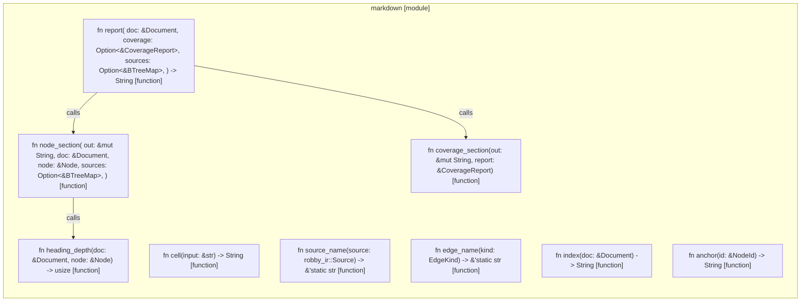

# `robby_render::markdown`

[Self-model](../../README.md) · [robby_render](../index.md)

| | |
|---|---|
| kind | `code.module` |
| declared at | [`crates/robby-render/src/lib.rs:8`](../../../../crates/robby-render/src/lib.rs#L8) |
| provenance | extractor · confidence 1.00 |
| nodes | 14 |

## Items

| Item | Kind | Steps | Location |
|---|---|---:|---|
| [`report`](report.md) | `code.function` | 12 | `crates/robby-render/src/markdown.rs:14:1` |
| [`coverage_section`](coverage-section.md) | `code.function` | 12 | `crates/robby-render/src/markdown.rs:60:1` |
| [`node_section`](node-section.md) | `code.function` | 30 | `crates/robby-render/src/markdown.rs:102:1` |
| [`heading_depth`](heading-depth.md) | `code.function` | 5 | `crates/robby-render/src/markdown.rs:195:1` |
| [`cell`](cell.md) | `code.function` | 1 | `crates/robby-render/src/markdown.rs:205:1` |
| [`source_name`](source-name.md) | `code.function` | 5 | `crates/robby-render/src/markdown.rs:209:1` |
| [`edge_name`](edge-name.md) | `code.function` | 9 | `crates/robby-render/src/markdown.rs:219:1` |
| [`index`](index-n_fadae9.md) | `code.function` | 6 | `crates/robby-render/src/markdown.rs:233:1` |
| [`anchor`](anchor.md) | `code.function` | 1 | `crates/robby-render/src/markdown.rs:255:1` |

## Imports

- `use std::collections::BTreeMap;`
- `use std::fmt::Write as _;`
- `use robby_ir::{CoverageReport, Document, EdgeKind, Node, NodeId};`
- `use crate::{flowchart, sequence, stable_id};`

