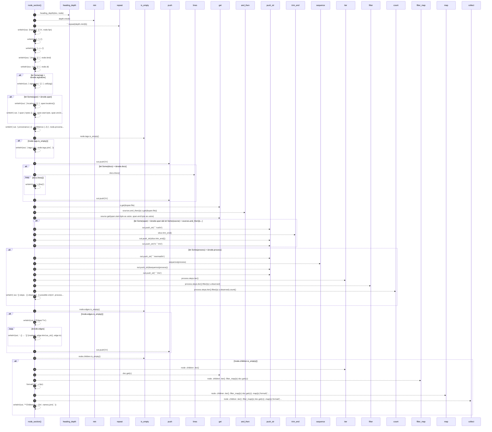

# `robby_render::markdown::node_section`

[Self-model](../../README.md) · [markdown](index.md)

| | |
|---|---|
| kind | `code.function` |
| signature | `fn node_section(     out: &mut String,     doc: &Document,     node: &Node,     sources: Option<&BTreeMap<String, String>>, )` |
| location | [`crates/robby-render/src/markdown.rs:145`](../../../../crates/robby-render/src/markdown.rs#L145) |
| provenance | extractor · confidence 1.00 |

```rust
fn node_section(
    out: &mut String,
    doc: &Document,
    node: &Node,
    sources: Option<&BTreeMap<String, String>>,
) {
    let depth = heading_depth(doc, node);
    let hashes = "#".repeat(depth.min(6));

    let _ = writeln!(out, "{hashes} `{}`\n", node.fqn);
    let _ = writeln!(out, "| | |");
    let _ = writeln!(out, "|---|---|");
    let _ = writeln!(out, "| kind | `{}` |", node.kind);
    let _ = writeln!(out, "| id | `{}` |", node.id);
    if let Some(sig) = &node.signature {
        let _ = writeln!(out, "| signature | `{}` |", cell(sig));
    }
    if let Some(span) = &node.span {
        let _ = writeln!(out, "| location | `{}` |", span.location());
        let _ = writeln!(
            out,
            "| span | bytes {}..{} |",
            span.start.byte, span.end.byte
        );
    }
    let _ = writeln!(
        out,
        "| provenance | {} · confidence {:.2} |",
        node.provenance.source.as_str(),
        node.provenance.confidence
    );
    if !node.tags.is_empty() {
        let _ = writeln!(out, "| tags | {} |", node.tags.join(", "));
    }
    out.push('\n');

    if let Some(docs) = &node.docs {
        for line in docs.lines() {
            let _ = writeln!(out, "> {line}");
        }
        out.push('\n');
    }

    if let Some(span) = &node.span
        && let Some(source) = sources.and_then(|s| s.get(&span.file))
        && let Some(slice) = source.get(span.start.byte as usize..span.end.byte as usize)
    {
        out.push_str("```rust\n");
        out.push_str(slice.trim_end());
        out.push_str("\n```\n\n");
    }

    if let Some(process) = &node.process {
        out.push_str("```mermaid\n");
        out.push_str(&sequence(process));
        out.push_str("```\n\n");

        let observed = process.steps.iter().filter(|s| s.observed).count();
        let _ = writeln!(
            out,
            "{} steps · {} observed · {} possible only\n",
            process.steps.len(),
            observed,
            process.steps.len() - observed
        );
    }

    if !node.edges.is_empty() {
        let _ = writeln!(out, "**Edges**\n");
        for edge in &node.edges {
            let marker = if edge.resolved { "" } else { " (unresolved)" };
            let _ = writeln!(out, "- {} → `{}`{marker}", edge.kind.as_str(), edge.to);
        }
        out.push('\n');
    }

    if !node.children.is_empty() {
        let names: Vec<String> = node
            .children
            .iter()
            .filter_map(|c| doc.get(c))
            .map(|c| format!("`{}`", c.fqn))
            .collect();
        let _ = writeln!(out, "**Children** — {}\n", names.join(", "));
    }
}
```



45 steps · 0 observed · 45 possible only

**Edges**

- calls → [`robby_render::markdown::heading_depth`](heading-depth.md)
- calls → [`robby_render::view::links::impl LinkGraph::is_empty`](../view/links/index.md)
- calls → [`robby_render::report::impl Report::push`](../report/index.md)
- calls → [`robby_render::report::impl Report::push`](../report/index.md)
- calls → [`robby_ir::model::impl Document::get`](../../robby_ir/model/index.md)
- calls → [`robby_ir::model::impl Document::get`](../../robby_ir/model/index.md)
- calls → [`robby_render::sequence`](../sequence.md)
- calls → [`robby_render::view::links::impl LinkGraph::is_empty`](../view/links/index.md)
- calls → [`robby_render::report::impl Report::push`](../report/index.md)
- calls → [`robby_render::view::links::impl LinkGraph::is_empty`](../view/links/index.md)
- calls → [`robby_ir::model::impl Document::get`](../../robby_ir/model/index.md)
- calls → [`robby_render::view::select::collect`](../view/select/collect.md)

## References

- calls → [`robby_ir::model`](../../robby_ir/model/index.md) — get
- calls → [`robby_render`](../index.md) — sequence
- calls → [`robby_render::markdown`](index.md) — heading_depth
- calls → [`robby_render::report`](../report/index.md) — push
- calls → [`robby_render::view::links`](../view/links/index.md) — is_empty
- calls → [`robby_render::view::select`](../view/select/index.md) — collect

## Referenced by

- calls ← [`robby_render::markdown::report`](report.md)

