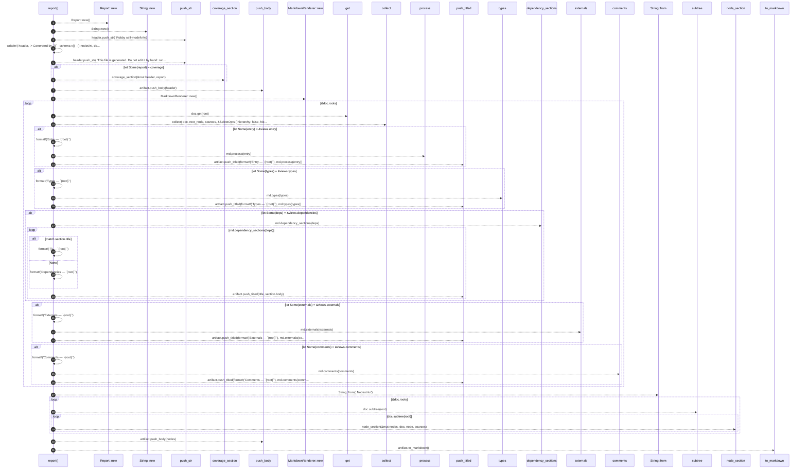

# `robby_render::markdown::report`

[Self-model](../../README.md) · [markdown](index.md)

| | |
|---|---|
| kind | `code.function` |
| signature | `fn report(     doc: &Document,     coverage: Option<&CoverageReport>,     sources: Option<&BTreeMap<String, String>>, ) -> String` |
| location | [`crates/robby-render/src/markdown.rs:17`](../../../../crates/robby-render/src/markdown.rs#L17) |
| provenance | extractor · confidence 1.00 |

> Render a complete Markdown report artifact.
> 
> When `sources` is provided, each node's exact source slice is embedded next
> to its diagram. That makes the file self-contained: one segment, its
> process, and its provenance in the same place.

```rust
/// Render a complete Markdown report artifact.
///
/// When `sources` is provided, each node's exact source slice is embedded next
/// to its diagram. That makes the file self-contained: one segment, its
/// process, and its provenance in the same place.
pub fn report(
    doc: &Document,
    coverage: Option<&CoverageReport>,
    sources: Option<&BTreeMap<String, String>>,
) -> String {
    let mut artifact = Report::new();
    let mut header = String::new();
    header.push_str("# Robby self-model\n\n");
    let _ = writeln!(
        header,
        "> Generated by `{}` · schema v{} · {} nodes\n",
        doc.generator,
        doc.schema_version,
        doc.nodes.len()
    );
    header.push_str(
        "This file is generated. Do not edit it by hand: run `robby report` instead.\n\n",
    );
    if let Some(report) = coverage {
        coverage_section(&mut header, report);
    }
    artifact.push_body(header);

    let md = MarkdownRenderer::new();
    for root in &doc.roots {
        let Some(root_node) = doc.get(root) else {
            continue;
        };
        let views = collect(
            doc,
            root_node,
            sources,
            &SelectOpts {
                hierarchy: false,
                hierarchy_depth: 0,
                hierarchy_all: false,
                sibling: false,
                source: false,
                types: true,
                dependencies: true,
                externals: true,
                comments: true,
                links: false,
                entry: true,
                process: false,
            },
        );
        if let Some(entry) = &views.entry {
            artifact.push_titled(format!("Entry — `{root}`"), md.process(entry));
        }
        if let Some(types) = &views.types {
            artifact.push_titled(format!("Types — `{root}`"), md.types(types));
        }
        if let Some(deps) = &views.dependencies {
            for section in md.dependency_sections(deps) {
                let title = match section.title {
                    Some(t) => format!("{t} — `{root}`"),
                    None => format!("Dependencies — `{root}`"),
                };
                artifact.push_titled(title, section.body);
            }
        }
        if let Some(externals) = &views.externals {
            artifact.push_titled(format!("Externals — `{root}`"), md.externals(externals));
        }
        if let Some(comments) = &views.comments {
            artifact.push_titled(format!("Comments — `{root}`"), md.comments(comments));
        }
    }

    let mut nodes = String::from("## Nodes\n\n");
    for root in &doc.roots {
        for node in doc.subtree(root) {
            node_section(&mut nodes, doc, node, sources);
        }
    }
    artifact.push_body(nodes);

    artifact.to_markdown()
}
```



31 steps · 0 observed · 31 possible only

**Edges**

- calls → [`robby_render::report::impl Report::new`](../report/index.md)
- calls → [`robby_render::report::impl Report::new`](../report/index.md)
- calls → [`robby_render::markdown::coverage_section`](coverage-section.md)
- calls → [`robby_render::report::impl Report::push_body`](../report/index.md)
- calls → [`robby_render::report::impl Report::new`](../report/index.md)
- calls → [`robby_ir::model::impl Document::get`](../../robby_ir/model/index.md)
- calls → [`robby_render::view::select::collect`](../view/select/collect.md)
- calls → [`robby_render::test_render::process`](../test_render/process.md)
- calls → [`robby_render::report::impl Report::push_titled`](../report/index.md)
- calls → [`robby_render::render::Renderer::types`](../render/index.md)
- calls → [`robby_render::report::impl Report::push_titled`](../report/index.md)
- calls → [`robby_render::render::Renderer::dependency_sections`](../render/index.md)
- calls → [`robby_render::report::impl Report::push_titled`](../report/index.md)
- calls → [`robby_render::render::Renderer::externals`](../render/index.md)
- calls → [`robby_render::report::impl Report::push_titled`](../report/index.md)
- calls → [`robby_render::render::Renderer::comments`](../render/index.md)
- calls → [`robby_render::report::impl Report::push_titled`](../report/index.md)
- calls → [`robby_ir::kind::impl From<&str> for Kind::from`](../../robby_ir/kind/index.md)
- calls → [`robby_ir::model::impl Document::subtree`](../../robby_ir/model/index.md)
- calls → [`robby_render::markdown::node_section`](node-section.md)
- calls → [`robby_render::report::impl Report::push_body`](../report/index.md)
- calls → [`robby_render::report::impl Report::to_markdown`](../report/index.md)

## References

- calls → [`robby_ir::kind`](../../robby_ir/kind/index.md) — from
- calls → [`robby_ir::model`](../../robby_ir/model/index.md) — get, subtree
- calls → [`robby_render::markdown`](index.md) — coverage_section, node_section
- calls → [`robby_render::render`](../render/index.md) — comments, dependency_sections, externals, types
- calls → [`robby_render::report`](../report/index.md) — new, push_body, push_titled, to_markdown
- calls → [`robby_render::test_render`](../test_render/index.md) — process
- calls → [`robby_render::view::select`](../view/select/index.md) — collect

## Referenced by

- calls ← [`robby_render::test_markdown::fences_are_balanced`](../test_markdown/fences-are-balanced.md)
- calls ← [`robby_render::test_markdown::report_embeds_source_and_diagram_together`](../test_markdown/report-embeds-source-and-diagram-together.md)
- calls ← [`robby_render::test_markdown::report_is_byte_stable`](../test_markdown/report-is-byte-stable.md)
- calls ← [`robby_render::test_markdown::report_without_sources_still_renders`](../test_markdown/report-without-sources-still-renders.md)
- calls ← [`robby_render::test_render::externals_and_comments_sections_render`](../test_render/externals-and-comments-sections-render.md)

