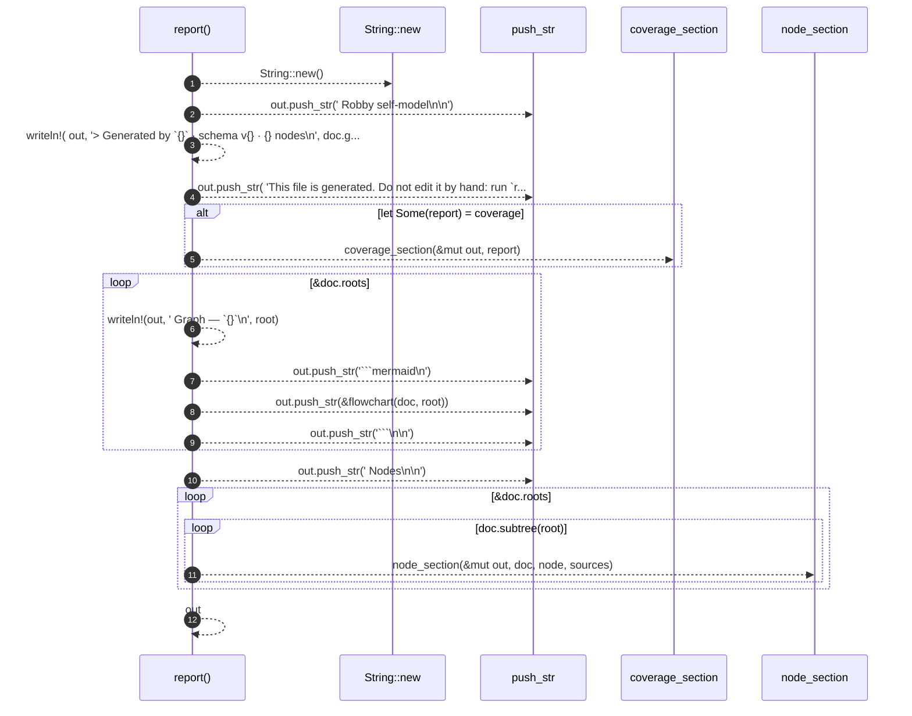

# `robby_render::markdown::report`

[Self-model](../../README.md) · [markdown](index.md)

| | |
|---|---|
| kind | `code.function` |
| signature | `fn report(     doc: &Document,     coverage: Option<&CoverageReport>,     sources: Option<&BTreeMap<String, String>>, ) -> String` |
| location | [`crates/robby-render/src/markdown.rs:14`](../../../../crates/robby-render/src/markdown.rs#L14) |
| provenance | extractor · confidence 1.00 |

> Render a complete Markdown report.
> 
> When `sources` is provided, each node's exact source slice is embedded next
> to its diagram. That makes the file self-contained: one segment, its
> process, and its provenance in the same place.

```rust
/// Render a complete Markdown report.
///
/// When `sources` is provided, each node's exact source slice is embedded next
/// to its diagram. That makes the file self-contained: one segment, its
/// process, and its provenance in the same place.
pub fn report(
    doc: &Document,
    coverage: Option<&CoverageReport>,
    sources: Option<&BTreeMap<String, String>>,
) -> String {
    let mut out = String::new();

    out.push_str("# Robby self-model\n\n");
    let _ = writeln!(
        out,
        "> Generated by `{}` · schema v{} · {} nodes\n",
        doc.generator,
        doc.schema_version,
        doc.nodes.len()
    );
    out.push_str(
        "This file is generated. Do not edit it by hand: run `robby report` instead.\n\n",
    );

    if let Some(report) = coverage {
        coverage_section(&mut out, report);
    }

    // Overview graph for each root.
    for root in &doc.roots {
        let _ = writeln!(out, "## Graph — `{}`\n", root);
        out.push_str("```mermaid\n");
        out.push_str(&flowchart(doc, root));
        out.push_str("```\n\n");
    }

    out.push_str("## Nodes\n\n");
    for root in &doc.roots {
        for node in doc.subtree(root) {
            node_section(&mut out, doc, node, sources);
        }
    }

    out
}
```



12 steps · 0 observed · 12 possible only

**Edges**

- calls → [`robby_extract::impl LineIndex::new`](../../robby_extract/index.md)
- calls → [`robby_render::markdown::coverage_section`](coverage-section.md)
- calls → [`robby_render::markdown::node_section`](node-section.md)

