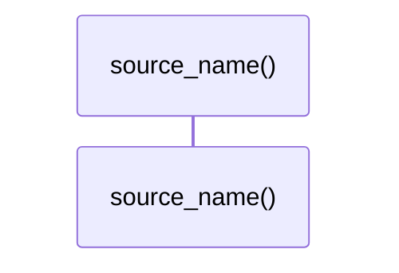

# `robby_render::markdown::source_name`

[Self-model](../../README.md) · [markdown](index.md)

| | |
|---|---|
| kind | `code.function` |
| signature | `fn source_name(source: robby_ir::Source) -> &'static str` |
| location | [`crates/robby-render/src/markdown.rs:252`](../../../../crates/robby-render/src/markdown.rs#L252) |
| provenance | extractor · confidence 1.00 |

```rust
pub(crate) fn source_name(source: robby_ir::Source) -> &'static str {
    match source {
        robby_ir::Source::Extractor => "extractor",
        robby_ir::Source::Macro => "macro",
        robby_ir::Source::Trace => "trace",
        robby_ir::Source::Agent => "agent",
        robby_ir::Source::Hand => "hand",
    }
}
```



0 steps · 0 observed · 0 possible only

