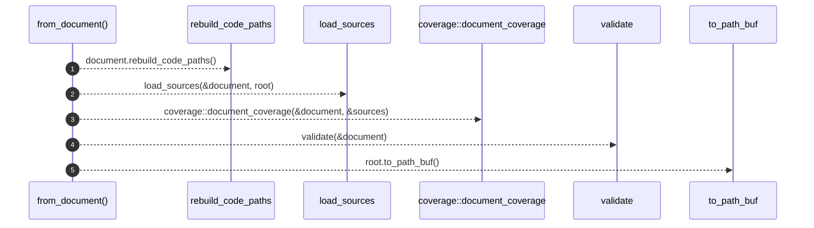

# `robby_render::pipeline::from_document`

[Self-model](../../README.md) · [pipeline](index.md)

| | |
|---|---|
| kind | `code.function` |
| signature | `fn from_document(mut document: Document, root: &Path) -> Loaded` |
| location | [`crates/robby-render/src/pipeline.rs:88`](../../../../crates/robby-render/src/pipeline.rs#L88) |
| provenance | extractor · confidence 1.00 |

> Compute everything derived from an in-memory document.

```rust
/// Compute everything derived from an in-memory document.
pub fn from_document(mut document: Document, root: &Path) -> Loaded {
    // Refresh entrypoint call trees so older IR files and post-edit graphs
    // stay consistent with current `Calls` edges.
    document.rebuild_code_paths();
    let sources = load_sources(&document, root);
    let coverage = coverage::document_coverage(&document, &sources);
    let diagnostics = validate(&document);
    Loaded {
        document,
        sources,
        coverage,
        diagnostics,
        root: root.to_path_buf(),
    }
}
```



5 steps · 0 observed · 5 possible only

**Edges**

- calls → [`robby_ir::model::impl Document::rebuild_code_paths`](../../robby_ir/model/index.md)
- calls → [`robby_render::pipeline::load_sources`](load-sources.md)
- calls → [`robby_ir::coverage::document_coverage`](../../robby_ir/coverage/document-coverage.md)
- calls → [`robby_ir::model::validate`](../../robby_ir/model/validate.md)

## References

- calls → [`robby_ir::coverage`](../../robby_ir/coverage/index.md) — document_coverage
- calls → [`robby_ir::model`](../../robby_ir/model/index.md) — rebuild_code_paths, validate
- calls → [`robby_render::pipeline`](index.md) — load_sources

## Referenced by

- calls ← [`robby_cli::build::main`](../../robby_cli/build/main.md)
- calls ← [`robby_cli::example_self_model::run`](../../robby_cli/example_self_model/run.md)
- calls ← [`robby_render::pipeline::load`](load.md)
- calls ← [`robby_render::test_web::child_world_rects_lie_inside_parent_world`](../test_web/child-world-rects-lie-inside-parent-world.md)
- calls ← [`robby_render::test_web::every_child_and_resolved_portal_is_a_frame`](../test_web/every-child-and-resolved-portal-is-a-frame.md)
- calls ← [`robby_render::test_web::scene_json_is_byte_identical_across_runs`](../test_web/scene-json-is-byte-identical-across-runs.md)
- calls ← [`robby_render::test_web::sibling_local_rects_do_not_overlap`](../test_web/sibling-local-rects-do-not-overlap.md)
- calls ← [`robby_render::test_web::sibling_world_rects_do_not_collapse_onto_each_other`](../test_web/sibling-world-rects-do-not-collapse-onto-each-other.md)
- calls ← [`robby_render::test_web::unresolved_portal_has_no_zoom_target`](../test_web/unresolved-portal-has-no-zoom-target.md)
- calls ← [`robby_render::web::write_site`](../web/write-site.md)

