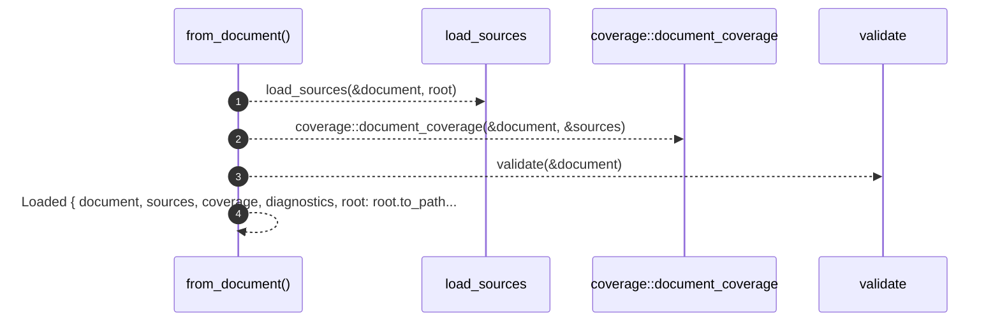

# `robby_render::pipeline::from_document`

[Self-model](../../README.md) · [pipeline](index.md)

| | |
|---|---|
| kind | `code.function` |
| signature | `fn from_document(document: Document, root: &Path) -> Loaded` |
| location | [`crates/robby-render/src/pipeline.rs:85`](../../../../crates/robby-render/src/pipeline.rs#L85) |
| provenance | extractor · confidence 1.00 |

> Compute everything derived from an in-memory document.

```rust
/// Compute everything derived from an in-memory document.
pub fn from_document(document: Document, root: &Path) -> Loaded {
    let sources = load_sources(&document, root);
    let coverage = coverage::document_coverage(&document, &sources);
    let diagnostics = validate(&document);
    Loaded {
        document,
        sources,
        coverage,
        diagnostics,
        root: root.to_path_buf(),
    }
}
```



4 steps · 0 observed · 4 possible only

**Edges**

- calls → [`robby_render::pipeline::load_sources`](load-sources.md)
- calls → [`robby_ir::coverage::document_coverage`](../../robby_ir/coverage/document-coverage.md)
- calls → [`robby_ir::model::validate`](../../robby_ir/model/validate.md)

