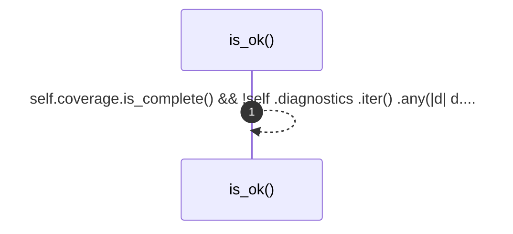
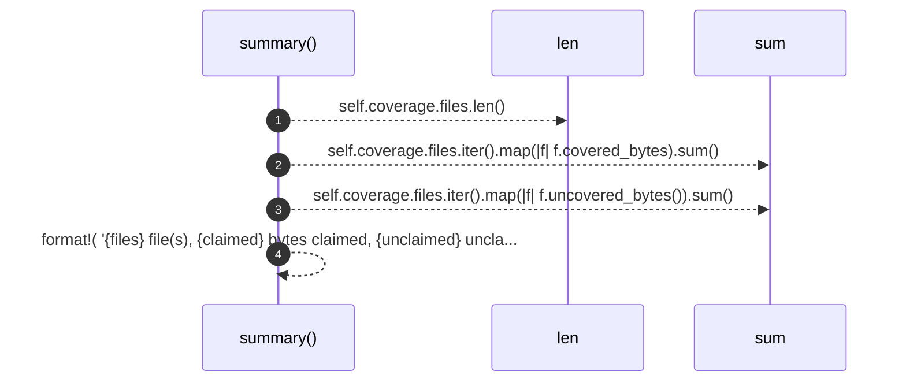

# `robby_render::pipeline::impl Loaded`

[Self-model](../../README.md) · [pipeline](index.md)

| | |
|---|---|
| kind | `code.impl` |
| location | [`crates/robby-render/src/pipeline.rs:27`](../../../../crates/robby-render/src/pipeline.rs#L27) |
| provenance | extractor · confidence 1.00 |

```rust
impl Loaded {
    /// True when the coverage gate passes and there are no error diagnostics.
    pub fn is_ok(&self) -> bool {
        self.coverage.is_complete()
            && !self
                .diagnostics
                .iter()
                .any(|d| d.severity == Severity::Error)
    }

    /// One-line summary for build output and CI logs.
    pub fn summary(&self) -> String {
        let files = self.coverage.files.len();
        let claimed: u32 = self.coverage.files.iter().map(|f| f.covered_bytes).sum();
        let unclaimed: u32 = self.coverage.files.iter().map(|f| f.uncovered_bytes()).sum();
        format!(
            "{files} file(s), {claimed} bytes claimed, {unclaimed} unclaimed, {} diagnostic(s)",
            self.diagnostics.len()
        )
    }
}
```

### `is_ok`

| | |
|---|---|
| kind | `code.method` |
| signature | `fn is_ok(1)` |
| location | [`crates/robby-render/src/pipeline.rs:28`](../../../../crates/robby-render/src/pipeline.rs#L28) |
| provenance | extractor · confidence 1.00 |

> True when the coverage gate passes and there are no error diagnostics.

```rust
/// True when the coverage gate passes and there are no error diagnostics.
    pub fn is_ok(&self) -> bool {
        self.coverage.is_complete()
            && !self
                .diagnostics
                .iter()
                .any(|d| d.severity == Severity::Error)
    }
```



1 steps · 0 observed · 1 possible only

### `summary`

| | |
|---|---|
| kind | `code.method` |
| signature | `fn summary(1)` |
| location | [`crates/robby-render/src/pipeline.rs:37`](../../../../crates/robby-render/src/pipeline.rs#L37) |
| provenance | extractor · confidence 1.00 |

> One-line summary for build output and CI logs.

```rust
/// One-line summary for build output and CI logs.
    pub fn summary(&self) -> String {
        let files = self.coverage.files.len();
        let claimed: u32 = self.coverage.files.iter().map(|f| f.covered_bytes).sum();
        let unclaimed: u32 = self.coverage.files.iter().map(|f| f.uncovered_bytes()).sum();
        format!(
            "{files} file(s), {claimed} bytes claimed, {unclaimed} unclaimed, {} diagnostic(s)",
            self.diagnostics.len()
        )
    }
```



4 steps · 0 observed · 4 possible only

