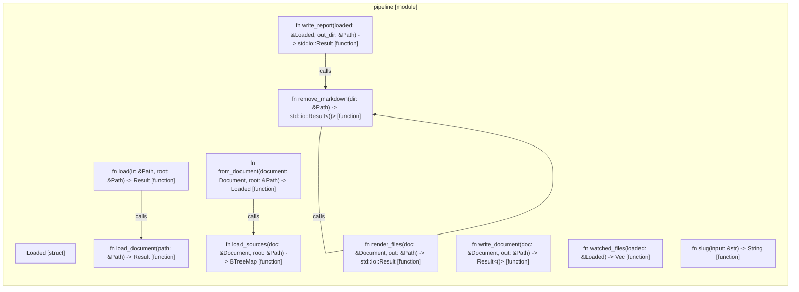

# `robby_render::pipeline`

[Self-model](../../README.md) · [robby_render](../index.md)

| | |
|---|---|
| kind | `code.module` |
| declared at | [`crates/robby-render/src/lib.rs:9`](../../../../crates/robby-render/src/lib.rs#L9) |
| provenance | extractor · confidence 1.00 |
| nodes | 25 |

## Items

| Item | Kind | Steps | Location |
|---|---|---:|---|
| [`Loaded`](loaded.md) | `code.struct` | — | `crates/robby-render/src/pipeline.rs:17:1` |
| [`impl Loaded`](impl-loaded.md) | `code.impl` | — | `crates/robby-render/src/pipeline.rs:27:1` |
| [`load_document`](load-document.md) | `code.function` | 3 | `crates/robby-render/src/pipeline.rs:49:1` |
| [`load_sources`](load-sources.md) | `code.function` | 6 | `crates/robby-render/src/pipeline.rs:55:1` |
| [`load`](load.md) | `code.function` | 3 | `crates/robby-render/src/pipeline.rs:79:1` |
| [`from_document`](from-document.md) | `code.function` | 4 | `crates/robby-render/src/pipeline.rs:85:1` |
| [`render_files`](render-files.md) | `code.function` | 11 | `crates/robby-render/src/pipeline.rs:99:1` |
| [`write_document`](write-document.md) | `code.function` | 5 | `crates/robby-render/src/pipeline.rs:117:1` |
| [`write_report`](write-report.md) | `code.function` | 12 | `crates/robby-render/src/pipeline.rs:126:1` |
| [`remove_markdown`](remove-markdown.md) | `code.function` | 9 | `crates/robby-render/src/pipeline.rs:158:1` |
| [`watched_files`](watched-files.md) | `code.function` | 1 | `crates/robby-render/src/pipeline.rs:176:1` |
| [`slug`](slug.md) | `code.function` | 9 | `crates/robby-render/src/pipeline.rs:185:1` |

## Imports

- `use std::collections::BTreeMap;`
- `use std::fs;`
- `use std::path::{Path, PathBuf};`
- `use anyhow::Result;`
- `use robby_ir::{CoverageReport, Diagnostic, Document, Severity, coverage, validate};`

