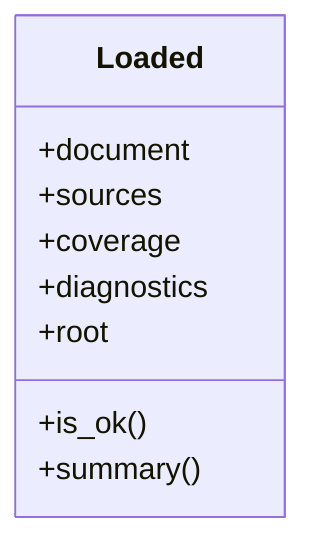
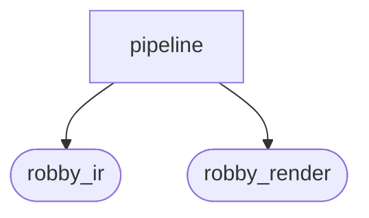
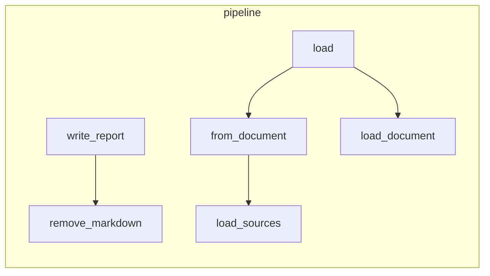

# `robby_render::pipeline`

[Self-model](../../README.md) · [robby_render](../index.md)

| | |
|---|---|
| kind | `code.module` |
| declared at | [`crates/robby-render/src/lib.rs:11`](../../../../crates/robby-render/src/lib.rs#L11) |
| provenance | extractor · confidence 1.00 |
| nodes | 25 |

## Types



## Package diagram



## Module coupling



## Dependency matrix

| | pipeline | robby_ir | robby_render |
|---|---:|---:|---:|
| **pipeline** | · | 6 | 13 |
| **robby_ir** | | · | |
| **robby_render** | | | · |

## Comments

- `crates/robby-render/src/pipeline.rs:105:1` (docs, `robby_render::pipeline::render_files`): "Write one `.mmd` file per process and per root graph."
  ```
  /// Write one `.mmd` file per process and per root graph.
  pub fn render_files(doc: &Document, out: &Path) -> std::io::Result<usize> {
      fs::create_dir_all(out)?;
      let mut count = 0;
  
      for (id, mermaid) in crate::all_sequences(doc) {
          fs::write(out.join(format!("seq-{}.mmd", slug(id.as_str()))), mermaid)?;
          count += 1;
      }
      for root in &doc.roots {
          let mermaid = crate::flowchart(doc, root);
          fs::write(
              out.join(format!("graph-{}.mmd", slug(root.as_str()))),
              mermaid,
          )?;
          count += 1;
      }
  
      Ok(count)
  }
  ```
- `crates/robby-render/src/pipeline.rs:126:1` (docs, `robby_render::pipeline::write_document`): "Write the IR document itself as a committed artifact."
  ```
  /// Write the IR document itself as a committed artifact.
  pub fn write_document(doc: &Document, out: &Path) -> Result<()> {
      if let Some(parent) = out.parent() {
          fs::create_dir_all(parent)?;
      }
      fs::write(out, serde_json::to_string_pretty(doc)?)?;
      Ok(())
  }
  ```
- `crates/robby-render/src/pipeline.rs:135:1` (docs, `robby_render::pipeline::write_report`): "Render the self-model as a linked tree of Markdown pages. Returns the number of pages written. Stale pages are removed …"
  ```
  /// Render the self-model as a linked tree of Markdown pages.
  ///
  /// Returns the number of pages written. Stale pages are removed first so a
  /// deleted module cannot leave a ghost page behind.
  pub fn write_report(loaded: &Loaded, out_dir: &Path) -> std::io::Result<usize> {
      let out_rel = out_dir
          .strip_prefix(&loaded.root)
          .unwrap_or(out_dir)
          .to_string_lossy()
          .replace('\\', "/");
  
      let pages = crate::tree::tree(
          &loaded.document,
          Some(&loaded.coverage),
          Some(&loaded.sources),
          &out_rel,
      );
  
      fs::create_dir_all(out_dir)?;
      remove_markdown(out_dir)?;
  
      for page in &pages {
          let path = out_dir.join(&page.path);
          if let Some(parent) = path.parent() {
              fs::create_dir_all(parent)?;
          }
          fs::write(&path, &page.body)?;
      }
  
      Ok(pages.len())
  }
  ```
- `crates/robby-render/src/pipeline.rs:15:1` (docs, `robby_render::pipeline::Loaded`): "A document plus everything derived from it."
  ```
  /// A document plus everything derived from it.
  pub struct Loaded {
      pub document: Document,
      pub sources: BTreeMap<String, String>,
      pub coverage: CoverageReport,
      pub diagnostics: Vec<Diagnostic>,
      /// Workspace root the source paths are relative to.
      pub root: PathBuf,
  }
  ```
- `crates/robby-render/src/pipeline.rs:167:1` (docs, `robby_render::pipeline::remove_markdown`): "Delete generated Markdown so removed modules do not linger."
  ```
  /// Delete generated Markdown so removed modules do not linger.
  fn remove_markdown(dir: &Path) -> std::io::Result<()> {
      if !dir.is_dir() {
          return Ok(());
      }
      for entry in fs::read_dir(dir)? {
          let path = entry?.path();
          if path.is_dir() {
              remove_markdown(&path)?;
              // Remove directories that became empty.
              let _ = fs::remove_dir(&path);
          } else if path.extension().is_some_and(|ext| ext == "md") {
              fs::remove_file(&path)?;
          }
      }
      Ok(())
  }
  ```
- `crates/robby-render/src/pipeline.rs:185:1` (docs, `robby_render::pipeline::watched_files`): "Files whose change must invalidate a cached build."
  ```
  /// Files whose change must invalidate a cached build.
  pub fn watched_files(loaded: &Loaded) -> Vec<PathBuf> {
      loaded.sources.keys().map(PathBuf::from).collect::<Vec<_>>()
  }
  ```
- `crates/robby-render/src/pipeline.rs:26:5` (docs, `robby_render::pipeline::impl Loaded::is_ok`): "True when the coverage gate passes and there are no error diagnostics."
  ```
  /// True when the coverage gate passes and there are no error diagnostics.
      pub fn is_ok(&self) -> bool {
          self.coverage.is_complete()
              && !self
                  .diagnostics
                  .iter()
                  .any(|d| d.severity == Severity::Error)
      }
  ```
- `crates/robby-render/src/pipeline.rs:35:5` (docs, `robby_render::pipeline::impl Loaded::summary`): "One-line summary for build output and CI logs."
  ```
  /// One-line summary for build output and CI logs.
      pub fn summary(&self) -> String {
          let files = self.coverage.files.len();
          let claimed: u32 = self.coverage.files.iter().map(|f| f.covered_bytes).sum();
          let unclaimed: u32 = self
              .coverage
              .files
              .iter()
              .map(robby_ir::FileCoverage::uncovered_bytes)
              .sum();
          format!(
              "{files} file(s), {claimed} bytes claimed, {unclaimed} unclaimed, {} diagnostic(s)",
              self.diagnostics.len()
          )
      }
  ```
- `crates/robby-render/src/pipeline.rs:52:1` (docs, `robby_render::pipeline::load_document`): "Read and parse an IR document."
  ```
  /// Read and parse an IR document.
  pub fn load_document(path: &Path) -> Result<Document> {
      let text = fs::read_to_string(path)?;
      Ok(serde_json::from_str(&text)?)
  }
  ```
- `crates/robby-render/src/pipeline.rs:58:1` (docs, `robby_render::pipeline::load_sources`): "Read every source file the document references. A missing file is not an error here: the coverage report will show it a…"
  ```
  /// Read every source file the document references.
  ///
  /// A missing file is not an error here: the coverage report will show it as
  /// fully unclaimed, which is the more useful failure.
  pub fn load_sources(doc: &Document, root: &Path) -> BTreeMap<String, String> {
      let mut sources = BTreeMap::new();
  
      // A document that declares its files is authoritative: a declared file that
      // cannot be read is a missing piece of the map, not something to skip.
      let files: Vec<String> = if doc.files.is_empty() {
          coverage::all_spans(doc).keys().cloned().collect()
      } else {
          doc.files.clone()
      };
  
      for file in files {
          let path = root.join(&file);
          if let Ok(text) = fs::read_to_string(&path) {
              sources.insert(file, text);
          }
      }
      sources
  }
  ```
- `crates/robby-render/src/pipeline.rs:82:1` (docs, `robby_render::pipeline::load`): "Load a document and everything derived from it."
  ```
  /// Load a document and everything derived from it.
  pub fn load(ir: &Path, root: &Path) -> Result<Loaded> {
      let document = load_document(ir)?;
      Ok(from_document(document, root))
  }
  ```
- `crates/robby-render/src/pipeline.rs:88:1` (docs, `robby_render::pipeline::from_document`): "Compute everything derived from an in-memory document."
  ```
  /// Compute everything derived from an in-memory document.
  pub fn from_document(mut document: Document, root: &Path) -> Loaded {
      // Refresh entrypoint call trees so older IR files and post-edit graphs
      // stay consistent with current `Calls` edges.
      document.rebuild_code_paths();
      let sources = load_sources(&document, root);
      let coverage = coverage::document_coverage(&document, &sources);
      let diagnostics = validate(&document);
      Loaded {
          document,
          sources,
          coverage,
          diagnostics,
          root: root.to_path_buf(),
      }
  }
  ```
## References

- calls → [`robby_ir::coverage`](../../robby_ir/coverage/index.md) — all_spans, document_coverage, is_complete
- calls → [`robby_ir::model`](../../robby_ir/model/index.md) — insert, rebuild_code_paths, validate
- calls → [`robby_render`](../index.md) — all_sequences, flowchart, stable_id
- calls → [`robby_render::report`](../report/index.md) — new, push
- calls → [`robby_render::tui`](../tui/index.md) — tree
- calls → [`robby_render::view::links`](../view/links/index.md) — is_empty
- calls → [`robby_render::view::select`](../view/select/index.md) — collect

## Referenced by

- calls ← [`robby_cli::build::main`](../../robby_cli/build/main.md)
- calls ← [`robby_cli::check`](../../robby_cli/check.md)
- calls ← [`robby_cli::enrich_comments`](../../robby_cli/enrich-comments.md)
- calls ← [`robby_cli::example_self_model::run`](../../robby_cli/example_self_model/run.md)
- calls ← [`robby_cli::print_human`](../../robby_cli/print-human.md)
- calls ← [`robby_cli::report`](../../robby_cli/report.md)
- calls ← [`robby_cli::run`](../../robby_cli/run.md)
- calls ← [`robby_cli::show`](../../robby_cli/show.md)
- calls ← [`robby_cli::web`](../../robby_cli/web.md)
- calls ← [`robby_render::test_web::child_world_rects_lie_inside_parent_world`](../test_web/child-world-rects-lie-inside-parent-world.md)
- calls ← [`robby_render::test_web::every_child_and_resolved_portal_is_a_frame`](../test_web/every-child-and-resolved-portal-is-a-frame.md)
- calls ← [`robby_render::test_web::scene_json_is_byte_identical_across_runs`](../test_web/scene-json-is-byte-identical-across-runs.md)
- calls ← [`robby_render::test_web::sibling_local_rects_do_not_overlap`](../test_web/sibling-local-rects-do-not-overlap.md)
- calls ← [`robby_render::test_web::sibling_world_rects_do_not_collapse_onto_each_other`](../test_web/sibling-world-rects-do-not-collapse-onto-each-other.md)
- calls ← [`robby_render::test_web::unresolved_portal_has_no_zoom_target`](../test_web/unresolved-portal-has-no-zoom-target.md)
- calls ← [`robby_render::web::write_site`](../web/write-site.md)

## Items

| Item | Kind | Steps | Location |
|---|---|---:|---|
| [`Loaded`](loaded.md) | `code.struct` | — | `crates/robby-render/src/pipeline.rs:15:1` |
| [`impl Loaded`](impl-loaded.md) | `code.impl` | — | `crates/robby-render/src/pipeline.rs:25:1` |
| [`load_document`](load-document.md) | `code.function` | 5 | `crates/robby-render/src/pipeline.rs:52:1` |
| [`load_sources`](load-sources.md) | `code.function` | 10 | `crates/robby-render/src/pipeline.rs:58:1` |
| [`load`](load.md) | `code.function` | 4 | `crates/robby-render/src/pipeline.rs:82:1` |
| [`from_document`](from-document.md) | `code.function` | 5 | `crates/robby-render/src/pipeline.rs:88:1` |
| [`render_files`](render-files.md) | `code.function` | 13 | `crates/robby-render/src/pipeline.rs:105:1` |
| [`write_document`](write-document.md) | `code.function` | 8 | `crates/robby-render/src/pipeline.rs:126:1` |
| [`write_report`](write-report.md) | `code.function` | 19 | `crates/robby-render/src/pipeline.rs:135:1` |
| [`remove_markdown`](remove-markdown.md) | `code.function` | 16 | `crates/robby-render/src/pipeline.rs:167:1` |
| [`watched_files`](watched-files.md) | `code.function` | 3 | `crates/robby-render/src/pipeline.rs:185:1` |
| [`slug`](slug.md) | `code.function` | 12 | `crates/robby-render/src/pipeline.rs:190:1` |

## Imports

- `use std::collections::BTreeMap;`
- `use std::fs;`
- `use std::path::{Path, PathBuf};`
- `use anyhow::Result;`
- [`use robby_ir::{CoverageReport, Diagnostic, Document, Severity, coverage, validate};`](../../robby_ir/index.md)

