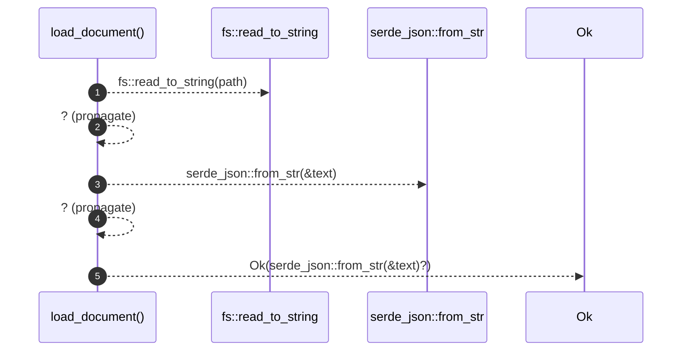

# `robby_render::pipeline::load_document`

[Self-model](../../README.md) · [pipeline](index.md)

| | |
|---|---|
| kind | `code.function` |
| signature | `fn load_document(path: &Path) -> Result<Document>` |
| location | [`crates/robby-render/src/pipeline.rs:49`](../../../../crates/robby-render/src/pipeline.rs#L49) |
| provenance | extractor · confidence 1.00 |

> Read and parse an IR document.

```rust
/// Read and parse an IR document.
pub fn load_document(path: &Path) -> Result<Document> {
    let text = fs::read_to_string(path)?;
    Ok(serde_json::from_str(&text)?)
}
```



5 steps · 0 observed · 5 possible only

## Referenced by

- calls ← [`robby_render::pipeline::load`](load.md)

