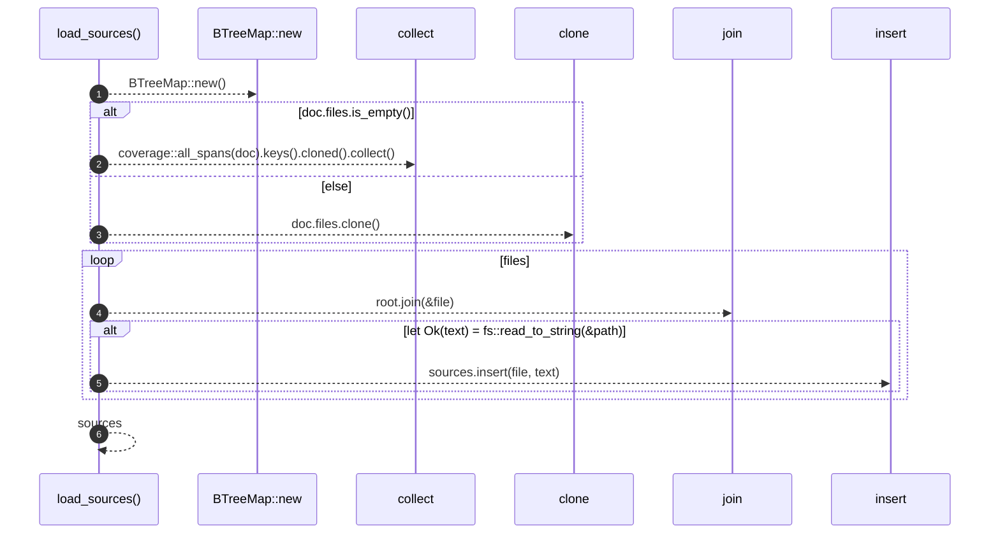

# `robby_render::pipeline::load_sources`

[Self-model](../../README.md) · [pipeline](index.md)

| | |
|---|---|
| kind | `code.function` |
| signature | `fn load_sources(doc: &Document, root: &Path) -> BTreeMap<String, String>` |
| location | [`crates/robby-render/src/pipeline.rs:55`](../../../../crates/robby-render/src/pipeline.rs#L55) |
| provenance | extractor · confidence 1.00 |

> Read every source file the document references.
> 
> A missing file is not an error here: the coverage report will show it as
> fully unclaimed, which is the more useful failure.

```rust
/// Read every source file the document references.
///
/// A missing file is not an error here: the coverage report will show it as
/// fully unclaimed, which is the more useful failure.
pub fn load_sources(doc: &Document, root: &Path) -> BTreeMap<String, String> {
    let mut sources = BTreeMap::new();

    // A document that declares its files is authoritative: a declared file that
    // cannot be read is a missing piece of the map, not something to skip.
    let files: Vec<String> = if doc.files.is_empty() {
        coverage::all_spans(doc).keys().cloned().collect()
    } else {
        doc.files.clone()
    };

    for file in files {
        let path = root.join(&file);
        if let Ok(text) = fs::read_to_string(&path) {
            sources.insert(file, text);
        }
    }
    sources
}
```



6 steps · 0 observed · 6 possible only

**Edges**

- calls → [`robby_extract::impl LineIndex::new`](../../robby_extract/index.md)
- calls → [`robby_ir::model::impl Document::insert`](../../robby_ir/model/index.md)

