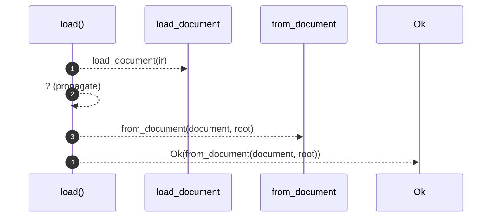

# `robby_render::pipeline::load`

[Self-model](../../README.md) · [pipeline](index.md)

| | |
|---|---|
| kind | `code.function` |
| signature | `fn load(ir: &Path, root: &Path) -> Result<Loaded>` |
| location | [`crates/robby-render/src/pipeline.rs:79`](../../../../crates/robby-render/src/pipeline.rs#L79) |
| provenance | extractor · confidence 1.00 |

> Load a document and everything derived from it.

```rust
/// Load a document and everything derived from it.
pub fn load(ir: &Path, root: &Path) -> Result<Loaded> {
    let document = load_document(ir)?;
    Ok(from_document(document, root))
}
```



4 steps · 0 observed · 4 possible only

**Edges**

- calls → [`robby_render::pipeline::load_document`](load-document.md)
- calls → [`robby_render::pipeline::from_document`](from-document.md)

## References

- calls → [`robby_render::pipeline`](index.md) — from_document, load_document

## Referenced by

- calls ← [`robby_cli::check`](../../robby_cli/check.md)
- calls ← [`robby_cli::enrich_comments`](../../robby_cli/enrich-comments.md)
- calls ← [`robby_cli::example_self_model::run`](../../robby_cli/example_self_model/run.md)
- calls ← [`robby_cli::report`](../../robby_cli/report.md)
- calls ← [`robby_cli::run`](../../robby_cli/run.md)
- calls ← [`robby_cli::show`](../../robby_cli/show.md)
- calls ← [`robby_cli::write_web`](../../robby_cli/write-web.md)

