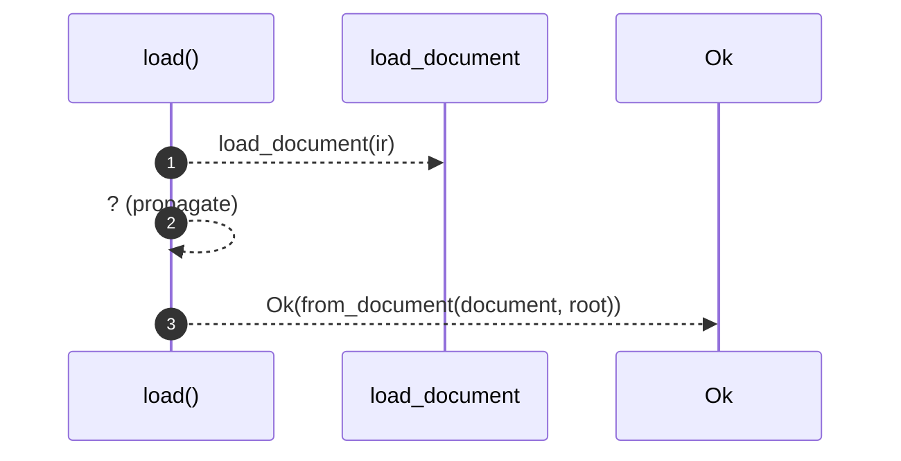

# `robby_render::pipeline::load`

[Self-model](../../README.md) · [pipeline](index.md)

| | |
|---|---|
| kind | `code.function` |
| signature | `fn load(ir: &Path, root: &Path) -> Result<Loaded>` |
| location | [`crates/robby-render/src/pipeline.rs:79`](../../../../crates/robby-render/src/pipeline.rs#L79) |
| provenance | extractor · confidence 1.00 |

> Load a document and everything derived from it.

```rust
/// Load a document and everything derived from it.
pub fn load(ir: &Path, root: &Path) -> Result<Loaded> {
    let document = load_document(ir)?;
    Ok(from_document(document, root))
}
```



3 steps · 0 observed · 3 possible only

**Edges**

- calls → [`robby_render::pipeline::load_document`](load-document.md)

