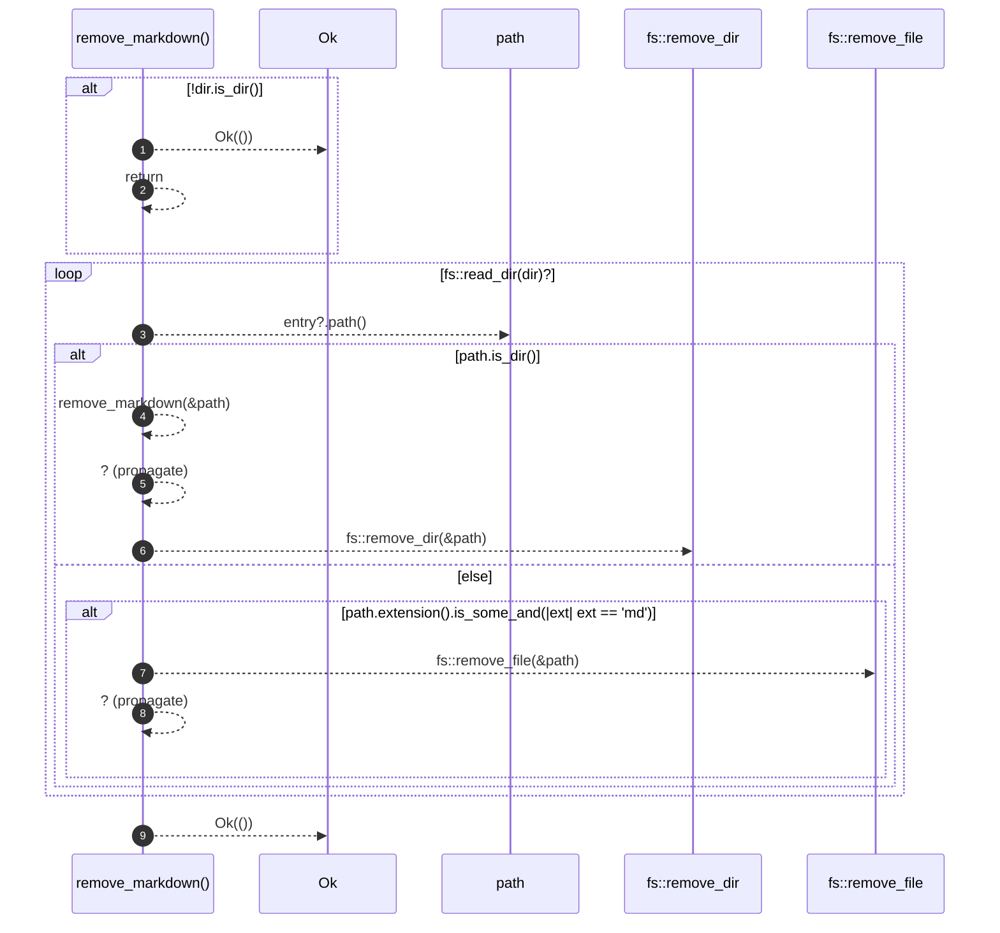

# `robby_render::pipeline::remove_markdown`

[Self-model](../../README.md) · [pipeline](index.md)

| | |
|---|---|
| kind | `code.function` |
| signature | `fn remove_markdown(dir: &Path) -> std::io::Result<()>` |
| location | [`crates/robby-render/src/pipeline.rs:158`](../../../../crates/robby-render/src/pipeline.rs#L158) |
| provenance | extractor · confidence 1.00 |

> Delete generated Markdown so removed modules do not linger.

```rust
/// Delete generated Markdown so removed modules do not linger.
fn remove_markdown(dir: &Path) -> std::io::Result<()> {
    if !dir.is_dir() {
        return Ok(());
    }
    for entry in fs::read_dir(dir)? {
        let path = entry?.path();
        if path.is_dir() {
            remove_markdown(&path)?;
            // Remove directories that became empty.
            let _ = fs::remove_dir(&path);
        } else if path.extension().is_some_and(|ext| ext == "md") {
            fs::remove_file(&path)?;
        }
    }
    Ok(())
}
```



9 steps · 0 observed · 9 possible only

**Edges**

- calls → [`robby_render::pipeline::remove_markdown`](remove-markdown.md)

