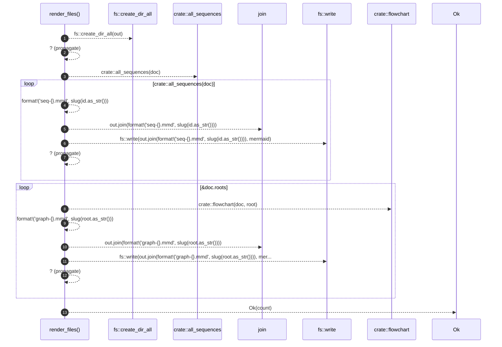

# `robby_render::pipeline::render_files`

[Self-model](../../README.md) · [pipeline](index.md)

| | |
|---|---|
| kind | `code.function` |
| signature | `fn render_files(doc: &Document, out: &Path) -> std::io::Result<usize>` |
| location | [`crates/robby-render/src/pipeline.rs:102`](../../../../crates/robby-render/src/pipeline.rs#L102) |
| provenance | extractor · confidence 1.00 |

> Write one `.mmd` file per process and per root graph.

```rust
/// Write one `.mmd` file per process and per root graph.
pub fn render_files(doc: &Document, out: &Path) -> std::io::Result<usize> {
    fs::create_dir_all(out)?;
    let mut count = 0;

    for (id, mermaid) in crate::all_sequences(doc) {
        fs::write(out.join(format!("seq-{}.mmd", slug(id.as_str()))), mermaid)?;
        count += 1;
    }
    for root in &doc.roots {
        let mermaid = crate::flowchart(doc, root);
        fs::write(out.join(format!("graph-{}.mmd", slug(root.as_str()))), mermaid)?;
        count += 1;
    }

    Ok(count)
}
```



13 steps · 0 observed · 13 possible only

**Edges**

- calls → [`robby_render::all_sequences`](../all-sequences.md)
- calls → [`robby_render::flowchart`](../flowchart.md)

## References

- calls → [`robby_render`](../index.md) — all_sequences, flowchart

## Referenced by

- calls ← [`robby_cli::build::main`](../../robby_cli/build/main.md)
- calls ← [`robby_cli::example_self_model::run`](../../robby_cli/example_self_model/run.md)
- calls ← [`robby_cli::run`](../../robby_cli/run.md)

