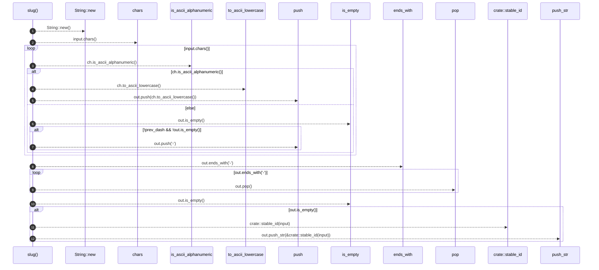

# `robby_render::pipeline::slug`

[Self-model](../../README.md) · [pipeline](index.md)

| | |
|---|---|
| kind | `code.function` |
| signature | `fn slug(input: &str) -> String` |
| location | [`crates/robby-render/src/pipeline.rs:188`](../../../../crates/robby-render/src/pipeline.rs#L188) |
| provenance | extractor · confidence 1.00 |

```rust
fn slug(input: &str) -> String {
    let mut out = String::new();
    let mut prev_dash = false;
    for ch in input.chars() {
        if ch.is_ascii_alphanumeric() {
            out.push(ch.to_ascii_lowercase());
            prev_dash = false;
        } else if !prev_dash && !out.is_empty() {
            out.push('-');
            prev_dash = true;
        }
    }
    while out.ends_with('-') {
        out.pop();
    }
    if out.is_empty() {
        out.push_str(&crate::stable_id(input));
    }
    out
}
```



12 steps · 0 observed · 12 possible only

**Edges**

- calls → [`robby_render::report::impl Report::new`](../report/index.md)
- calls → [`robby_render::report::impl Report::push`](../report/index.md)
- calls → [`robby_render::view::links::impl LinkGraph::is_empty`](../view/links/index.md)
- calls → [`robby_render::report::impl Report::push`](../report/index.md)
- calls → [`robby_render::view::links::impl LinkGraph::is_empty`](../view/links/index.md)
- calls → [`robby_render::stable_id`](../stable-id.md)

## References

- calls → [`robby_render`](../index.md) — stable_id
- calls → [`robby_render::report`](../report/index.md) — new, push
- calls → [`robby_render::view::links`](../view/links/index.md) — is_empty

