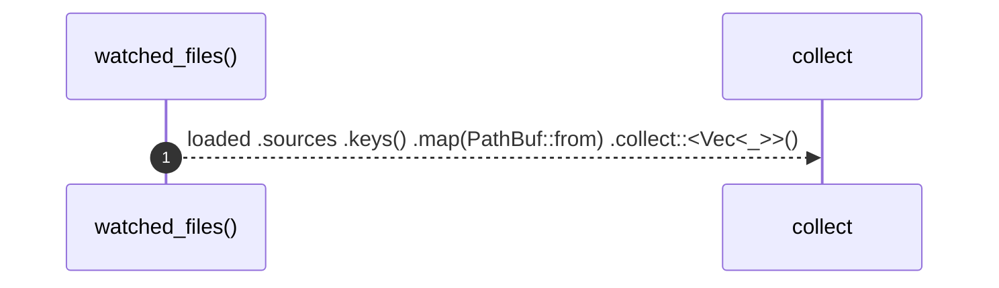

# `robby_render::pipeline::watched_files`

[Self-model](../../README.md) · [pipeline](index.md)

| | |
|---|---|
| kind | `code.function` |
| signature | `fn watched_files(loaded: &Loaded) -> Vec<PathBuf>` |
| location | [`crates/robby-render/src/pipeline.rs:176`](../../../../crates/robby-render/src/pipeline.rs#L176) |
| provenance | extractor · confidence 1.00 |

> Files whose change must invalidate a cached build.

```rust
/// Files whose change must invalidate a cached build.
pub fn watched_files(loaded: &Loaded) -> Vec<PathBuf> {
    loaded
        .sources
        .keys()
        .map(PathBuf::from)
        .collect::<Vec<_>>()
}
```



1 steps · 0 observed · 1 possible only

