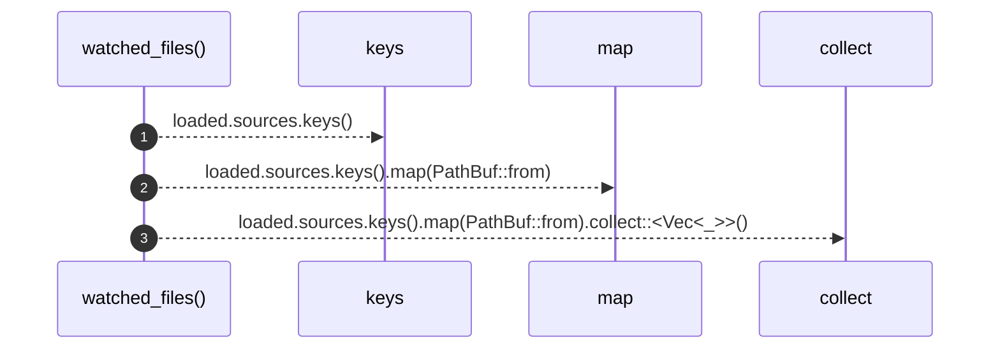

# `robby_render::pipeline::watched_files`

[Self-model](../../README.md) · [pipeline](index.md)

| | |
|---|---|
| kind | `code.function` |
| signature | `fn watched_files(loaded: &Loaded) -> Vec<PathBuf>` |
| location | [`crates/robby-render/src/pipeline.rs:190`](../../../../crates/robby-render/src/pipeline.rs#L190) |
| provenance | extractor · confidence 1.00 |

> Files whose change must invalidate a cached build.

```rust
/// Files whose change must invalidate a cached build.
pub fn watched_files(loaded: &Loaded) -> Vec<PathBuf> {
    loaded.sources.keys().map(PathBuf::from).collect::<Vec<_>>()
}
```



3 steps · 0 observed · 3 possible only

**Edges**

- calls → [`robby_render::view::select::collect`](../view/select/collect.md)

## References

- calls → [`robby_render::view::select`](../view/select/index.md) — collect

