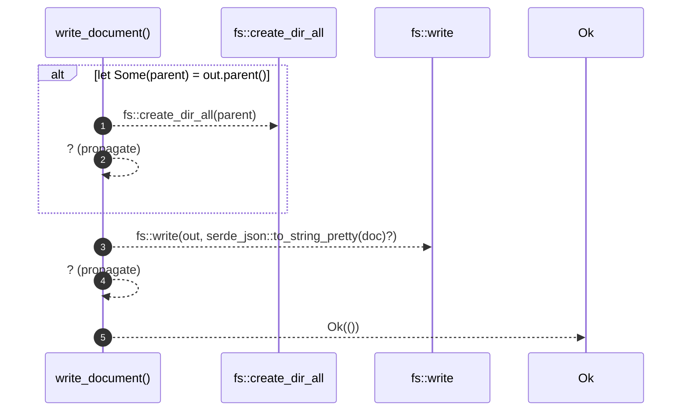

# `robby_render::pipeline::write_document`

[Self-model](../../README.md) · [pipeline](index.md)

| | |
|---|---|
| kind | `code.function` |
| signature | `fn write_document(doc: &Document, out: &Path) -> Result<()>` |
| location | [`crates/robby-render/src/pipeline.rs:117`](../../../../crates/robby-render/src/pipeline.rs#L117) |
| provenance | extractor · confidence 1.00 |

> Write the IR document itself as a committed artifact.

```rust
/// Write the IR document itself as a committed artifact.
pub fn write_document(doc: &Document, out: &Path) -> Result<()> {
    if let Some(parent) = out.parent() {
        fs::create_dir_all(parent)?;
    }
    fs::write(out, serde_json::to_string_pretty(doc)?)?;
    Ok(())
}
```



5 steps · 0 observed · 5 possible only

