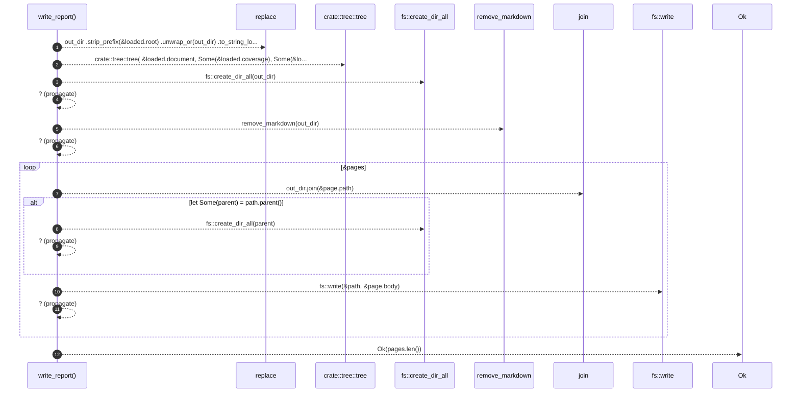

# `robby_render::pipeline::write_report`

[Self-model](../../README.md) · [pipeline](index.md)

| | |
|---|---|
| kind | `code.function` |
| signature | `fn write_report(loaded: &Loaded, out_dir: &Path) -> std::io::Result<usize>` |
| location | [`crates/robby-render/src/pipeline.rs:126`](../../../../crates/robby-render/src/pipeline.rs#L126) |
| provenance | extractor · confidence 1.00 |

> Render the self-model as a linked tree of Markdown pages.
> 
> Returns the number of pages written. Stale pages are removed first so a
> deleted module cannot leave a ghost page behind.

```rust
/// Render the self-model as a linked tree of Markdown pages.
///
/// Returns the number of pages written. Stale pages are removed first so a
/// deleted module cannot leave a ghost page behind.
pub fn write_report(loaded: &Loaded, out_dir: &Path) -> std::io::Result<usize> {
    let out_rel = out_dir
        .strip_prefix(&loaded.root)
        .unwrap_or(out_dir)
        .to_string_lossy()
        .replace('\\', "/");

    let pages = crate::tree::tree(
        &loaded.document,
        Some(&loaded.coverage),
        Some(&loaded.sources),
        &out_rel,
    );

    fs::create_dir_all(out_dir)?;
    remove_markdown(out_dir)?;

    for page in &pages {
        let path = out_dir.join(&page.path);
        if let Some(parent) = path.parent() {
            fs::create_dir_all(parent)?;
        }
        fs::write(&path, &page.body)?;
    }

    Ok(pages.len())
}
```



12 steps · 0 observed · 12 possible only

**Edges**

- calls → [`robby_render::tree::tree`](../tree/tree.md)
- calls → [`robby_render::pipeline::remove_markdown`](remove-markdown.md)

