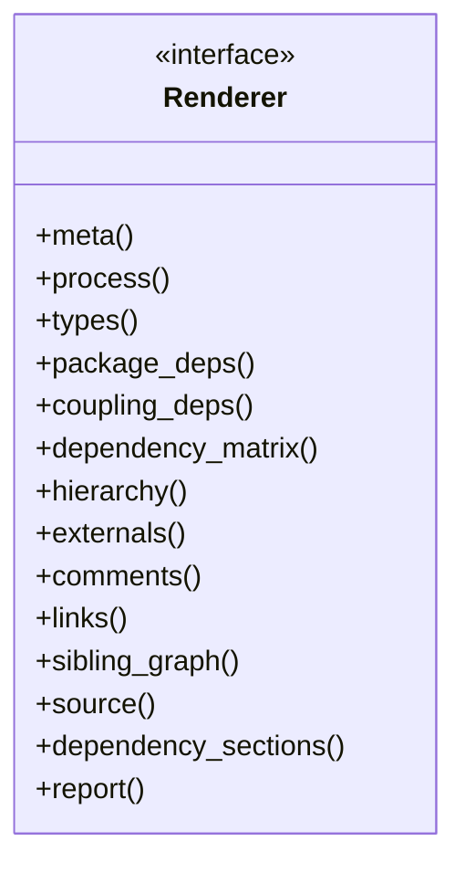
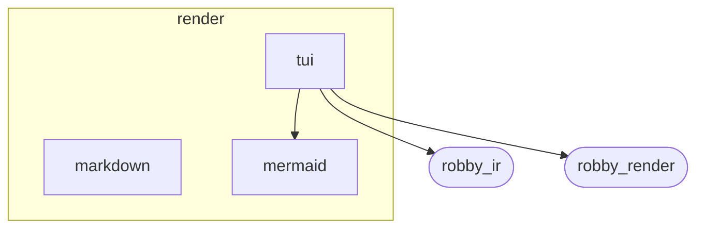

# `robby_render::render`

[Self-model](../../README.md) · [robby_render](../index.md)

| | |
|---|---|
| kind | `code.module` |
| declared at | [`crates/robby-render/src/lib.rs:12`](../../../../crates/robby-render/src/lib.rs#L12) |
| provenance | extractor · confidence 1.00 |
| nodes | 72 |

## Types



## Package diagram



## Module coupling

```mermaid
flowchart TB
    subgraph n_c53db78a9ef33eb6["render"]
        direction TB
        subgraph n_1b88225e3fbd26cd["mermaid"]
            direction TB
            n_e9aacb4720bb8e4e["dsm_markdown_table"]
        end
        subgraph n_eeb2a2cd375a2e2c["tui"]
            direction TB
            n_32780da9ddf75af3["ascii_coupling"]
            n_8208ba2b40e6adfa["ascii_package_structure"]
            n_34052eece36e7f4e["clip"]
            n_0877d202cb3d1db5["comments"]
            n_6526ab43ccd69d23["coupling_deps"]
            n_2157cbc8b72be24e["dependency_matrix"]
            n_45a8dbe34e997f29["externals"]
            n_2d7b3d99a600dc16["hierarchy"]
            n_1fb1e54d52a9fcbc["links"]
            n_92067e3e318325fe["meta"]
            n_5d9930b67863fdc3["new"]
            n_f3eaf8a36e3f327c["package_deps"]
            n_9ca36d5dba653bd8["process"]
            n_92c00755071fede2["render_report"]
            n_fc276d517df85552["select_opts"]
            n_15ef501f822ee7c6["show"]
            n_b0cef0aada7c7ad0["sibling_graph"]
            n_0d5be6053804de16["source"]
            n_3d335e8af528db78["types"]
        end
        n_7db5ab3630099277["report"]
    end
    n_0877d202cb3d1db5 --> n_34052eece36e7f4e
    n_0877d202cb3d1db5 --> n_5d9930b67863fdc3
    n_0d5be6053804de16 --> n_5d9930b67863fdc3
    n_15ef501f822ee7c6 --> n_92c00755071fede2
    n_15ef501f822ee7c6 --> n_fc276d517df85552
    n_1fb1e54d52a9fcbc --> n_5d9930b67863fdc3
    n_2157cbc8b72be24e --> n_e9aacb4720bb8e4e
    n_2d7b3d99a600dc16 --> n_5d9930b67863fdc3
    n_32780da9ddf75af3 -->|"3"| n_5d9930b67863fdc3
    n_34052eece36e7f4e --> n_5d9930b67863fdc3
    n_3d335e8af528db78 --> n_5d9930b67863fdc3
    n_45a8dbe34e997f29 --> n_5d9930b67863fdc3
    n_6526ab43ccd69d23 --> n_32780da9ddf75af3
    n_8208ba2b40e6adfa --> n_5d9930b67863fdc3
    n_92067e3e318325fe --> n_5d9930b67863fdc3
    n_92c00755071fede2 --> n_7db5ab3630099277
    n_9ca36d5dba653bd8 -->|"3"| n_34052eece36e7f4e
    n_9ca36d5dba653bd8 --> n_5d9930b67863fdc3
    n_b0cef0aada7c7ad0 --> n_5d9930b67863fdc3
    n_f3eaf8a36e3f327c --> n_8208ba2b40e6adfa
```



## Dependency matrix

| | markdown | tui | mermaid | robby_ir | robby_render | render |
|---|---:|---:|---:|---:|---:|---:|
| **markdown** | · | | | | | |
| **tui** | | · | 1 | 9 | 47 | 1 |
| **mermaid** | | | · | | | |
| **robby_ir** | | | | · | | |
| **robby_render** | | | | | · | |
| **render** | | | | | | · |

## Comments

- `crates/robby-render/src/render/mod.rs:18:1` (docs, `robby_render::render::Renderer`): "Transform one view into text. Callers that need a full artifact assemble many of these into a [`Report`]."
  ```
  /// Transform one view into text.
  ///
  /// Callers that need a full artifact assemble many of these into a [`Report`].
  pub trait Renderer {
      fn meta(&self, meta: &NodeMeta) -> String;
      fn process(&self, view: &ProcessView) -> String;
      fn types(&self, view: &TypeModel) -> String;
      /// Nested source-structure package digraph + externals.
      fn package_deps(&self, view: &PackageStructure) -> String;
      /// Internal call coupling (modules as subgraphs, functions as nodes).
      fn coupling_deps(&self, view: &CouplingGraph) -> String;
      /// Design / dependency structure matrix over packages.
      fn dependency_matrix(&self, view: &PackageStructure) -> String;
      fn hierarchy(&self, view: &HierarchyView) -> String;
      fn externals(&self, view: &ExternalsView) -> String;
      fn comments(&self, view: &CommentsView) -> String;
      fn links(&self, view: &LinkGraph) -> String;
      fn sibling_graph(&self, view: &SiblingGraph) -> String;
      fn source(&self, view: &SourceSlice) -> String;
  
      /// Dependency formalisms as report sections (skips empty bodies).
      fn dependency_sections(&self, views: &DependencyViews) -> Vec<Section> {
          let mut sections = Vec::new();
          if !views.packages.is_empty() {
              let body = self.package_deps(&views.packages);
              if !body.trim().is_empty() {
                  sections.push(Section::titled("Package diagram", body));
              }
          }
          if !views.coupling.is_empty() {
              let body = self.coupling_deps(&views.coupling);
              if !body.trim().is_empty() {
                  sections.push(Section::titled("Module coupling", body));
              }
          }
          if !views.packages.is_empty() {
              let body = self.dependency_matrix(&views.packages);
              if !body.trim().is_empty() {
                  sections.push(Section::titled("Dependency matrix", body));
              }
          }
          sections
      }
  
      /// Build a report from the views selected for one node.
      fn report(&self, views: &NodeViews) -> Report {
          let mut report = Report::new();
          let meta = self.meta(&views.meta);
          if !meta.trim().is_empty() {
              report.push_body(meta);
          }
          if let Some(entry) = &views.entry {
              report.push(Section::titled("Entry", self.process(entry)));
          }
          if let Some(types) = &views.types {
              report.push(Section::titled("Types", self.types(types)));
          }
          if let Some(deps) = &views.dependencies {
              for section in self.dependency_sections(deps) {
                  report.push(section);
              }
          }
          if let Some(externals) = &views.externals {
              let body = self.externals(externals);
              if !body.trim().is_empty() {
                  report.push(Section::titled("Externals", body));
              }
          }
          if let Some(comments) = &views.comments {
              let body = self.comments(comments);
              if !body.trim().is_empty() {
                  report.push(Section::titled("Comments", body));
              }
          }
          if let Some(process) = &views.process {
              report.push(Section::titled("Process", self.process(process)));
          }
          if let Some(hierarchy) = &views.hierarchy {
              report.push(Section::titled("Tree", self.hierarchy(hierarchy)));
          }
          if !views.links.is_empty() {
              report.push(Section::titled("Links", self.links(&views.links)));
          }
          if let Some(sibling) = &views.sibling {
              report.push(Section::titled("Graph", self.sibling_graph(sibling)));
          }
          if let Some(source) = &views.source {
              report.push(Section::titled("Source", self.source(source)));
          }
          report
      }
  }
  ```
- `crates/robby-render/src/render/tui.rs:18:1` (docs, `robby_render::render::tui::ShowOptions`): "Options for one `robby show` invocation."
  ```
  /// Options for one `robby show` invocation.
  #[derive(Debug, Clone)]
  pub struct ShowOptions {
      pub depth: usize,
      pub width: usize,
      pub all: bool,
      pub tree: bool,
      pub graph: bool,
      pub process: bool,
      pub source: bool,
      pub entry: bool,
      pub types: bool,
      pub dependencies: bool,
      pub externals: bool,
      pub comments: bool,
      pub references: bool,
  }
  ```
- `crates/robby-render/src/render/tui.rs:91:5` (docs, `robby_render::render::tui::impl TuiRenderer::show`): "Collect views for a node and render a terminal report artifact."
  ```
  /// Collect views for a node and render a terminal report artifact.
      pub fn show(
          &self,
          doc: &Document,
          node: &Node,
          sources: Option<&BTreeMap<String, String>>,
          opts: &ShowOptions,
      ) -> String {
          let views = collect(doc, node, sources, &opts.select_opts());
          self.render_report(&views)
      }
  ```
## References

- calls → [`robby_ir::kind`](../../robby_ir/kind/index.md) — from
- calls → [`robby_ir::model`](../../robby_ir/model/index.md) — get, walk
- calls → [`robby_render::render::mermaid`](mermaid/index.md) — dsm_markdown_table
- calls → [`robby_render::report`](../report/index.md) — push, to_terminal
- calls → [`robby_render::view::comments`](../view/comments/index.md) — apply_highlights, as_str
- calls → [`robby_render::view::deps`](../view/deps/index.md) — leaf_nodes, module_by_stable
- calls → [`robby_render::view::links`](../view/links/index.md) — is_empty
- calls → [`robby_render::view::select`](../view/select/index.md) — collect

## Referenced by

- calls ← [`robby_render::class_diagram`](../class-diagram.md)
- calls ← [`robby_render::coupling`](../coupling.md)
- calls ← [`robby_render::dependencies`](../dependencies.md)
- calls ← [`robby_render::dependency_report`](../dependency-report.md)
- calls ← [`robby_render::flowchart`](../flowchart.md)
- calls ← [`robby_render::markdown::report`](../markdown/report.md)
- calls ← [`robby_render::render::markdown::impl MarkdownRenderer::new`](markdown/index.md)
- calls ← [`robby_render::render::mermaid::dsm_markdown_table`](mermaid/dsm-markdown-table.md)
- calls ← [`robby_render::render::mermaid::impl Renderer for MermaidRenderer::comments`](mermaid/index.md)
- calls ← [`robby_render::render::mermaid::impl Renderer for MermaidRenderer::coupling_deps`](mermaid/index.md)
- calls ← [`robby_render::render::mermaid::impl Renderer for MermaidRenderer::dependency_matrix`](mermaid/index.md)
- calls ← [`robby_render::render::mermaid::impl Renderer for MermaidRenderer::externals`](mermaid/index.md)
- calls ← [`robby_render::render::mermaid::impl Renderer for MermaidRenderer::hierarchy`](mermaid/index.md)
- calls ← [`robby_render::render::mermaid::impl Renderer for MermaidRenderer::links`](mermaid/index.md)
- calls ← [`robby_render::render::mermaid::impl Renderer for MermaidRenderer::meta`](mermaid/index.md)
- calls ← [`robby_render::render::mermaid::impl Renderer for MermaidRenderer::source`](mermaid/index.md)
- calls ← [`robby_render::report::impl Report::new`](../report/index.md)
- calls ← [`robby_render::test_render::externals_and_comments_sections_render`](../test_render/externals-and-comments-sections-render.md)
- calls ← [`robby_render::tree::module_page`](../tree/module-page.md)
- calls ← [`robby_render::tui::graph`](../tui/graph.md)
- calls ← [`robby_render::tui::show_collected`](../tui/show-collected.md)
- calls ← [`robby_render::tui::timeline`](../tui/timeline.md)
- calls ← [`robby_render::tui::tree`](../tui/tree.md)
- calls ← [`robby_render::workspace_dependencies`](../workspace-dependencies.md)

## Modules

- [`render::tui`](tui/index.md) — 51 nodes

## Items

| Item | Kind | Steps | Location |
|---|---|---:|---|
| [`Renderer`](renderer.md) | `code.trait` | — | `crates/robby-render/src/render/mod.rs:18:1` |

## Imports

- `pub use markdown::MarkdownRenderer;`
- `pub use mermaid::MermaidRenderer;`
- `pub use tui::{ShowOptions, TuiRenderer};`
- `use crate::report::{Report, Section};`
- `use crate::view::{`

