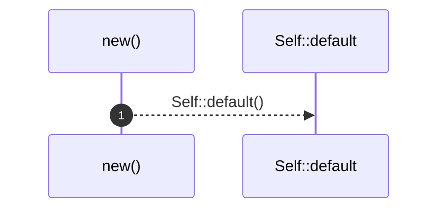
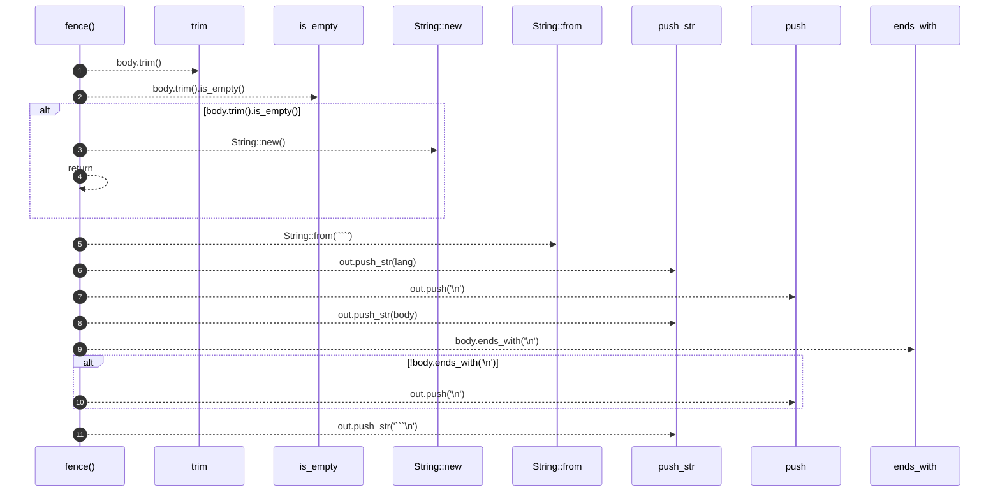

# `robby_render::render::markdown::impl MarkdownRenderer`

[Self-model](../../../README.md) · [render::markdown](index.md)

| | |
|---|---|
| kind | `code.impl` |
| location | [`crates/robby-render/src/render/markdown.rs:21`](../../../../../crates/robby-render/src/render/markdown.rs#L21) |
| provenance | extractor · confidence 1.00 |

```rust
impl MarkdownRenderer {
    pub fn new() -> Self {
        Self::default()
    }

    fn fence(lang: &str, body: &str) -> String {
        if body.trim().is_empty() {
            return String::new();
        }
        let mut out = String::from("```");
        out.push_str(lang);
        out.push('\n');
        out.push_str(body);
        if !body.ends_with('\n') {
            out.push('\n');
        }
        out.push_str("```\n");
        out
    }
}
```

## References

- calls → [`robby_ir::kind`](../../../robby_ir/kind/index.md) — from
- calls → [`robby_render::render::tui`](../tui/index.md) — default
- calls → [`robby_render::report`](../../report/index.md) — push
- calls → [`robby_render::view::links`](../../view/links/index.md) — is_empty

## Referenced by

- calls ← [`robby_render::render::markdown::impl Renderer for MarkdownRenderer::comments`](index.md)
- calls ← [`robby_render::render::markdown::impl Renderer for MarkdownRenderer::coupling_deps`](index.md)
- calls ← [`robby_render::render::markdown::impl Renderer for MarkdownRenderer::externals`](index.md)
- calls ← [`robby_render::render::markdown::impl Renderer for MarkdownRenderer::hierarchy`](index.md)
- calls ← [`robby_render::render::markdown::impl Renderer for MarkdownRenderer::links`](index.md)
- calls ← [`robby_render::render::markdown::impl Renderer for MarkdownRenderer::meta`](index.md)
- calls ← [`robby_render::render::markdown::impl Renderer for MarkdownRenderer::package_deps`](index.md)
- calls ← [`robby_render::render::markdown::impl Renderer for MarkdownRenderer::process`](index.md)
- calls ← [`robby_render::render::markdown::impl Renderer for MarkdownRenderer::sibling_graph`](index.md)
- calls ← [`robby_render::render::markdown::impl Renderer for MarkdownRenderer::types`](index.md)

### `new`

| | |
|---|---|
| kind | `code.method` |
| signature | `fn new(0)` |
| location | [`crates/robby-render/src/render/markdown.rs:22`](../../../../../crates/robby-render/src/render/markdown.rs#L22) |
| provenance | extractor · confidence 1.00 |

```rust
pub fn new() -> Self {
        Self::default()
    }
```



1 steps · 0 observed · 1 possible only

**Edges**

- calls → [`robby_render::render::tui::impl Default for ShowOptions::default`](../tui/index.md)

### `fence`

| | |
|---|---|
| kind | `code.method` |
| signature | `fn fence(2)` |
| location | [`crates/robby-render/src/render/markdown.rs:26`](../../../../../crates/robby-render/src/render/markdown.rs#L26) |
| provenance | extractor · confidence 1.00 |

```rust
fn fence(lang: &str, body: &str) -> String {
        if body.trim().is_empty() {
            return String::new();
        }
        let mut out = String::from("```");
        out.push_str(lang);
        out.push('\n');
        out.push_str(body);
        if !body.ends_with('\n') {
            out.push('\n');
        }
        out.push_str("```\n");
        out
    }
```



11 steps · 0 observed · 11 possible only

**Edges**

- calls → [`robby_render::view::links::impl LinkGraph::is_empty`](../../view/links/index.md)
- calls → [`robby_render::render::markdown::impl MarkdownRenderer::new`](index.md)
- calls → [`robby_ir::kind::impl From<&str> for Kind::from`](../../../robby_ir/kind/index.md)
- calls → [`robby_render::report::impl Report::push`](../../report/index.md)
- calls → [`robby_render::report::impl Report::push`](../../report/index.md)

