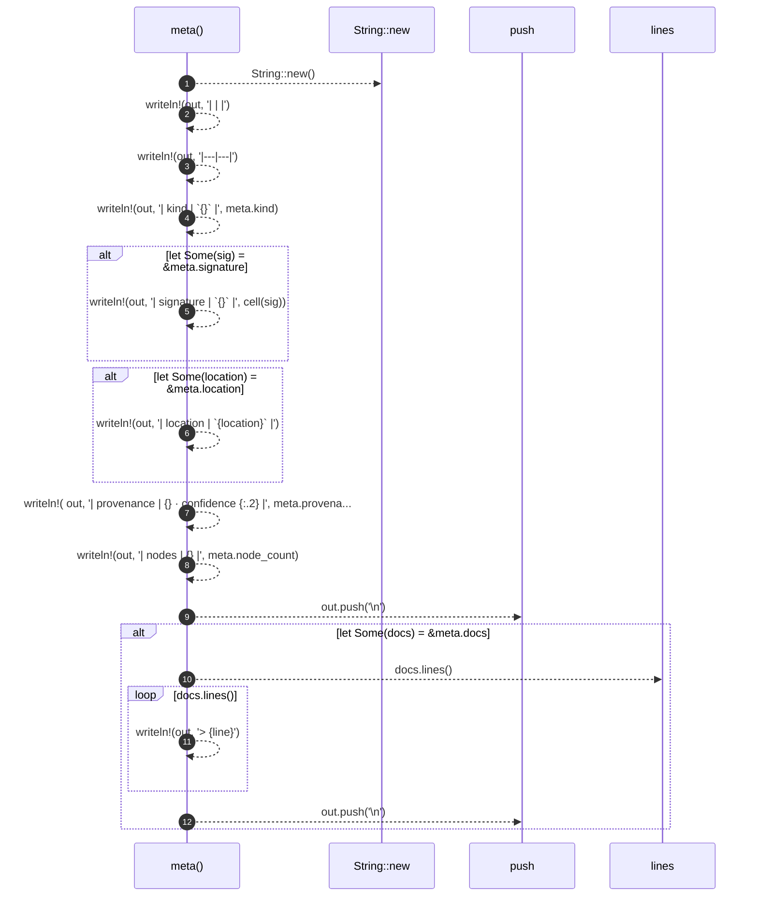
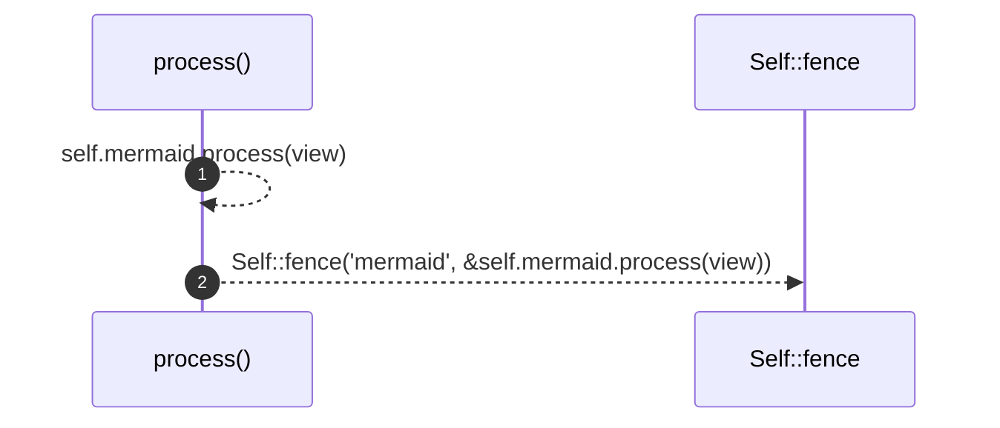
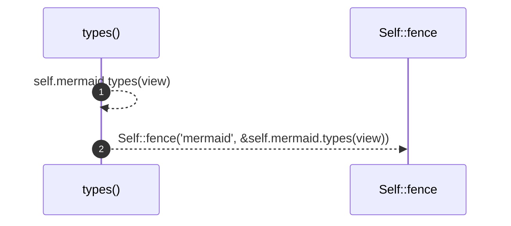
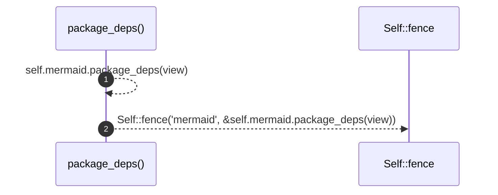
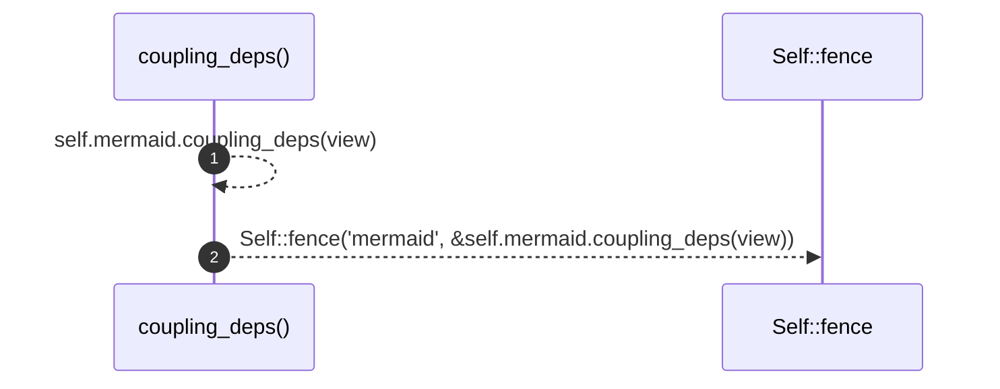
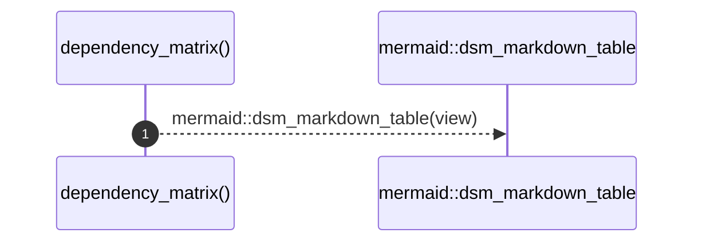
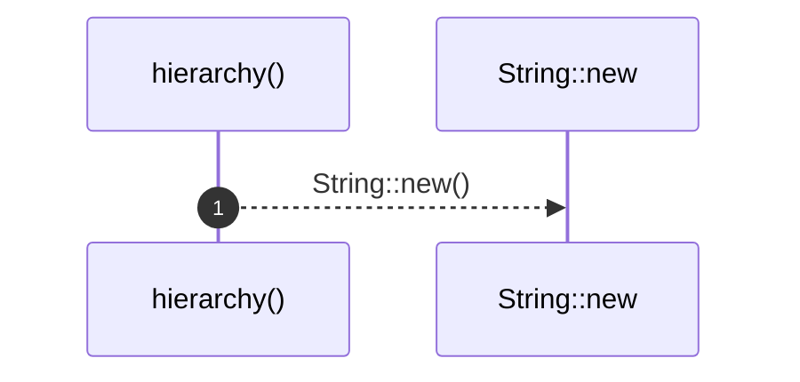
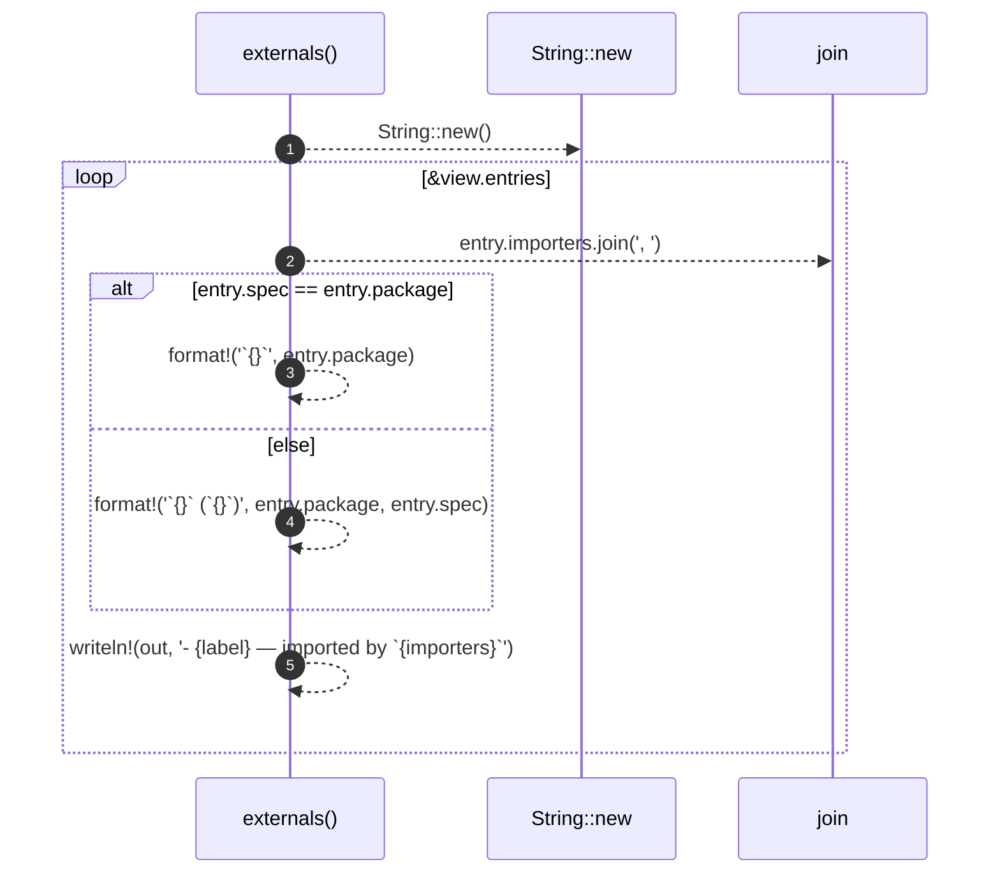
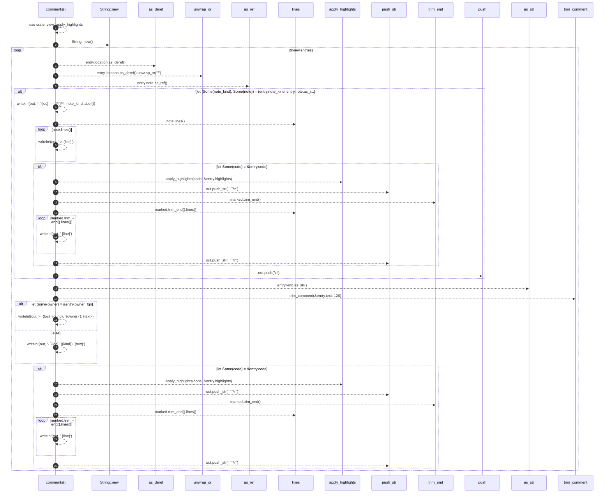
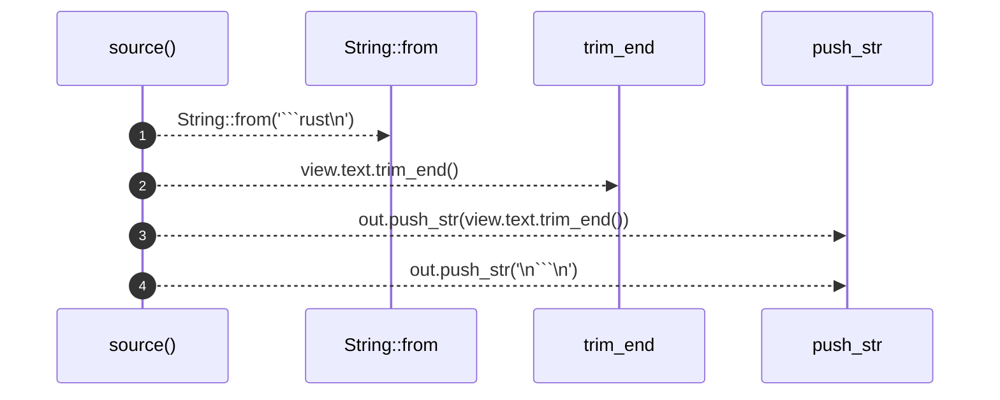

# `robby_render::render::markdown::impl Renderer for MarkdownRenderer`

[Self-model](../../../README.md) · [render::markdown](index.md)

| | |
|---|---|
| kind | `code.impl` |
| location | [`crates/robby-render/src/render/markdown.rs:42`](../../../../../crates/robby-render/src/render/markdown.rs#L42) |
| provenance | extractor · confidence 1.00 |

```rust
impl Renderer for MarkdownRenderer {
    fn meta(&self, meta: &NodeMeta) -> String {
        let mut out = String::new();
        let _ = writeln!(out, "| | |");
        let _ = writeln!(out, "|---|---|");
        let _ = writeln!(out, "| kind | `{}` |", meta.kind);
        if let Some(sig) = &meta.signature {
            let _ = writeln!(out, "| signature | `{}` |", cell(sig));
        }
        if let Some(location) = &meta.location {
            let _ = writeln!(out, "| location | `{location}` |");
        }
        let _ = writeln!(
            out,
            "| provenance | {} · confidence {:.2} |",
            meta.provenance_source, meta.confidence
        );
        let _ = writeln!(out, "| nodes | {} |", meta.node_count);
        out.push('\n');
        if let Some(docs) = &meta.docs {
            for line in docs.lines() {
                let _ = writeln!(out, "> {line}");
            }
            out.push('\n');
        }
        out
    }

    fn process(&self, view: &ProcessView) -> String {
        Self::fence("mermaid", &self.mermaid.process(view))
    }

    fn types(&self, view: &TypeModel) -> String {
        Self::fence("mermaid", &self.mermaid.types(view))
    }

    fn package_deps(&self, view: &PackageStructure) -> String {
        Self::fence("mermaid", &self.mermaid.package_deps(view))
    }

    fn coupling_deps(&self, view: &CouplingGraph) -> String {
        Self::fence("mermaid", &self.mermaid.coupling_deps(view))
    }

    fn dependency_matrix(&self, view: &PackageStructure) -> String {
        mermaid::dsm_markdown_table(view)
    }

    fn hierarchy(&self, _view: &HierarchyView) -> String {
        String::new()
    }

    fn externals(&self, view: &ExternalsView) -> String {
        let mut out = String::new();
        for entry in &view.entries {
            let importers = entry.importers.join(", ");
            let label = if entry.spec == entry.package {
                format!("`{}`", entry.package)
            } else {
                format!("`{}` (`{}`)", entry.package, entry.spec)
            };
            let _ = writeln!(out, "- {label} — imported by `{importers}`");
        }
        out
    }

    fn comments(&self, view: &CommentsView) -> String {
        use crate::view::apply_highlights;

        let mut out = String::new();
        for entry in &view.entries {
            let loc = entry.location.as_deref().unwrap_or("?");
            if let (Some(note_kind), Some(note)) = (entry.note_kind, entry.note.as_ref()) {
                let _ = writeln!(out, "- `{loc}` — **{}**", note_kind.label());
                for line in note.lines() {
                    let _ = writeln!(out, "  > {line}");
                }
                if let Some(code) = &entry.code {
                    let marked = apply_highlights(code, &entry.highlights);
                    out.push_str("  ```\n");
                    for line in marked.trim_end().lines() {
                        let _ = writeln!(out, "  {line}");
                    }
                    out.push_str("  ```\n");
                }
                out.push('\n');
                continue;
            }
            let kind = entry.kind.as_str();
            let text = trim_comment(&entry.text, 120);
            if let Some(owner) = &entry.owner_fqn {
                let _ = writeln!(out, "- `{loc}` ({kind}, `{owner}`): {text}");
            } else {
                let _ = writeln!(out, "- `{loc}` ({kind}): {text}");
            }
            if let Some(code) = &entry.code {
                let marked = apply_highlights(code, &entry.highlights);
                out.push_str("  ```\n");
                for line in marked.trim_end().lines() {
                    let _ = writeln!(out, "  {line}");
                }
                out.push_str("  ```\n");
            }
        }
        out
    }

    fn links(&self, view: &LinkGraph) -> String {
        let mut out = String::new();
        if !view.outbound.is_empty() {
            out.push_str("## References\n\n");
            for link in &view.outbound {
                let detail = if link.items.len() <= 4 {
                    format!(" — {}", link.items.join(", "))
                } else {
                    format!(" — {} items", link.items.len())
                };
                let _ = writeln!(
                    out,
                    "- {} → `{}`{detail}",
                    link.kind_label, link.module_fqn
                );
            }
            out.push('\n');
        }
        if !view.inbound.is_empty() {
            out.push_str("## Referenced by\n\n");
            for link in &view.inbound {
                let kinds = link.kinds.join(", ");
                let _ = writeln!(out, "- {kinds} ← `{}`", link.caller_fqn);
            }
            out.push('\n');
        }
        out
    }

    fn sibling_graph(&self, view: &SiblingGraph) -> String {
        Self::fence("mermaid", &self.mermaid.sibling_graph(view))
    }

    fn source(&self, view: &SourceSlice) -> String {
        let mut out = String::from("```rust\n");
        out.push_str(view.text.trim_end());
        out.push_str("\n```\n");
        out
    }
}
```

## References

- calls → [`robby_ir::kind`](../../../robby_ir/kind/index.md) — from
- calls → [`robby_render::render::markdown`](index.md) — fence, new, trim_comment
- calls → [`robby_render::render::mermaid`](../mermaid/index.md) — dsm_markdown_table
- calls → [`robby_render::report`](../../report/index.md) — push
- calls → [`robby_render::view::comments`](../../view/comments/index.md) — apply_highlights, as_str
- calls → [`robby_render::view::links`](../../view/links/index.md) — is_empty

### `meta`

| | |
|---|---|
| kind | `code.method` |
| signature | `fn meta(2)` |
| location | [`crates/robby-render/src/render/markdown.rs:43`](../../../../../crates/robby-render/src/render/markdown.rs#L43) |
| provenance | extractor · confidence 1.00 |

```rust
fn meta(&self, meta: &NodeMeta) -> String {
        let mut out = String::new();
        let _ = writeln!(out, "| | |");
        let _ = writeln!(out, "|---|---|");
        let _ = writeln!(out, "| kind | `{}` |", meta.kind);
        if let Some(sig) = &meta.signature {
            let _ = writeln!(out, "| signature | `{}` |", cell(sig));
        }
        if let Some(location) = &meta.location {
            let _ = writeln!(out, "| location | `{location}` |");
        }
        let _ = writeln!(
            out,
            "| provenance | {} · confidence {:.2} |",
            meta.provenance_source, meta.confidence
        );
        let _ = writeln!(out, "| nodes | {} |", meta.node_count);
        out.push('\n');
        if let Some(docs) = &meta.docs {
            for line in docs.lines() {
                let _ = writeln!(out, "> {line}");
            }
            out.push('\n');
        }
        out
    }
```



12 steps · 0 observed · 12 possible only

**Edges**

- calls → [`robby_render::render::markdown::impl MarkdownRenderer::new`](index.md)
- calls → [`robby_render::report::impl Report::push`](../../report/index.md)
- calls → [`robby_render::report::impl Report::push`](../../report/index.md)

### `process`

| | |
|---|---|
| kind | `code.method` |
| signature | `fn process(2)` |
| location | [`crates/robby-render/src/render/markdown.rs:70`](../../../../../crates/robby-render/src/render/markdown.rs#L70) |
| provenance | extractor · confidence 1.00 |

```rust
fn process(&self, view: &ProcessView) -> String {
        Self::fence("mermaid", &self.mermaid.process(view))
    }
```



2 steps · 0 observed · 2 possible only

**Edges**

- calls → [`robby_render::render::markdown::impl Renderer for MarkdownRenderer::process`](index.md)
- calls → [`robby_render::render::markdown::impl MarkdownRenderer::fence`](index.md)

### `types`

| | |
|---|---|
| kind | `code.method` |
| signature | `fn types(2)` |
| location | [`crates/robby-render/src/render/markdown.rs:74`](../../../../../crates/robby-render/src/render/markdown.rs#L74) |
| provenance | extractor · confidence 1.00 |

```rust
fn types(&self, view: &TypeModel) -> String {
        Self::fence("mermaid", &self.mermaid.types(view))
    }
```



2 steps · 0 observed · 2 possible only

**Edges**

- calls → [`robby_render::render::markdown::impl Renderer for MarkdownRenderer::types`](index.md)
- calls → [`robby_render::render::markdown::impl MarkdownRenderer::fence`](index.md)

### `package_deps`

| | |
|---|---|
| kind | `code.method` |
| signature | `fn package_deps(2)` |
| location | [`crates/robby-render/src/render/markdown.rs:78`](../../../../../crates/robby-render/src/render/markdown.rs#L78) |
| provenance | extractor · confidence 1.00 |

```rust
fn package_deps(&self, view: &PackageStructure) -> String {
        Self::fence("mermaid", &self.mermaid.package_deps(view))
    }
```



2 steps · 0 observed · 2 possible only

**Edges**

- calls → [`robby_render::render::markdown::impl Renderer for MarkdownRenderer::package_deps`](index.md)
- calls → [`robby_render::render::markdown::impl MarkdownRenderer::fence`](index.md)

### `coupling_deps`

| | |
|---|---|
| kind | `code.method` |
| signature | `fn coupling_deps(2)` |
| location | [`crates/robby-render/src/render/markdown.rs:82`](../../../../../crates/robby-render/src/render/markdown.rs#L82) |
| provenance | extractor · confidence 1.00 |

```rust
fn coupling_deps(&self, view: &CouplingGraph) -> String {
        Self::fence("mermaid", &self.mermaid.coupling_deps(view))
    }
```



2 steps · 0 observed · 2 possible only

**Edges**

- calls → [`robby_render::render::markdown::impl Renderer for MarkdownRenderer::coupling_deps`](index.md)
- calls → [`robby_render::render::markdown::impl MarkdownRenderer::fence`](index.md)

### `dependency_matrix`

| | |
|---|---|
| kind | `code.method` |
| signature | `fn dependency_matrix(2)` |
| location | [`crates/robby-render/src/render/markdown.rs:86`](../../../../../crates/robby-render/src/render/markdown.rs#L86) |
| provenance | extractor · confidence 1.00 |

```rust
fn dependency_matrix(&self, view: &PackageStructure) -> String {
        mermaid::dsm_markdown_table(view)
    }
```



1 steps · 0 observed · 1 possible only

**Edges**

- calls → [`robby_render::render::mermaid::dsm_markdown_table`](../mermaid/dsm-markdown-table.md)

### `hierarchy`

| | |
|---|---|
| kind | `code.method` |
| signature | `fn hierarchy(2)` |
| location | [`crates/robby-render/src/render/markdown.rs:90`](../../../../../crates/robby-render/src/render/markdown.rs#L90) |
| provenance | extractor · confidence 1.00 |

```rust
fn hierarchy(&self, _view: &HierarchyView) -> String {
        String::new()
    }
```



1 steps · 0 observed · 1 possible only

**Edges**

- calls → [`robby_render::render::markdown::impl MarkdownRenderer::new`](index.md)

### `externals`

| | |
|---|---|
| kind | `code.method` |
| signature | `fn externals(2)` |
| location | [`crates/robby-render/src/render/markdown.rs:94`](../../../../../crates/robby-render/src/render/markdown.rs#L94) |
| provenance | extractor · confidence 1.00 |

```rust
fn externals(&self, view: &ExternalsView) -> String {
        let mut out = String::new();
        for entry in &view.entries {
            let importers = entry.importers.join(", ");
            let label = if entry.spec == entry.package {
                format!("`{}`", entry.package)
            } else {
                format!("`{}` (`{}`)", entry.package, entry.spec)
            };
            let _ = writeln!(out, "- {label} — imported by `{importers}`");
        }
        out
    }
```



5 steps · 0 observed · 5 possible only

**Edges**

- calls → [`robby_render::render::markdown::impl MarkdownRenderer::new`](index.md)

### `comments`

| | |
|---|---|
| kind | `code.method` |
| signature | `fn comments(2)` |
| location | [`crates/robby-render/src/render/markdown.rs:108`](../../../../../crates/robby-render/src/render/markdown.rs#L108) |
| provenance | extractor · confidence 1.00 |

```rust
fn comments(&self, view: &CommentsView) -> String {
        use crate::view::apply_highlights;

        let mut out = String::new();
        for entry in &view.entries {
            let loc = entry.location.as_deref().unwrap_or("?");
            if let (Some(note_kind), Some(note)) = (entry.note_kind, entry.note.as_ref()) {
                let _ = writeln!(out, "- `{loc}` — **{}**", note_kind.label());
                for line in note.lines() {
                    let _ = writeln!(out, "  > {line}");
                }
                if let Some(code) = &entry.code {
                    let marked = apply_highlights(code, &entry.highlights);
                    out.push_str("  ```\n");
                    for line in marked.trim_end().lines() {
                        let _ = writeln!(out, "  {line}");
                    }
                    out.push_str("  ```\n");
                }
                out.push('\n');
                continue;
            }
            let kind = entry.kind.as_str();
            let text = trim_comment(&entry.text, 120);
            if let Some(owner) = &entry.owner_fqn {
                let _ = writeln!(out, "- `{loc}` ({kind}, `{owner}`): {text}");
            } else {
                let _ = writeln!(out, "- `{loc}` ({kind}): {text}");
            }
            if let Some(code) = &entry.code {
                let marked = apply_highlights(code, &entry.highlights);
                out.push_str("  ```\n");
                for line in marked.trim_end().lines() {
                    let _ = writeln!(out, "  {line}");
                }
                out.push_str("  ```\n");
            }
        }
        out
    }
```



25 steps · 0 observed · 25 possible only

**Edges**

- calls → [`robby_render::render::markdown::impl MarkdownRenderer::new`](index.md)
- calls → [`robby_render::view::comments::apply_highlights`](../../view/comments/apply-highlights.md)
- calls → [`robby_render::report::impl Report::push`](../../report/index.md)
- calls → [`robby_render::view::comments::impl NoteKind::as_str`](../../view/comments/index.md)
- calls → [`robby_render::render::markdown::trim_comment`](trim-comment.md)
- calls → [`robby_render::view::comments::apply_highlights`](../../view/comments/apply-highlights.md)

### `links`

| | |
|---|---|
| kind | `code.method` |
| signature | `fn links(2)` |
| location | [`crates/robby-render/src/render/markdown.rs:149`](../../../../../crates/robby-render/src/render/markdown.rs#L149) |
| provenance | extractor · confidence 1.00 |

```rust
fn links(&self, view: &LinkGraph) -> String {
        let mut out = String::new();
        if !view.outbound.is_empty() {
            out.push_str("## References\n\n");
            for link in &view.outbound {
                let detail = if link.items.len() <= 4 {
                    format!(" — {}", link.items.join(", "))
                } else {
                    format!(" — {} items", link.items.len())
                };
                let _ = writeln!(
                    out,
                    "- {} → `{}`{detail}",
                    link.kind_label, link.module_fqn
                );
            }
            out.push('\n');
        }
        if !view.inbound.is_empty() {
            out.push_str("## Referenced by\n\n");
            for link in &view.inbound {
                let kinds = link.kinds.join(", ");
                let _ = writeln!(out, "- {kinds} ← `{}`", link.caller_fqn);
            }
            out.push('\n');
        }
        out
    }
```

```mermaid
sequenceDiagram
    autonumber
    participant links as links()
    participant String__new as String::new
    participant is_empty as is_empty
    participant push_str as push_str
    participant len as len
    participant push as push
    participant join as join
    links-->>String__new: String::new()
    links-->>is_empty: view.outbound.is_empty()
    alt !view.outbound.is_empty()
    links-->>push_str: out.push_str(' References\n\n')
    loop &view.outbound
    links-->>len: link.items.len()
    alt link.items.len() <= 4
    links-->>links: format!(' — {}', link.items.join(', '))
    else else
    links-->>links: format!(' — {} items', link.items.len())
    end
    links-->>links: writeln!( out, '- {} → `{}`{detail}', link.kind_label, link.module_fqn )
    end
    links-->>push: out.push('\n')
    end
    links-->>is_empty: view.inbound.is_empty()
    alt !view.inbound.is_empty()
    links-->>push_str: out.push_str(' Referenced by\n\n')
    loop &view.inbound
    links-->>join: link.kinds.join(', ')
    links-->>links: writeln!(out, '- {kinds} ← `{}`', link.caller_fqn)
    end
    links-->>push: out.push('\n')
    end
```

13 steps · 0 observed · 13 possible only

**Edges**

- calls → [`robby_render::render::markdown::impl MarkdownRenderer::new`](index.md)
- calls → [`robby_render::view::links::impl LinkGraph::is_empty`](../../view/links/index.md)
- calls → [`robby_render::report::impl Report::push`](../../report/index.md)
- calls → [`robby_render::view::links::impl LinkGraph::is_empty`](../../view/links/index.md)
- calls → [`robby_render::report::impl Report::push`](../../report/index.md)

### `sibling_graph`

| | |
|---|---|
| kind | `code.method` |
| signature | `fn sibling_graph(2)` |
| location | [`crates/robby-render/src/render/markdown.rs:178`](../../../../../crates/robby-render/src/render/markdown.rs#L178) |
| provenance | extractor · confidence 1.00 |

```rust
fn sibling_graph(&self, view: &SiblingGraph) -> String {
        Self::fence("mermaid", &self.mermaid.sibling_graph(view))
    }
```


2 steps · 0 observed · 2 possible only

**Edges**

- calls → [`robby_render::render::markdown::impl Renderer for MarkdownRenderer::sibling_graph`](index.md)
- calls → [`robby_render::render::markdown::impl MarkdownRenderer::fence`](index.md)

### `source`

| | |
|---|---|
| kind | `code.method` |
| signature | `fn source(2)` |
| location | [`crates/robby-render/src/render/markdown.rs:182`](../../../../../crates/robby-render/src/render/markdown.rs#L182) |
| provenance | extractor · confidence 1.00 |

```rust
fn source(&self, view: &SourceSlice) -> String {
        let mut out = String::from("```rust\n");
        out.push_str(view.text.trim_end());
        out.push_str("\n```\n");
        out
    }
```



4 steps · 0 observed · 4 possible only

**Edges**

- calls → [`robby_ir::kind::impl From<&str> for Kind::from`](../../../robby_ir/kind/index.md)

