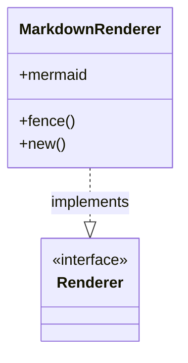
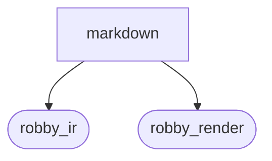
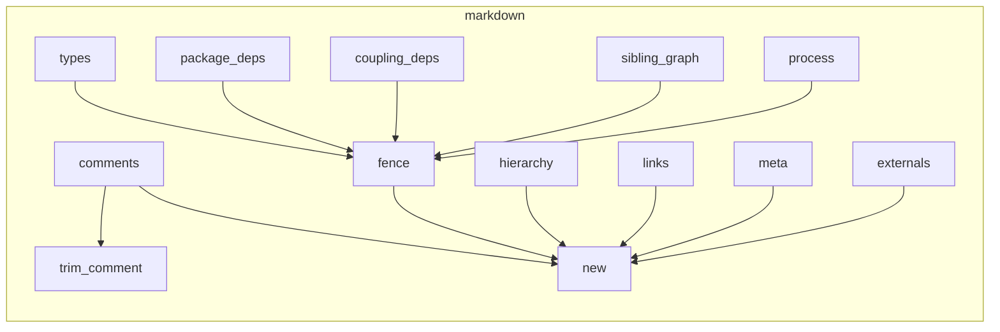

# `robby_render::render::markdown`

[Self-model](../../../README.md) · [robby_render](../../index.md)

| | |
|---|---|
| kind | `code.module` |
| declared at | [`crates/robby-render/src/render/mod.rs:4`](../../../../../crates/robby-render/src/render/mod.rs#L4) |
| provenance | extractor · confidence 1.00 |
| nodes | 25 |

## Types

## Package diagram

## Module coupling

## Dependency matrix

| | markdown | robby_ir | robby_render |
|---|---:|---:|---:|
| **markdown** | · | 2 | 17 |
| **robby_ir** | | · | |
| **robby_render** | | | · |
## References

- calls → [`robby_ir::kind`](../../../robby_ir/kind/index.md) — from
- calls → [`robby_render::render::mermaid`](../mermaid/index.md) — dsm_markdown_table
- calls → [`robby_render::render::tui`](../tui/index.md) — default
- calls → [`robby_render::report`](../../report/index.md) — push
- calls → [`robby_render::view::comments`](../../view/comments/index.md) — apply_highlights, as_str
- calls → [`robby_render::view::links`](../../view/links/index.md) — is_empty
- calls → [`robby_render::view::select`](../../view/select/index.md) — collect

## Items

| Item | Kind | Steps | Location |
|---|---|---:|---|
| [`MarkdownRenderer`](markdownrenderer.md) | `code.struct` | — | `crates/robby-render/src/render/markdown.rs:16:1` |
| [`impl MarkdownRenderer`](impl-markdownrenderer.md) | `code.impl` | — | `crates/robby-render/src/render/markdown.rs:21:1` |
| [`impl Renderer for MarkdownRenderer`](impl-renderer-for-markdownrenderer.md) | `code.impl` | — | `crates/robby-render/src/render/markdown.rs:42:1` |
| [`cell`](cell.md) | `code.function` | 2 | `crates/robby-render/src/render/markdown.rs:186:1` |
| [`trim_comment`](trim-comment.md) | `code.function` | 12 | `crates/robby-render/src/render/markdown.rs:190:1` |

## Imports

- `use std::fmt::Write as _;`
- `use crate::view::{`
- `use super::Renderer;`
- `use super::mermaid::{self, MermaidRenderer};`

