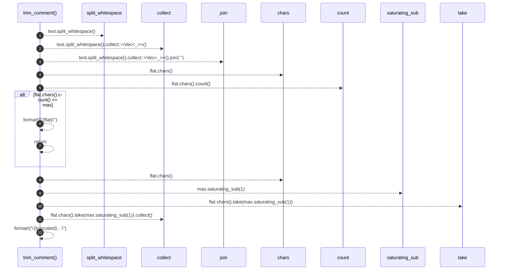

# `robby_render::render::markdown::trim_comment`

[Self-model](../../../README.md) · [render::markdown](index.md)

| | |
|---|---|
| kind | `code.function` |
| signature | `fn trim_comment(text: &str, max: usize) -> String` |
| location | [`crates/robby-render/src/render/markdown.rs:190`](../../../../../crates/robby-render/src/render/markdown.rs#L190) |
| provenance | extractor · confidence 1.00 |

```rust
fn trim_comment(text: &str, max: usize) -> String {
    let flat: String = text.split_whitespace().collect::<Vec<_>>().join(" ");
    if flat.chars().count() <= max {
        return format!("\"{flat}\"");
    }
    let truncated: String = flat.chars().take(max.saturating_sub(1)).collect();
    format!("\"{truncated}…\"")
}
```



12 steps · 0 observed · 12 possible only

**Edges**

- calls → [`robby_render::view::select::collect`](../../view/select/collect.md)
- calls → [`robby_render::view::select::collect`](../../view/select/collect.md)

## References

- calls → [`robby_render::view::select`](../../view/select/index.md) — collect

## Referenced by

- calls ← [`robby_render::render::markdown::impl Renderer for MarkdownRenderer::comments`](index.md)

