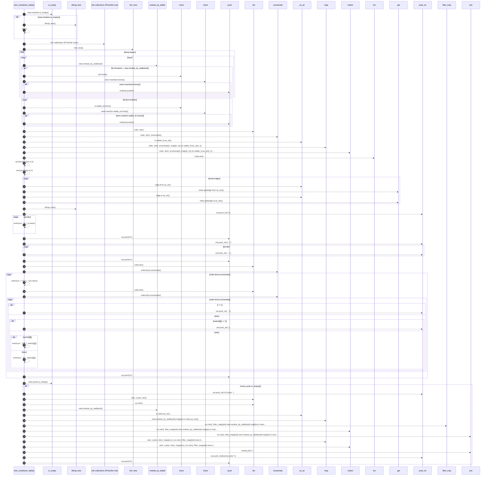

# `robby_render::render::mermaid::dsm_markdown_table`

[Self-model](../../../README.md) · [render::mermaid](index.md)

| | |
|---|---|
| kind | `code.function` |
| signature | `fn dsm_markdown_table(view: &PackageStructure) -> String` |
| location | [`crates/robby-render/src/render/mermaid.rs:284`](../../../../../crates/robby-render/src/render/mermaid.rs#L284) |
| provenance | extractor · confidence 1.00 |

> Markdown DSM table (row depends on column). Shared by Markdown/TUI.

```rust
/// Markdown DSM table (row depends on column). Shared by Markdown/TUI.
pub fn dsm_markdown_table(view: &PackageStructure) -> String {
    if view.modules.is_empty() {
        return String::new();
    }

    let order: Vec<&crate::view::DepModule> = {
        // Prefer layer order for headers, then any leftovers by name.
        let mut seen = std::collections::BTreeSet::new();
        let mut ordered = Vec::new();
        for layer in &view.layers {
            for sid in layer {
                if let Some(m) = view.module_by_stable(sid) {
                    if seen.insert(sid.clone()) {
                        ordered.push(m);
                    }
                }
            }
        }
        for m in &view.modules {
            if seen.insert(m.stable_id.clone()) {
                ordered.push(m);
            }
        }
        ordered
    };

    let index: std::collections::BTreeMap<&str, usize> = order
        .iter()
        .enumerate()
        .map(|(i, m)| (m.stable_id.as_str(), i))
        .collect();

    let n = order.len();
    let mut matrix = vec![vec![0usize; n]; n];
    let mut cyclic = vec![vec![false; n]; n];
    for edge in &view.edges {
        let Some(&i) = index.get(edge.from.as_str()) else {
            continue;
        };
        let Some(&j) = index.get(edge.to.as_str()) else {
            continue;
        };
        matrix[i][j] = edge.weight;
        cyclic[i][j] = edge.in_cycle;
    }

    let mut out = String::new();
    out.push_str("| |");
    for m in &order {
        let _ = write!(out, " {} |", m.name);
    }
    out.push('\n');
    out.push_str("|---|");
    for _ in &order {
        out.push_str("---:|");
    }
    out.push('\n');

    for (i, row) in order.iter().enumerate() {
        let _ = write!(out, "| **{}** |", row.name);
        for (j, _) in order.iter().enumerate() {
            if i == j {
                out.push_str(" · |");
            } else if matrix[i][j] == 0 {
                out.push_str(" |");
            } else if cyclic[i][j] {
                let _ = write!(out, " {}⇄ |", matrix[i][j]);
            } else {
                let _ = write!(out, " {} |", matrix[i][j]);
            }
        }
        out.push('\n');
    }

    if !view.cycles.is_empty() {
        out.push_str("\nCycles: ");
        let names: Vec<String> = view
            .cycles
            .iter()
            .map(|scc| {
                scc.iter()
                    .filter_map(|sid| view.module_by_stable(sid).map(|m| m.name.as_str()))
                    .collect::<Vec<_>>()
                    .join(" ↔ ")
            })
            .collect();
        out.push_str(&names.join("; "));
        out.push('\n');
    }

    out
}
```



56 steps · 0 observed · 56 possible only

**Edges**

- calls → [`robby_render::view::links::impl LinkGraph::is_empty`](../../view/links/index.md)
- calls → [`robby_render::render::tui::impl TuiRenderer::new`](../tui/index.md)
- calls → [`robby_render::render::tui::impl TuiRenderer::new`](../tui/index.md)
- calls → [`robby_render::render::tui::impl TuiRenderer::new`](../tui/index.md)
- calls → [`robby_render::view::deps::impl PackageStructure::module_by_stable`](../../view/deps/index.md)
- calls → [`robby_ir::model::impl Document::insert`](../../../robby_ir/model/index.md)
- calls → [`robby_render::report::impl Report::push`](../../report/index.md)
- calls → [`robby_ir::model::impl Document::insert`](../../../robby_ir/model/index.md)
- calls → [`robby_render::report::impl Report::push`](../../report/index.md)
- calls → [`robby_render::view::comments::impl NoteKind::as_str`](../../view/comments/index.md)
- calls → [`robby_render::view::select::collect`](../../view/select/collect.md)
- calls → [`robby_render::view::comments::impl NoteKind::as_str`](../../view/comments/index.md)
- calls → [`robby_ir::model::impl Document::get`](../../../robby_ir/model/index.md)
- calls → [`robby_render::view::comments::impl NoteKind::as_str`](../../view/comments/index.md)
- calls → [`robby_ir::model::impl Document::get`](../../../robby_ir/model/index.md)
- calls → [`robby_render::render::tui::impl TuiRenderer::new`](../tui/index.md)
- calls → [`robby_render::report::impl Report::push`](../../report/index.md)
- calls → [`robby_render::report::impl Report::push`](../../report/index.md)
- calls → [`robby_render::report::impl Report::push`](../../report/index.md)
- calls → [`robby_render::view::links::impl LinkGraph::is_empty`](../../view/links/index.md)
- calls → [`robby_render::view::deps::impl PackageStructure::module_by_stable`](../../view/deps/index.md)
- calls → [`robby_render::view::comments::impl NoteKind::as_str`](../../view/comments/index.md)
- calls → [`robby_render::view::select::collect`](../../view/select/collect.md)
- calls → [`robby_render::view::select::collect`](../../view/select/collect.md)
- calls → [`robby_render::report::impl Report::push`](../../report/index.md)

## References

- calls → [`robby_ir::model`](../../../robby_ir/model/index.md) — get, insert
- calls → [`robby_render::render::tui`](../tui/index.md) — new
- calls → [`robby_render::report`](../../report/index.md) — push
- calls → [`robby_render::view::comments`](../../view/comments/index.md) — as_str
- calls → [`robby_render::view::deps`](../../view/deps/index.md) — module_by_stable
- calls → [`robby_render::view::links`](../../view/links/index.md) — is_empty
- calls → [`robby_render::view::select`](../../view/select/index.md) — collect

## Referenced by

- calls ← [`robby_render::render::markdown::impl Renderer for MarkdownRenderer::dependency_matrix`](../markdown/index.md)
- calls ← [`robby_render::render::tui::impl Renderer for TuiRenderer::dependency_matrix`](../tui/index.md)

