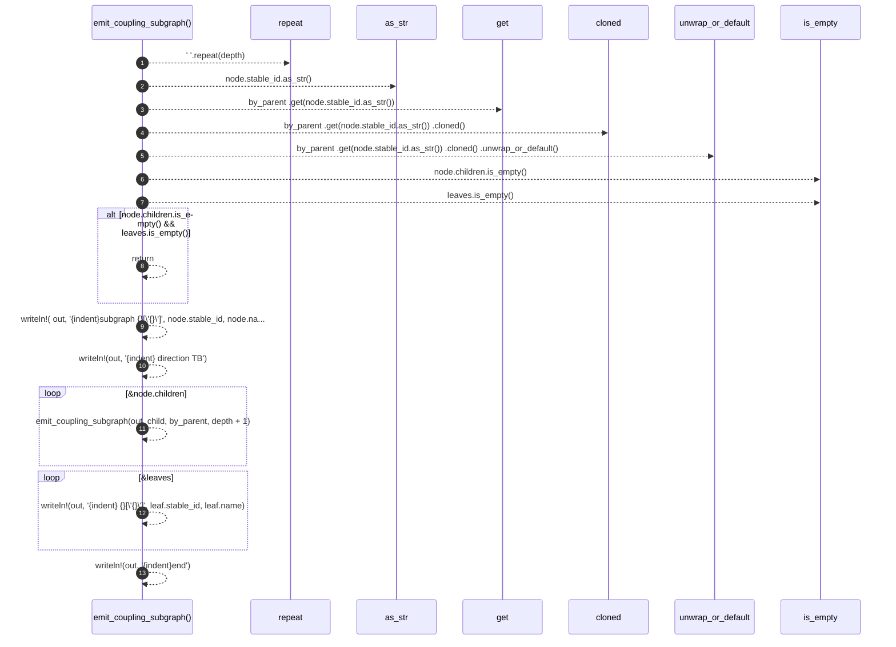

# `robby_render::render::mermaid::emit_coupling_subgraph`

[Self-model](../../../README.md) · [render::mermaid](index.md)

| | |
|---|---|
| kind | `code.function` |
| signature | `fn emit_coupling_subgraph(     out: &mut String,     node: &CouplingModule,     by_parent: &std::collections::BTreeMap<&str, Vec<&CouplingFn>>,     depth: usize, )` |
| location | [`crates/robby-render/src/render/mermaid.rs:249`](../../../../../crates/robby-render/src/render/mermaid.rs#L249) |
| provenance | extractor · confidence 1.00 |

```rust
fn emit_coupling_subgraph(
    out: &mut String,
    node: &CouplingModule,
    by_parent: &std::collections::BTreeMap<&str, Vec<&CouplingFn>>,
    depth: usize,
) {
    let indent = "    ".repeat(depth);
    let leaves = by_parent
        .get(node.stable_id.as_str())
        .cloned()
        .unwrap_or_default();
    if node.children.is_empty() && leaves.is_empty() {
        return;
    }

    let _ = writeln!(
        out,
        "{indent}subgraph {}[\"{}\"]",
        node.stable_id, node.name
    );
    let _ = writeln!(out, "{indent}    direction TB");
    for child in &node.children {
        emit_coupling_subgraph(out, child, by_parent, depth + 1);
    }
    for leaf in &leaves {
        let _ = writeln!(out, "{indent}    {}[\"{}\"]", leaf.stable_id, leaf.name);
    }
    let _ = writeln!(out, "{indent}end");
}
```



13 steps · 0 observed · 13 possible only

**Edges**

- calls → [`robby_render::view::comments::impl CommentKind::as_str`](../../view/comments/index.md)
- calls → [`robby_ir::model::impl Document::get`](../../../robby_ir/model/index.md)
- calls → [`robby_render::view::links::impl LinkGraph::is_empty`](../../view/links/index.md)
- calls → [`robby_render::view::links::impl LinkGraph::is_empty`](../../view/links/index.md)
- calls → [`robby_render::render::mermaid::emit_coupling_subgraph`](emit-coupling-subgraph.md)

## References

- calls → [`robby_ir::model`](../../../robby_ir/model/index.md) — get
- calls → [`robby_render::view::comments`](../../view/comments/index.md) — as_str
- calls → [`robby_render::view::links`](../../view/links/index.md) — is_empty

## Referenced by

- calls ← [`robby_render::render::mermaid::impl Renderer for MermaidRenderer::coupling_deps`](index.md)

