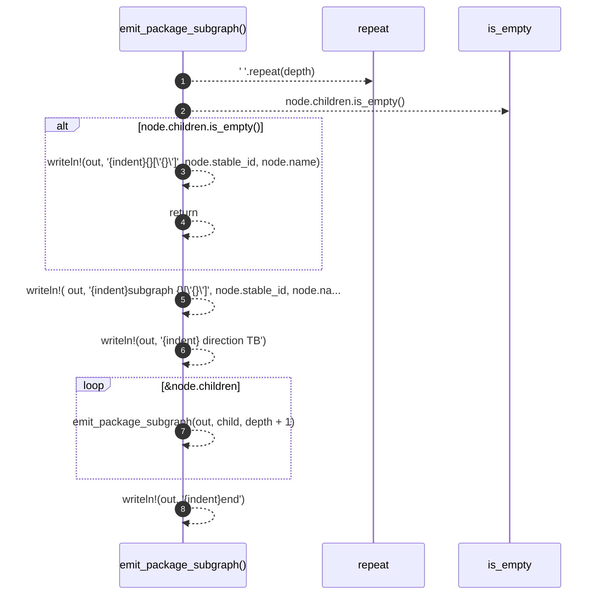

# `robby_render::render::mermaid::emit_package_subgraph`

[Self-model](../../../README.md) · [render::mermaid](index.md)

| | |
|---|---|
| kind | `code.function` |
| signature | `fn emit_package_subgraph(out: &mut String, node: &PackageNode, depth: usize)` |
| location | [`crates/robby-render/src/render/mermaid.rs:212`](../../../../../crates/robby-render/src/render/mermaid.rs#L212) |
| provenance | extractor · confidence 1.00 |

```rust
fn emit_package_subgraph(out: &mut String, node: &PackageNode, depth: usize) {
    let indent = "    ".repeat(depth);
    if node.children.is_empty() {
        // Leaf package: draw as a node so edges have an endpoint.
        let _ = writeln!(out, "{indent}{}[\"{}\"]", node.stable_id, node.name);
        return;
    }
    let _ = writeln!(
        out,
        "{indent}subgraph {}[\"{}\"]",
        node.stable_id, node.name
    );
    let _ = writeln!(out, "{indent}    direction TB");
    for child in &node.children {
        emit_package_subgraph(out, child, depth + 1);
    }
    let _ = writeln!(out, "{indent}end");
}
```



8 steps · 0 observed · 8 possible only

**Edges**

- calls → [`robby_render::view::links::impl LinkGraph::is_empty`](../../view/links/index.md)
- calls → [`robby_render::render::mermaid::emit_package_subgraph`](emit-package-subgraph.md)

## References

- calls → [`robby_render::view::links`](../../view/links/index.md) — is_empty

## Referenced by

- calls ← [`robby_render::render::mermaid::impl Renderer for MermaidRenderer::package_deps`](index.md)

