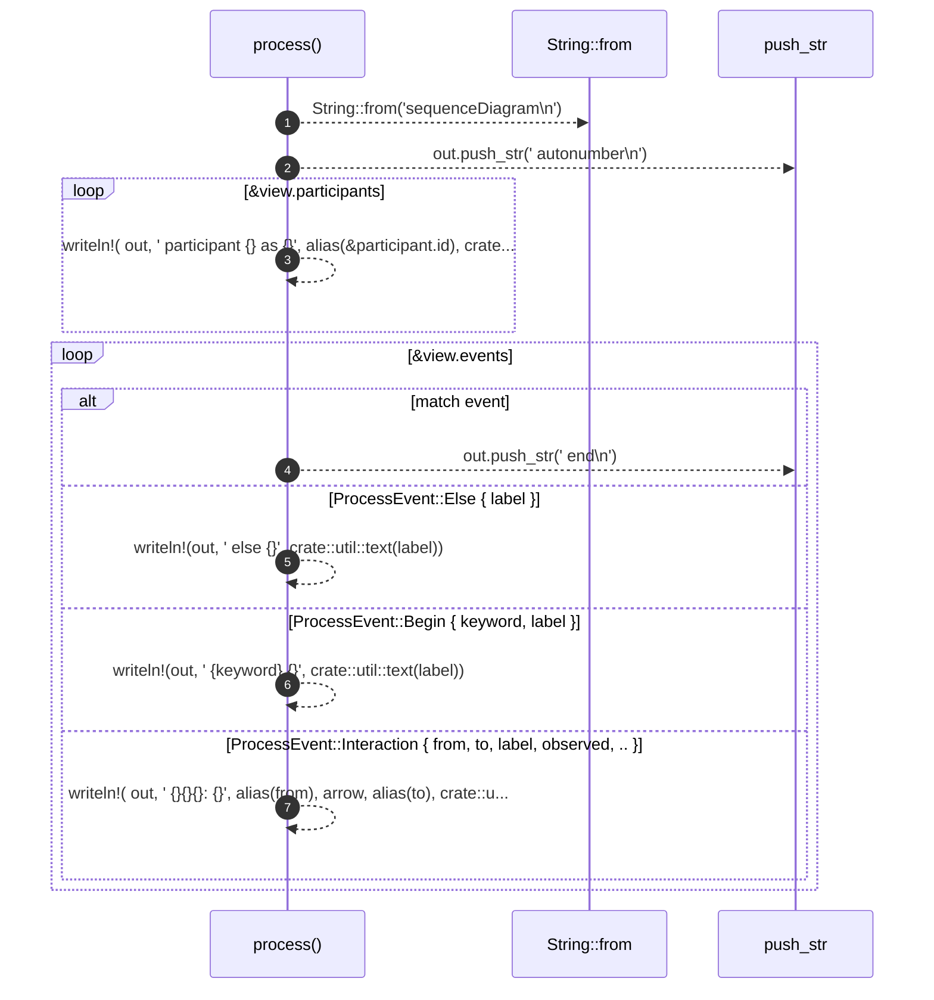
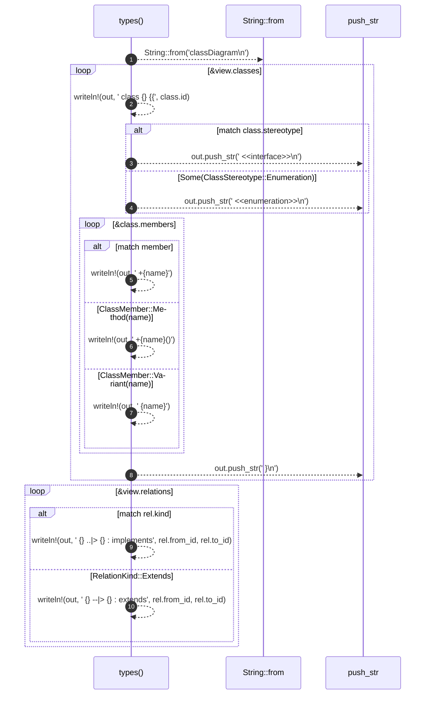
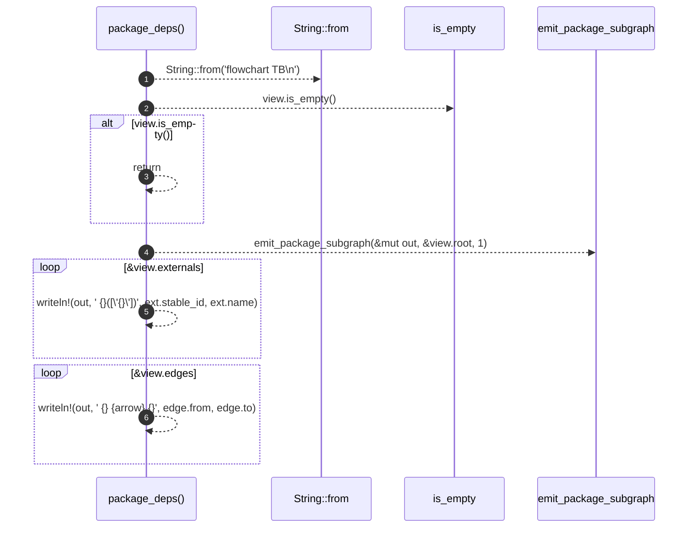
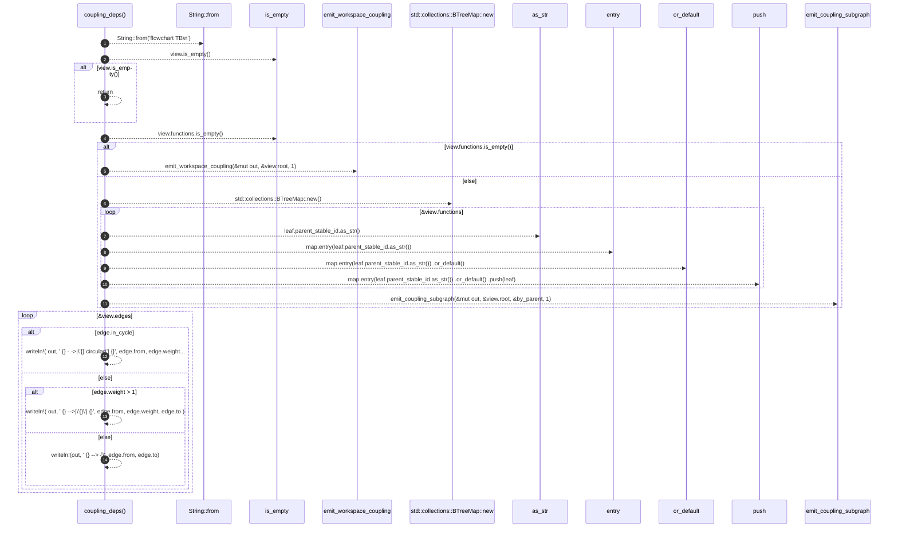
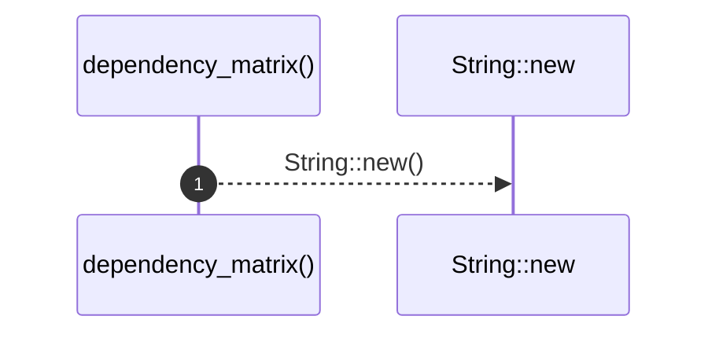
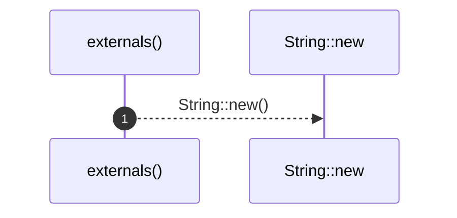
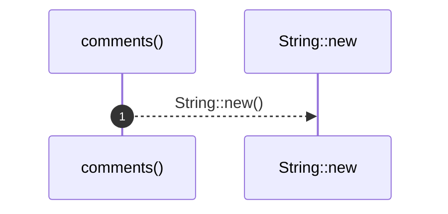
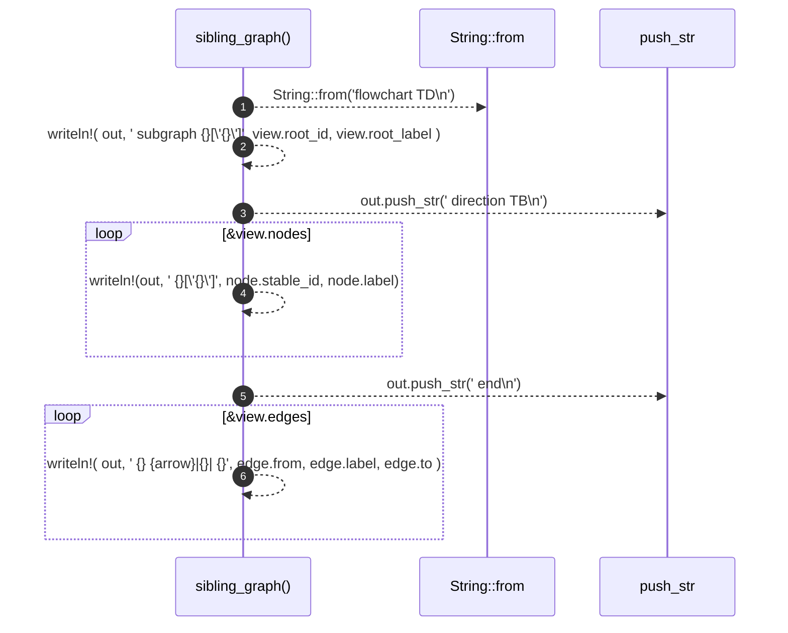

# `robby_render::render::mermaid::impl Renderer for MermaidRenderer`

[Self-model](../../../README.md) · [render::mermaid](index.md)

| | |
|---|---|
| kind | `code.impl` |
| location | [`crates/robby-render/src/render/mermaid.rs:17`](../../../../../crates/robby-render/src/render/mermaid.rs#L17) |
| provenance | extractor · confidence 1.00 |

```rust
impl Renderer for MermaidRenderer {
    fn meta(&self, _meta: &NodeMeta) -> String {
        String::new()
    }

    fn process(&self, view: &ProcessView) -> String {
        let mut out = String::from("sequenceDiagram\n");
        out.push_str("    autonumber\n");

        for participant in &view.participants {
            let _ = writeln!(
                out,
                "    participant {} as {}",
                alias(&participant.id),
                crate::util::text(&participant.label)
            );
        }

        for event in &view.events {
            match event {
                ProcessEvent::End => out.push_str("    end\n"),
                ProcessEvent::Else { label } => {
                    let _ = writeln!(out, "    else {}", crate::util::text(label));
                }
                ProcessEvent::Begin { keyword, label } => {
                    let _ = writeln!(out, "    {keyword} {}", crate::util::text(label));
                }
                ProcessEvent::Interaction {
                    from,
                    to,
                    label,
                    observed,
                    ..
                } => {
                    let arrow = if *observed { "->>" } else { "-->>" };
                    let _ = writeln!(
                        out,
                        "    {}{}{}: {}",
                        alias(from),
                        arrow,
                        alias(to),
                        crate::util::text(label)
                    );
                }
            }
        }

        out
    }

    fn types(&self, view: &TypeModel) -> String {
        let mut out = String::from("classDiagram\n");
        for class in &view.classes {
            let _ = writeln!(out, "    class {} {{", class.id);
            match class.stereotype {
                Some(ClassStereotype::Interface) => out.push_str("        <<interface>>\n"),
                Some(ClassStereotype::Enumeration) => out.push_str("        <<enumeration>>\n"),
                None => {}
            }
            for member in &class.members {
                match member {
                    ClassMember::Field(name) => {
                        let _ = writeln!(out, "        +{name}");
                    }
                    ClassMember::Method(name) => {
                        let _ = writeln!(out, "        +{name}()");
                    }
                    ClassMember::Variant(name) => {
                        let _ = writeln!(out, "        {name}");
                    }
                }
            }
            out.push_str("    }\n");
        }
        for rel in &view.relations {
            match rel.kind {
                RelationKind::Implements => {
                    let _ = writeln!(out, "    {} ..|> {} : implements", rel.from_id, rel.to_id);
                }
                RelationKind::Extends => {
                    let _ = writeln!(out, "    {} --|> {} : extends", rel.from_id, rel.to_id);
                }
            }
        }
        out
    }

    fn package_deps(&self, view: &PackageStructure) -> String {
        // Nested source-structure packages + external stadiums; unweighted arrows.
        let mut out = String::from("flowchart TB\n");
        if view.is_empty() {
            return out;
        }

        emit_package_subgraph(&mut out, &view.root, 1);
        for ext in &view.externals {
            let _ = writeln!(out, "    {}([\"{}\"])", ext.stable_id, ext.name);
        }
        for edge in &view.edges {
            let arrow = if edge.in_cycle { "-.->" } else { "-->" };
            let _ = writeln!(out, "    {} {arrow} {}", edge.from, edge.to);
        }
        out
    }

    fn coupling_deps(&self, view: &CouplingGraph) -> String {
        // Modules as subgraphs; functions (or workspace modules) as nodes; Calls.
        let mut out = String::from("flowchart TB\n");
        if view.is_empty() {
            return out;
        }

        if view.functions.is_empty() {
            // Workspace: crates as subgraphs, modules as leaf nodes.
            emit_workspace_coupling(&mut out, &view.root, 1);
        } else {
            let by_parent: std::collections::BTreeMap<&str, Vec<&CouplingFn>> = {
                let mut map: std::collections::BTreeMap<&str, Vec<&CouplingFn>> =
                    std::collections::BTreeMap::new();
                for leaf in &view.functions {
                    map.entry(leaf.parent_stable_id.as_str())
                        .or_default()
                        .push(leaf);
                }
                map
            };
            emit_coupling_subgraph(&mut out, &view.root, &by_parent, 1);
        }

        for edge in &view.edges {
            if edge.in_cycle {
                let _ = writeln!(
                    out,
                    "    {} -.->|\"{} circular\"| {}",
                    edge.from, edge.weight, edge.to
                );
            } else if edge.weight > 1 {
                let _ = writeln!(
                    out,
                    "    {} -->|\"{}\"| {}",
                    edge.from, edge.weight, edge.to
                );
            } else {
                let _ = writeln!(out, "    {} --> {}", edge.from, edge.to);
            }
        }
        out
    }

    fn dependency_matrix(&self, view: &PackageStructure) -> String {
        // Mermaid has no matrix; DSM is rendered as Markdown/ASCII by other renderers.
        let _ = view;
        String::new()
    }

    fn hierarchy(&self, _view: &HierarchyView) -> String {
        String::new()
    }

    fn externals(&self, _view: &crate::view::ExternalsView) -> String {
        String::new()
    }

    fn comments(&self, _view: &crate::view::CommentsView) -> String {
        String::new()
    }

    fn links(&self, _view: &LinkGraph) -> String {
        String::new()
    }

    fn sibling_graph(&self, view: &SiblingGraph) -> String {
        let mut out = String::from("flowchart TD\n");
        let _ = writeln!(
            out,
            "    subgraph {}[\"{}\"]",
            view.root_id, view.root_label
        );
        out.push_str("        direction TB\n");
        for node in &view.nodes {
            let _ = writeln!(out, "        {}[\"{}\"]", node.stable_id, node.label);
        }
        out.push_str("    end\n");
        for edge in &view.edges {
            let arrow = if edge.resolved { "-->" } else { "-.->" };
            let _ = writeln!(
                out,
                "    {} {arrow}|{}| {}",
                edge.from, edge.label, edge.to
            );
        }
        out
    }

    fn source(&self, _view: &SourceSlice) -> String {
        String::new()
    }
}
```

## References

- calls → [`robby_ir::kind`](../../../robby_ir/kind/index.md) — from
- calls → [`robby_render::render::mermaid`](index.md) — emit_coupling_subgraph, emit_package_subgraph, emit_workspace_coupling
- calls → [`robby_render::render::tui`](../tui/index.md) — new
- calls → [`robby_render::report`](../../report/index.md) — push
- calls → [`robby_render::view::comments`](../../view/comments/index.md) — as_str
- calls → [`robby_render::view::links`](../../view/links/index.md) — is_empty

### `meta`

| | |
|---|---|
| kind | `code.method` |
| signature | `fn meta(2)` |
| location | [`crates/robby-render/src/render/mermaid.rs:18`](../../../../../crates/robby-render/src/render/mermaid.rs#L18) |
| provenance | extractor · confidence 1.00 |

```rust
fn meta(&self, _meta: &NodeMeta) -> String {
        String::new()
    }
```


1 steps · 0 observed · 1 possible only

**Edges**

- calls → [`robby_render::render::tui::impl TuiRenderer::new`](../tui/index.md)

### `process`

| | |
|---|---|
| kind | `code.method` |
| signature | `fn process(2)` |
| location | [`crates/robby-render/src/render/mermaid.rs:22`](../../../../../crates/robby-render/src/render/mermaid.rs#L22) |
| provenance | extractor · confidence 1.00 |

```rust
fn process(&self, view: &ProcessView) -> String {
        let mut out = String::from("sequenceDiagram\n");
        out.push_str("    autonumber\n");

        for participant in &view.participants {
            let _ = writeln!(
                out,
                "    participant {} as {}",
                alias(&participant.id),
                crate::util::text(&participant.label)
            );
        }

        for event in &view.events {
            match event {
                ProcessEvent::End => out.push_str("    end\n"),
                ProcessEvent::Else { label } => {
                    let _ = writeln!(out, "    else {}", crate::util::text(label));
                }
                ProcessEvent::Begin { keyword, label } => {
                    let _ = writeln!(out, "    {keyword} {}", crate::util::text(label));
                }
                ProcessEvent::Interaction {
                    from,
                    to,
                    label,
                    observed,
                    ..
                } => {
                    let arrow = if *observed { "->>" } else { "-->>" };
                    let _ = writeln!(
                        out,
                        "    {}{}{}: {}",
                        alias(from),
                        arrow,
                        alias(to),
                        crate::util::text(label)
                    );
                }
            }
        }

        out
    }
```



7 steps · 0 observed · 7 possible only

**Edges**

- calls → [`robby_ir::kind::impl From<&str> for Kind::from`](../../../robby_ir/kind/index.md)

### `types`

| | |
|---|---|
| kind | `code.method` |
| signature | `fn types(2)` |
| location | [`crates/robby-render/src/render/mermaid.rs:67`](../../../../../crates/robby-render/src/render/mermaid.rs#L67) |
| provenance | extractor · confidence 1.00 |

```rust
fn types(&self, view: &TypeModel) -> String {
        let mut out = String::from("classDiagram\n");
        for class in &view.classes {
            let _ = writeln!(out, "    class {} {{", class.id);
            match class.stereotype {
                Some(ClassStereotype::Interface) => out.push_str("        <<interface>>\n"),
                Some(ClassStereotype::Enumeration) => out.push_str("        <<enumeration>>\n"),
                None => {}
            }
            for member in &class.members {
                match member {
                    ClassMember::Field(name) => {
                        let _ = writeln!(out, "        +{name}");
                    }
                    ClassMember::Method(name) => {
                        let _ = writeln!(out, "        +{name}()");
                    }
                    ClassMember::Variant(name) => {
                        let _ = writeln!(out, "        {name}");
                    }
                }
            }
            out.push_str("    }\n");
        }
        for rel in &view.relations {
            match rel.kind {
                RelationKind::Implements => {
                    let _ = writeln!(out, "    {} ..|> {} : implements", rel.from_id, rel.to_id);
                }
                RelationKind::Extends => {
                    let _ = writeln!(out, "    {} --|> {} : extends", rel.from_id, rel.to_id);
                }
            }
        }
        out
    }
```



10 steps · 0 observed · 10 possible only

**Edges**

- calls → [`robby_ir::kind::impl From<&str> for Kind::from`](../../../robby_ir/kind/index.md)

### `package_deps`

| | |
|---|---|
| kind | `code.method` |
| signature | `fn package_deps(2)` |
| location | [`crates/robby-render/src/render/mermaid.rs:104`](../../../../../crates/robby-render/src/render/mermaid.rs#L104) |
| provenance | extractor · confidence 1.00 |

```rust
fn package_deps(&self, view: &PackageStructure) -> String {
        // Nested source-structure packages + external stadiums; unweighted arrows.
        let mut out = String::from("flowchart TB\n");
        if view.is_empty() {
            return out;
        }

        emit_package_subgraph(&mut out, &view.root, 1);
        for ext in &view.externals {
            let _ = writeln!(out, "    {}([\"{}\"])", ext.stable_id, ext.name);
        }
        for edge in &view.edges {
            let arrow = if edge.in_cycle { "-.->" } else { "-->" };
            let _ = writeln!(out, "    {} {arrow} {}", edge.from, edge.to);
        }
        out
    }
```



6 steps · 0 observed · 6 possible only

**Edges**

- calls → [`robby_ir::kind::impl From<&str> for Kind::from`](../../../robby_ir/kind/index.md)
- calls → [`robby_render::view::links::impl LinkGraph::is_empty`](../../view/links/index.md)
- calls → [`robby_render::render::mermaid::emit_package_subgraph`](emit-package-subgraph.md)

### `coupling_deps`

| | |
|---|---|
| kind | `code.method` |
| signature | `fn coupling_deps(2)` |
| location | [`crates/robby-render/src/render/mermaid.rs:122`](../../../../../crates/robby-render/src/render/mermaid.rs#L122) |
| provenance | extractor · confidence 1.00 |

```rust
fn coupling_deps(&self, view: &CouplingGraph) -> String {
        // Modules as subgraphs; functions (or workspace modules) as nodes; Calls.
        let mut out = String::from("flowchart TB\n");
        if view.is_empty() {
            return out;
        }

        if view.functions.is_empty() {
            // Workspace: crates as subgraphs, modules as leaf nodes.
            emit_workspace_coupling(&mut out, &view.root, 1);
        } else {
            let by_parent: std::collections::BTreeMap<&str, Vec<&CouplingFn>> = {
                let mut map: std::collections::BTreeMap<&str, Vec<&CouplingFn>> =
                    std::collections::BTreeMap::new();
                for leaf in &view.functions {
                    map.entry(leaf.parent_stable_id.as_str())
                        .or_default()
                        .push(leaf);
                }
                map
            };
            emit_coupling_subgraph(&mut out, &view.root, &by_parent, 1);
        }

        for edge in &view.edges {
            if edge.in_cycle {
                let _ = writeln!(
                    out,
                    "    {} -.->|\"{} circular\"| {}",
                    edge.from, edge.weight, edge.to
                );
            } else if edge.weight > 1 {
                let _ = writeln!(
                    out,
                    "    {} -->|\"{}\"| {}",
                    edge.from, edge.weight, edge.to
                );
            } else {
                let _ = writeln!(out, "    {} --> {}", edge.from, edge.to);
            }
        }
        out
    }
```



14 steps · 0 observed · 14 possible only

**Edges**

- calls → [`robby_ir::kind::impl From<&str> for Kind::from`](../../../robby_ir/kind/index.md)
- calls → [`robby_render::view::links::impl LinkGraph::is_empty`](../../view/links/index.md)
- calls → [`robby_render::view::links::impl LinkGraph::is_empty`](../../view/links/index.md)
- calls → [`robby_render::render::mermaid::emit_workspace_coupling`](emit-workspace-coupling.md)
- calls → [`robby_render::render::tui::impl TuiRenderer::new`](../tui/index.md)
- calls → [`robby_render::view::comments::impl NoteKind::as_str`](../../view/comments/index.md)
- calls → [`robby_render::report::impl Report::push`](../../report/index.md)
- calls → [`robby_render::render::mermaid::emit_coupling_subgraph`](emit-coupling-subgraph.md)

### `dependency_matrix`

| | |
|---|---|
| kind | `code.method` |
| signature | `fn dependency_matrix(2)` |
| location | [`crates/robby-render/src/render/mermaid.rs:166`](../../../../../crates/robby-render/src/render/mermaid.rs#L166) |
| provenance | extractor · confidence 1.00 |

```rust
fn dependency_matrix(&self, view: &PackageStructure) -> String {
        // Mermaid has no matrix; DSM is rendered as Markdown/ASCII by other renderers.
        let _ = view;
        String::new()
    }
```



1 steps · 0 observed · 1 possible only

**Edges**

- calls → [`robby_render::render::tui::impl TuiRenderer::new`](../tui/index.md)

### `hierarchy`

| | |
|---|---|
| kind | `code.method` |
| signature | `fn hierarchy(2)` |
| location | [`crates/robby-render/src/render/mermaid.rs:172`](../../../../../crates/robby-render/src/render/mermaid.rs#L172) |
| provenance | extractor · confidence 1.00 |

```rust
fn hierarchy(&self, _view: &HierarchyView) -> String {
        String::new()
    }
```


1 steps · 0 observed · 1 possible only

**Edges**

- calls → [`robby_render::render::tui::impl TuiRenderer::new`](../tui/index.md)

### `externals`

| | |
|---|---|
| kind | `code.method` |
| signature | `fn externals(2)` |
| location | [`crates/robby-render/src/render/mermaid.rs:176`](../../../../../crates/robby-render/src/render/mermaid.rs#L176) |
| provenance | extractor · confidence 1.00 |

```rust
fn externals(&self, _view: &crate::view::ExternalsView) -> String {
        String::new()
    }
```



1 steps · 0 observed · 1 possible only

**Edges**

- calls → [`robby_render::render::tui::impl TuiRenderer::new`](../tui/index.md)

### `comments`

| | |
|---|---|
| kind | `code.method` |
| signature | `fn comments(2)` |
| location | [`crates/robby-render/src/render/mermaid.rs:180`](../../../../../crates/robby-render/src/render/mermaid.rs#L180) |
| provenance | extractor · confidence 1.00 |

```rust
fn comments(&self, _view: &crate::view::CommentsView) -> String {
        String::new()
    }
```



1 steps · 0 observed · 1 possible only

**Edges**

- calls → [`robby_render::render::tui::impl TuiRenderer::new`](../tui/index.md)

### `links`

| | |
|---|---|
| kind | `code.method` |
| signature | `fn links(2)` |
| location | [`crates/robby-render/src/render/mermaid.rs:184`](../../../../../crates/robby-render/src/render/mermaid.rs#L184) |
| provenance | extractor · confidence 1.00 |

```rust
fn links(&self, _view: &LinkGraph) -> String {
        String::new()
    }
```

```mermaid
sequenceDiagram
    autonumber
    participant links as links()
    participant String__new as String::new
    links-->>String__new: String::new()
```

1 steps · 0 observed · 1 possible only

**Edges**

- calls → [`robby_render::render::tui::impl TuiRenderer::new`](../tui/index.md)

### `sibling_graph`

| | |
|---|---|
| kind | `code.method` |
| signature | `fn sibling_graph(2)` |
| location | [`crates/robby-render/src/render/mermaid.rs:188`](../../../../../crates/robby-render/src/render/mermaid.rs#L188) |
| provenance | extractor · confidence 1.00 |

```rust
fn sibling_graph(&self, view: &SiblingGraph) -> String {
        let mut out = String::from("flowchart TD\n");
        let _ = writeln!(
            out,
            "    subgraph {}[\"{}\"]",
            view.root_id, view.root_label
        );
        out.push_str("        direction TB\n");
        for node in &view.nodes {
            let _ = writeln!(out, "        {}[\"{}\"]", node.stable_id, node.label);
        }
        out.push_str("    end\n");
        for edge in &view.edges {
            let arrow = if edge.resolved { "-->" } else { "-.->" };
            let _ = writeln!(
                out,
                "    {} {arrow}|{}| {}",
                edge.from, edge.label, edge.to
            );
        }
        out
    }
```



6 steps · 0 observed · 6 possible only

**Edges**

- calls → [`robby_ir::kind::impl From<&str> for Kind::from`](../../../robby_ir/kind/index.md)

### `source`

| | |
|---|---|
| kind | `code.method` |
| signature | `fn source(2)` |
| location | [`crates/robby-render/src/render/mermaid.rs:211`](../../../../../crates/robby-render/src/render/mermaid.rs#L211) |
| provenance | extractor · confidence 1.00 |

```rust
fn source(&self, _view: &SourceSlice) -> String {
        String::new()
    }
```


1 steps · 0 observed · 1 possible only

**Edges**

- calls → [`robby_render::render::tui::impl TuiRenderer::new`](../tui/index.md)

