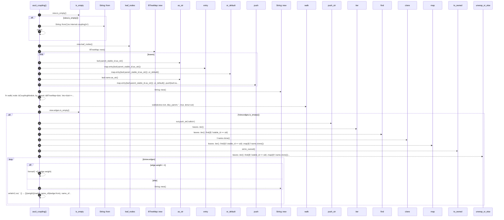

# `robby_render::render::tui::ascii_coupling`

[Self-model](../../../README.md) · [render::tui](index.md)

| | |
|---|---|
| kind | `code.function` |
| signature | `fn ascii_coupling(view: &CouplingGraph) -> String` |
| location | [`crates/robby-render/src/render/tui.rs:510`](../../../../../crates/robby-render/src/render/tui.rs#L510) |
| provenance | extractor · confidence 1.00 |

```rust
fn ascii_coupling(view: &CouplingGraph) -> String {
    if view.is_empty() {
        return String::from("(no internal coupling)\n");
    }
    let leaves = view.leaf_nodes();
    let by_parent: BTreeMap<&str, Vec<&str>> = {
        let mut map: BTreeMap<&str, Vec<&str>> = BTreeMap::new();
        for leaf in leaves {
            map.entry(leaf.parent_stable_id.as_str())
                .or_default()
                .push(leaf.name.as_str());
        }
        map
    };
    let mut out = String::new();
    fn walk(
        node: &CouplingModule,
        by_parent: &BTreeMap<&str, Vec<&str>>,
        prefix: &str,
        is_last: bool,
        out: &mut String,
    ) {
        let branch = if prefix.is_empty() {
            ""
        } else if is_last {
            "└── "
        } else {
            "├── "
        };
        let _ = writeln!(out, "{prefix}{branch}{}", node.name);
        let child_prefix = if prefix.is_empty() {
            String::new()
        } else if is_last {
            format!("{prefix}    ")
        } else {
            format!("{prefix}│   ")
        };
        let fns = by_parent.get(node.stable_id.as_str()).cloned().unwrap_or_default();
        let total = node.children.len() + fns.len();
        for (index, child) in node.children.iter().enumerate() {
            walk(child, by_parent, &child_prefix, index + 1 == total, out);
        }
        for (index, name) in fns.iter().enumerate() {
            let last = node.children.len() + index + 1 == total;
            let b = if last { "└── " } else { "├── " };
            let _ = writeln!(out, "{child_prefix}{b}{name}()");
        }
    }
    walk(&view.root, &by_parent, "", true, &mut out);
    if !view.edges.is_empty() {
        out.push_str("calls\n");
        let name_of = |sid: &str| -> String {
            leaves
                .iter()
                .find(|f| f.stable_id == sid)
                .map(|f| f.name.clone())
                .unwrap_or_else(|| sid.to_owned())
        };
        for edge in &view.edges {
            let mark = if edge.in_cycle { " ⇄" } else { "" };
            let weight = if edge.weight > 1 {
                format!(" ×{}", edge.weight)
            } else {
                String::new()
            };
            let _ = writeln!(
                out,
                "  {} → {}{weight}{mark}",
                name_of(&edge.from),
                name_of(&edge.to)
            );
        }
    }
    out
}
```



24 steps · 0 observed · 24 possible only

**Edges**

- calls → [`robby_render::view::links::impl LinkGraph::is_empty`](../../view/links/index.md)
- calls → [`robby_ir::kind::impl From<&str> for Kind::from`](../../../robby_ir/kind/index.md)
- calls → [`robby_render::view::deps::impl CouplingGraph::leaf_nodes`](../../view/deps/index.md)
- calls → [`robby_render::render::tui::impl TuiRenderer::new`](index.md)
- calls → [`robby_render::view::comments::impl NoteKind::as_str`](../../view/comments/index.md)
- calls → [`robby_render::view::comments::impl NoteKind::as_str`](../../view/comments/index.md)
- calls → [`robby_render::report::impl Report::push`](../../report/index.md)
- calls → [`robby_render::render::tui::impl TuiRenderer::new`](index.md)
- calls → [`robby_ir::model::impl Document::walk`](../../../robby_ir/model/index.md)
- calls → [`robby_render::view::links::impl LinkGraph::is_empty`](../../view/links/index.md)
- calls → [`robby_render::render::tui::impl TuiRenderer::new`](index.md)

## References

- calls → [`robby_ir::kind`](../../../robby_ir/kind/index.md) — from
- calls → [`robby_ir::model`](../../../robby_ir/model/index.md) — walk
- calls → [`robby_render::render::tui`](index.md) — new
- calls → [`robby_render::report`](../../report/index.md) — push
- calls → [`robby_render::view::comments`](../../view/comments/index.md) — as_str
- calls → [`robby_render::view::deps`](../../view/deps/index.md) — leaf_nodes
- calls → [`robby_render::view::links`](../../view/links/index.md) — is_empty

## Referenced by

- calls ← [`robby_render::render::tui::impl Renderer for TuiRenderer::coupling_deps`](index.md)

