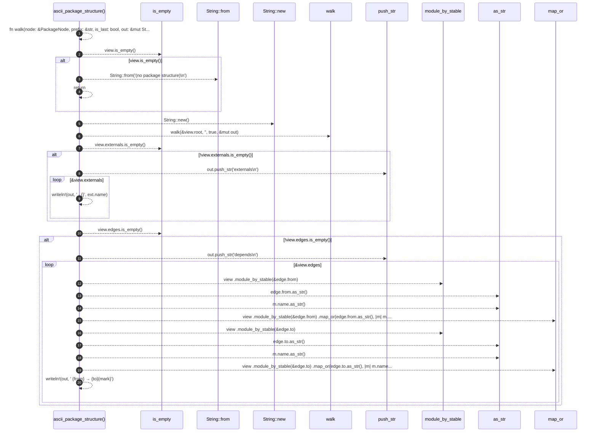

# `robby_render::render::tui::ascii_package_structure`

[Self-model](../../../README.md) · [render::tui](index.md)

| | |
|---|---|
| kind | `code.function` |
| signature | `fn ascii_package_structure(view: &PackageStructure) -> String` |
| location | [`crates/robby-render/src/render/tui.rs:450`](../../../../../crates/robby-render/src/render/tui.rs#L450) |
| provenance | extractor · confidence 1.00 |

```rust
fn ascii_package_structure(view: &PackageStructure) -> String {
    fn walk(node: &PackageNode, prefix: &str, is_last: bool, out: &mut String) {
        let branch = if prefix.is_empty() {
            ""
        } else if is_last {
            "└── "
        } else {
            "├── "
        };
        let _ = writeln!(out, "{prefix}{branch}{}", node.name);
        let child_prefix = if prefix.is_empty() {
            String::new()
        } else if is_last {
            format!("{prefix}    ")
        } else {
            format!("{prefix}│   ")
        };
        let count = node.children.len();
        for (index, child) in node.children.iter().enumerate() {
            walk(child, &child_prefix, index + 1 == count, out);
        }
    }
    if view.is_empty() {
        return String::from("(no package structure)\n");
    }
    let mut out = String::new();
    walk(&view.root, "", true, &mut out);
    if !view.externals.is_empty() {
        out.push_str("externals\n");
        for ext in &view.externals {
            let _ = writeln!(out, "  · {}", ext.name);
        }
    }
    if !view.edges.is_empty() {
        out.push_str("depends\n");
        for edge in &view.edges {
            let mark = if edge.in_cycle { " ⇄" } else { "" };
            let from = view
                .module_by_stable(&edge.from)
                .map_or(edge.from.as_str(), |m| m.name.as_str());
            let to = view
                .module_by_stable(&edge.to)
                .map_or(edge.to.as_str(), |m| m.name.as_str());
            let _ = writeln!(out, "  {from} → {to}{mark}");
        }
    }
    out
}
```



20 steps · 0 observed · 20 possible only

**Edges**

- calls → [`robby_render::view::links::impl LinkGraph::is_empty`](../../view/links/index.md)
- calls → [`robby_ir::kind::impl From<&str> for Kind::from`](../../../robby_ir/kind/index.md)
- calls → [`robby_render::render::tui::impl TuiRenderer::new`](index.md)
- calls → [`robby_ir::model::impl Document::walk`](../../../robby_ir/model/index.md)
- calls → [`robby_render::view::links::impl LinkGraph::is_empty`](../../view/links/index.md)
- calls → [`robby_render::view::links::impl LinkGraph::is_empty`](../../view/links/index.md)
- calls → [`robby_render::view::deps::impl PackageStructure::module_by_stable`](../../view/deps/index.md)
- calls → [`robby_render::view::comments::impl CommentKind::as_str`](../../view/comments/index.md)
- calls → [`robby_render::view::comments::impl CommentKind::as_str`](../../view/comments/index.md)
- calls → [`robby_render::view::deps::impl PackageStructure::module_by_stable`](../../view/deps/index.md)
- calls → [`robby_render::view::comments::impl CommentKind::as_str`](../../view/comments/index.md)
- calls → [`robby_render::view::comments::impl CommentKind::as_str`](../../view/comments/index.md)

## References

- calls → [`robby_ir::kind`](../../../robby_ir/kind/index.md) — from
- calls → [`robby_ir::model`](../../../robby_ir/model/index.md) — walk
- calls → [`robby_render::render::tui`](index.md) — new
- calls → [`robby_render::view::comments`](../../view/comments/index.md) — as_str
- calls → [`robby_render::view::deps`](../../view/deps/index.md) — module_by_stable
- calls → [`robby_render::view::links`](../../view/links/index.md) — is_empty

## Referenced by

- calls ← [`robby_render::render::tui::impl Renderer for TuiRenderer::package_deps`](index.md)

