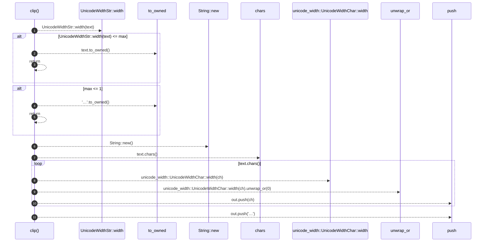

# `robby_render::render::tui::clip`

[Self-model](../../../README.md) · [render::tui](index.md)

| | |
|---|---|
| kind | `code.function` |
| signature | `fn clip(text: &str, max: usize) -> String` |
| location | [`crates/robby-render/src/render/tui.rs:586`](../../../../../crates/robby-render/src/render/tui.rs#L586) |
| provenance | extractor · confidence 1.00 |

```rust
fn clip(text: &str, max: usize) -> String {
    if UnicodeWidthStr::width(text) <= max {
        return text.to_owned();
    }
    if max <= 1 {
        return "…".to_owned();
    }
    let mut out = String::new();
    let mut width = 0;
    for ch in text.chars() {
        let ch_width = unicode_width::UnicodeWidthChar::width(ch).unwrap_or(0);
        if width + ch_width + 1 > max {
            break;
        }
        out.push(ch);
        width += ch_width;
    }
    out.push('…');
    out
}
```



11 steps · 0 observed · 11 possible only

**Edges**

- calls → [`robby_render::render::tui::impl TuiRenderer::new`](index.md)
- calls → [`robby_render::report::impl Report::push`](../../report/index.md)
- calls → [`robby_render::report::impl Report::push`](../../report/index.md)

## References

- calls → [`robby_render::render::tui`](index.md) — new
- calls → [`robby_render::report`](../../report/index.md) — push

## Referenced by

- calls ← [`robby_render::render::tui::impl Renderer for TuiRenderer::comments`](index.md)
- calls ← [`robby_render::render::tui::impl Renderer for TuiRenderer::process`](index.md)

