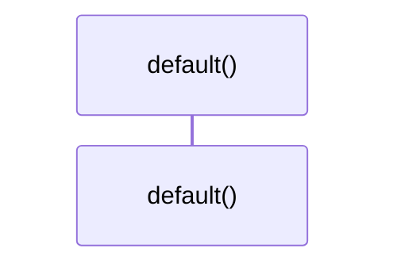

# `robby_render::render::tui::impl Default for ShowOptions`

[Self-model](../../../README.md) · [render::tui](index.md)

| | |
|---|---|
| kind | `code.impl` |
| location | [`crates/robby-render/src/render/tui.rs:36`](../../../../../crates/robby-render/src/render/tui.rs#L36) |
| provenance | extractor · confidence 1.00 |

```rust
impl Default for ShowOptions {
    fn default() -> Self {
        Self {
            depth: 4,
            width: 96,
            all: false,
            tree: true,
            graph: false,
            process: true,
            source: true,
            entry: true,
            types: true,
            dependencies: true,
            externals: true,
            comments: true,
            references: true,
        }
    }
}
```

## Referenced by

- calls ← [`robby_render::render::markdown::impl MarkdownRenderer::new`](../markdown/index.md)
- calls ← [`robby_render::report::impl Report::new`](../../report/index.md)
- calls ← [`robby_render::tui::timeline`](../../tui/timeline.md)

### `default`

| | |
|---|---|
| kind | `code.method` |
| signature | `fn default(0)` |
| location | [`crates/robby-render/src/render/tui.rs:37`](../../../../../crates/robby-render/src/render/tui.rs#L37) |
| provenance | extractor · confidence 1.00 |

```rust
fn default() -> Self {
        Self {
            depth: 4,
            width: 96,
            all: false,
            tree: true,
            graph: false,
            process: true,
            source: true,
            entry: true,
            types: true,
            dependencies: true,
            externals: true,
            comments: true,
            references: true,
        }
    }
```



0 steps · 0 observed · 0 possible only

