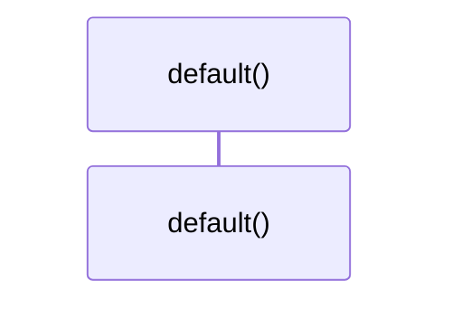

# `robby_render::render::tui::impl Default for TuiRenderer`

[Self-model](../../../README.md) · [render::tui](index.md)

| | |
|---|---|
| kind | `code.impl` |
| location | [`crates/robby-render/src/render/tui.rs:80`](../../../../../crates/robby-render/src/render/tui.rs#L80) |
| provenance | extractor · confidence 1.00 |

```rust
impl Default for TuiRenderer {
    fn default() -> Self {
        Self { width: 96 }
    }
}
```

### `default`

| | |
|---|---|
| kind | `code.method` |
| signature | `fn default(0)` |
| location | [`crates/robby-render/src/render/tui.rs:81`](../../../../../crates/robby-render/src/render/tui.rs#L81) |
| provenance | extractor · confidence 1.00 |

```rust
fn default() -> Self {
        Self { width: 96 }
    }
```



0 steps · 0 observed · 0 possible only

