# `robby_render::render::tui::impl Renderer for TuiRenderer`

[Self-model](../../../README.md) · [render::tui](index.md)

| | |
|---|---|
| kind | `code.impl` |
| location | [`crates/robby-render/src/render/tui.rs:108`](../../../../../crates/robby-render/src/render/tui.rs#L108) |
| provenance | extractor · confidence 1.00 |

```rust
impl Renderer for TuiRenderer {
    fn meta(&self, meta: &NodeMeta) -> String {
        let mut out = String::new();
        let rule = "─".repeat(self.width.clamp(24, 78));
        let _ = writeln!(out, "{}", meta.fqn);
        let _ = writeln!(out, "{rule}");
        let _ = writeln!(out, "kind        {}", meta.kind);
        if let Some(signature) = &meta.signature {
            let _ = writeln!(
                out,
                "signature   {}",
                clip(signature, self.width.saturating_sub(12))
            );
        }
        if let Some(location) = &meta.location {
            let _ = writeln!(out, "location    {location}");
        }
        let _ = writeln!(
            out,
            "provenance  {} · confidence {:.2}",
            meta.provenance_source, meta.confidence
        );
        let _ = writeln!(out, "nodes       {}", meta.node_count);
        if let Some(docs) = &meta.docs {
            out.push('\n');
            for line in docs.lines() {
                let _ = writeln!(out, "  {line}");
            }
        }
        out
    }

    fn process(&self, view: &ProcessView) -> String {
        if view.is_empty() {
            return String::from("(no steps)\n");
        }

        let labels: BTreeMap<&str, &str> = view
            .participants
            .iter()
            .map(|p| (p.id.as_str(), p.label.as_str()))
            .collect();
        let name = |id: &str| clip(labels.get(id).copied().unwrap_or(id), 28);

        let mut from_width = 0;
        let mut to_width = 0;
        let mut label_width = 0;
        let mut frame_depth = 0usize;
        let mut max_depth = 0usize;

        for event in &view.events {
            match event {
                ProcessEvent::Begin { .. } => {
                    frame_depth += 1;
                    max_depth = max_depth.max(frame_depth);
                }
                ProcessEvent::End => {
                    frame_depth = frame_depth.saturating_sub(1);
                }
                ProcessEvent::Interaction {
                    from, to, label, ..
                } => {
                    from_width = from_width.max(UnicodeWidthStr::width(name(from).as_str()));
                    to_width = to_width.max(UnicodeWidthStr::width(name(to).as_str()));
                    label_width = label_width.max(UnicodeWidthStr::width(clip(label, 52).as_str()));
                }
                ProcessEvent::Else { .. } => {}
            }
        }

        let number_width = view.step_count.to_string().len();
        let gutter = " ".repeat(number_width + 2);
        let mut out = String::new();

        out.push_str("lifelines  ");
        for (index, participant) in view.participants.iter().enumerate() {
            if index > 0 {
                out.push_str(" · ");
            }
            out.push_str(&clip(&participant.label, 32));
        }
        out.push('\n');
        let _ = writeln!(
            out,
            "{gutter}{} steps · {} observed · {} possible only",
            view.step_count,
            view.observed_count,
            view.step_count - view.observed_count
        );
        out.push('\n');

        let mut depth = 0usize;
        for event in &view.events {
            match event {
                ProcessEvent::End => {
                    depth = depth.saturating_sub(1);
                    let guide = "│ ".repeat(depth);
                    let _ = writeln!(out, "{gutter}{guide}└─ end");
                }
                ProcessEvent::Else { label } => {
                    let guide = "│ ".repeat(depth.saturating_sub(1));
                    let _ = writeln!(out, "{gutter}{guide}├─ else {}", clip(label, 60));
                }
                ProcessEvent::Begin { keyword, label } => {
                    let guide = "│ ".repeat(depth);
                    let _ = writeln!(out, "{gutter}{guide}┌─ {keyword} {}", clip(label, 60));
                    depth += 1;
                }
                ProcessEvent::Interaction {
                    index,
                    from,
                    to,
                    label,
                    observed,
                    kind,
                } => {
                    let guide = "│ ".repeat(depth);
                    let arrow = if *observed { "──▶" } else { "╌╌▶" };
                    let _ = writeln!(
                        out,
                        "{:>number_width$}  {guide}{} {arrow} {}  {}  {}",
                        index,
                        pad(&name(from), from_width),
                        pad(&name(to), to_width),
                        pad(&clip(label, 52), label_width),
                        kind.as_str(),
                    );
                }
            }
        }

        let _ = max_depth;
        out
    }

    fn types(&self, view: &TypeModel) -> String {
        let mut out = String::new();
        for class in &view.classes {
            let stereo = match class.stereotype {
                Some(ClassStereotype::Interface) => " «interface»",
                Some(ClassStereotype::Enumeration) => " «enumeration»",
                None => "",
            };
            let _ = writeln!(out, "{}{stereo}", class.name);
            for member in &class.members {
                match member {
                    ClassMember::Field(name) => {
                        let _ = writeln!(out, "  + {name}");
                    }
                    ClassMember::Method(name) => {
                        let _ = writeln!(out, "  + {name}()");
                    }
                    ClassMember::Variant(name) => {
                        let _ = writeln!(out, "  · {name}");
                    }
                }
            }
            out.push('\n');
        }
        for rel in &view.relations {
            let (arrow, label) = match rel.kind {
                crate::view::RelationKind::Implements => ("..|>", "implements"),
                crate::view::RelationKind::Extends => ("--|>", "extends"),
            };
            let _ = writeln!(out, "{} {arrow} {}  {label}", rel.from_id, rel.to_id);
        }
        out
    }

    fn package_deps(&self, view: &PackageStructure) -> String {
        ascii_package_structure(view)
    }

    fn coupling_deps(&self, view: &CouplingGraph) -> String {
        ascii_coupling(view)
    }

    fn dependency_matrix(&self, view: &PackageStructure) -> String {
        crate::render::mermaid::dsm_markdown_table(view)
    }

    fn externals(&self, view: &ExternalsView) -> String {
        let mut out = String::new();
        for entry in &view.entries {
            let importers = entry.importers.join(", ");
            let label = if entry.spec == entry.package {
                entry.package.clone()
            } else {
                format!("{} ({})", entry.package, entry.spec)
            };
            let _ = writeln!(out, "  {label} — imported by {importers}");
        }
        out
    }

    fn comments(&self, view: &CommentsView) -> String {
        use crate::view::apply_highlights;

        let mut out = String::new();
        for entry in &view.entries {
            let loc = entry.location.as_deref().unwrap_or("?");
            if let (Some(note_kind), Some(note)) = (entry.note_kind, entry.note.as_ref()) {
                let _ = writeln!(out, "  {loc} — {}", note_kind.label());
                for line in note.lines() {
                    let _ = writeln!(out, "    {line}");
                }
                if let Some(code) = &entry.code {
                    let marked = apply_highlights(code, &entry.highlights);
                    for line in marked.trim_end().lines() {
                        let _ = writeln!(out, "    │ {line}");
                    }
                }
                out.push('\n');
                continue;
            }
            let kind = entry.kind.as_str();
            let text = clip(&entry.text.replace('\n', " "), 80);
            if let Some(owner) = &entry.owner_fqn {
                let _ = writeln!(out, "  {loc} ({kind}, {owner}): {text}");
            } else {
                let _ = writeln!(out, "  {loc} ({kind}): {text}");
            }
            if let Some(code) = &entry.code {
                let marked = apply_highlights(code, &entry.highlights);
                for line in marked.trim_end().lines().take(8) {
                    let _ = writeln!(out, "    │ {line}");
                }
            }
        }
        out
    }

    fn hierarchy(&self, view: &HierarchyView) -> String {
        fn render(node: &HierarchyNode, prefix: &str, is_last: bool, out: &mut String) {
            let branch = if prefix.is_empty() {
                ""
            } else if is_last {
                "└── "
            } else {
                "├── "
            };
            if node.kind_tag.is_empty() {
                let _ = writeln!(out, "{prefix}{branch}{}", node.name);
            } else {
                let _ = writeln!(out, "{prefix}{branch}{} [{}]", node.name, node.kind_tag);
            }
            let child_prefix = if prefix.is_empty() {
                String::new()
            } else if is_last {
                format!("{prefix}    ")
            } else {
                format!("{prefix}│   ")
            };
            let count = node.children.len();
            for (index, child) in node.children.iter().enumerate() {
                render(child, &child_prefix, index + 1 == count, out);
            }
        }

        let mut out = String::new();
        render(&view.root, "", true, &mut out);
        out
    }

    fn links(&self, view: &LinkGraph) -> String {
        let mut out = String::new();
        if !view.outbound.is_empty() {
            out.push_str("references\n");
            for link in &view.outbound {
                let detail = if link.items.len() <= 4 {
                    format!(" — {}", link.items.join(", "))
                } else {
                    format!(" — {} items", link.items.len())
                };
                let _ = writeln!(out, "  {} → {}{detail}", link.kind_label, link.module_fqn);
            }
            out.push('\n');
        }
        if !view.inbound.is_empty() {
            out.push_str("referenced by\n");
            for link in &view.inbound {
                let kinds = link.kinds.join(", ");
                let _ = writeln!(out, "  {kinds} ← {}", link.caller_fqn);
            }
            out.push('\n');
        }
        out
    }

    fn sibling_graph(&self, view: &SiblingGraph) -> String {
        if view.nodes.is_empty() {
            return String::from("(no items to lay out)\n");
        }

        let labels: Vec<String> = view
            .nodes
            .iter()
            .map(|node| format!("{} [{}]", clip(&node.name, 22), node.kind_tag))
            .collect();

        let mut graph = Graph::new();
        for (index, label) in labels.iter().enumerate() {
            graph.add_node(index, label.as_str());
        }

        let index_of: BTreeMap<&str, usize> = view
            .nodes
            .iter()
            .enumerate()
            .map(|(index, node)| (node.stable_id.as_str(), index))
            .collect();

        for edge in &view.edges {
            let Some(&from) = index_of.get(edge.from.as_str()) else {
                continue;
            };
            let Some(&to) = index_of.get(edge.to.as_str()) else {
                continue;
            };
            let _ = graph.add_edge(from, to, Some(edge.label));
        }

        graph.set_direction(Direction::TopDown);
        let mut out = graph
            .compute_layout()
            .render_string(&RenderOptions::plain());
        if !out.ends_with('\n') {
            out.push('\n');
        }
        out
    }

    fn source(&self, view: &SourceSlice) -> String {
        let mut out = String::new();
        for line in view.text.trim_end().lines() {
            let _ = writeln!(out, "  {line}");
        }
        out.push('\n');
        out
    }
}
```

## References

- calls → [`robby_ir::kind`](../../../robby_ir/kind/index.md) — from
- calls → [`robby_ir::run`](../../../robby_ir/run/index.md) — get
- calls → [`robby_render::render::mermaid`](../mermaid/index.md) — dsm_markdown_table
- calls → [`robby_render::render::tui`](index.md) — ascii_coupling, ascii_package_structure, clip, new
- calls → [`robby_render::report`](../../report/index.md) — push
- calls → [`robby_render::view::comments`](../../view/comments/index.md) — apply_highlights, as_str
- calls → [`robby_render::view::links`](../../view/links/index.md) — is_empty
- calls → [`robby_render::view::select`](../../view/select/index.md) — collect

### `meta`

| | |
|---|---|
| kind | `code.method` |
| signature | `fn meta(2)` |
| location | [`crates/robby-render/src/render/tui.rs:109`](../../../../../crates/robby-render/src/render/tui.rs#L109) |
| provenance | extractor · confidence 1.00 |

```rust
fn meta(&self, meta: &NodeMeta) -> String {
        let mut out = String::new();
        let rule = "─".repeat(self.width.clamp(24, 78));
        let _ = writeln!(out, "{}", meta.fqn);
        let _ = writeln!(out, "{rule}");
        let _ = writeln!(out, "kind        {}", meta.kind);
        if let Some(signature) = &meta.signature {
            let _ = writeln!(
                out,
                "signature   {}",
                clip(signature, self.width.saturating_sub(12))
            );
        }
        if let Some(location) = &meta.location {
            let _ = writeln!(out, "location    {location}");
        }
        let _ = writeln!(
            out,
            "provenance  {} · confidence {:.2}",
            meta.provenance_source, meta.confidence
        );
        let _ = writeln!(out, "nodes       {}", meta.node_count);
        if let Some(docs) = &meta.docs {
            out.push('\n');
            for line in docs.lines() {
                let _ = writeln!(out, "  {line}");
            }
        }
        out
    }
```

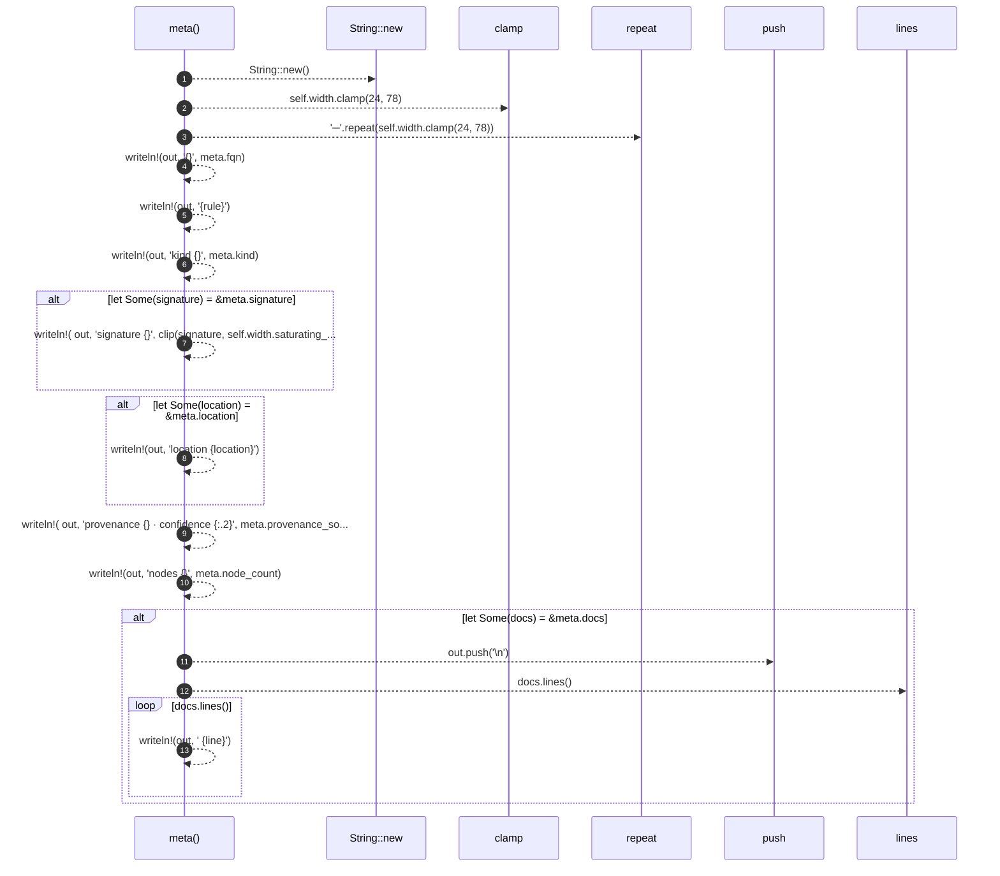

13 steps · 0 observed · 13 possible only

**Edges**

- calls → [`robby_render::render::tui::impl TuiRenderer::new`](index.md)
- calls → [`robby_render::report::impl Report::push`](../../report/index.md)

### `process`

| | |
|---|---|
| kind | `code.method` |
| signature | `fn process(2)` |
| location | [`crates/robby-render/src/render/tui.rs:140`](../../../../../crates/robby-render/src/render/tui.rs#L140) |
| provenance | extractor · confidence 1.00 |

```rust
fn process(&self, view: &ProcessView) -> String {
        if view.is_empty() {
            return String::from("(no steps)\n");
        }

        let labels: BTreeMap<&str, &str> = view
            .participants
            .iter()
            .map(|p| (p.id.as_str(), p.label.as_str()))
            .collect();
        let name = |id: &str| clip(labels.get(id).copied().unwrap_or(id), 28);

        let mut from_width = 0;
        let mut to_width = 0;
        let mut label_width = 0;
        let mut frame_depth = 0usize;
        let mut max_depth = 0usize;

        for event in &view.events {
            match event {
                ProcessEvent::Begin { .. } => {
                    frame_depth += 1;
                    max_depth = max_depth.max(frame_depth);
                }
                ProcessEvent::End => {
                    frame_depth = frame_depth.saturating_sub(1);
                }
                ProcessEvent::Interaction {
                    from, to, label, ..
                } => {
                    from_width = from_width.max(UnicodeWidthStr::width(name(from).as_str()));
                    to_width = to_width.max(UnicodeWidthStr::width(name(to).as_str()));
                    label_width = label_width.max(UnicodeWidthStr::width(clip(label, 52).as_str()));
                }
                ProcessEvent::Else { .. } => {}
            }
        }

        let number_width = view.step_count.to_string().len();
        let gutter = " ".repeat(number_width + 2);
        let mut out = String::new();

        out.push_str("lifelines  ");
        for (index, participant) in view.participants.iter().enumerate() {
            if index > 0 {
                out.push_str(" · ");
            }
            out.push_str(&clip(&participant.label, 32));
        }
        out.push('\n');
        let _ = writeln!(
            out,
            "{gutter}{} steps · {} observed · {} possible only",
            view.step_count,
            view.observed_count,
            view.step_count - view.observed_count
        );
        out.push('\n');

        let mut depth = 0usize;
        for event in &view.events {
            match event {
                ProcessEvent::End => {
                    depth = depth.saturating_sub(1);
                    let guide = "│ ".repeat(depth);
                    let _ = writeln!(out, "{gutter}{guide}└─ end");
                }
                ProcessEvent::Else { label } => {
                    let guide = "│ ".repeat(depth.saturating_sub(1));
                    let _ = writeln!(out, "{gutter}{guide}├─ else {}", clip(label, 60));
                }
                ProcessEvent::Begin { keyword, label } => {
                    let guide = "│ ".repeat(depth);
                    let _ = writeln!(out, "{gutter}{guide}┌─ {keyword} {}", clip(label, 60));
                    depth += 1;
                }
                ProcessEvent::Interaction {
                    index,
                    from,
                    to,
                    label,
                    observed,
                    kind,
                } => {
                    let guide = "│ ".repeat(depth);
                    let arrow = if *observed { "──▶" } else { "╌╌▶" };
                    let _ = writeln!(
                        out,
                        "{:>number_width$}  {guide}{} {arrow} {}  {}  {}",
                        index,
                        pad(&name(from), from_width),
                        pad(&name(to), to_width),
                        pad(&clip(label, 52), label_width),
                        kind.as_str(),
                    );
                }
            }
        }

        let _ = max_depth;
        out
    }
```

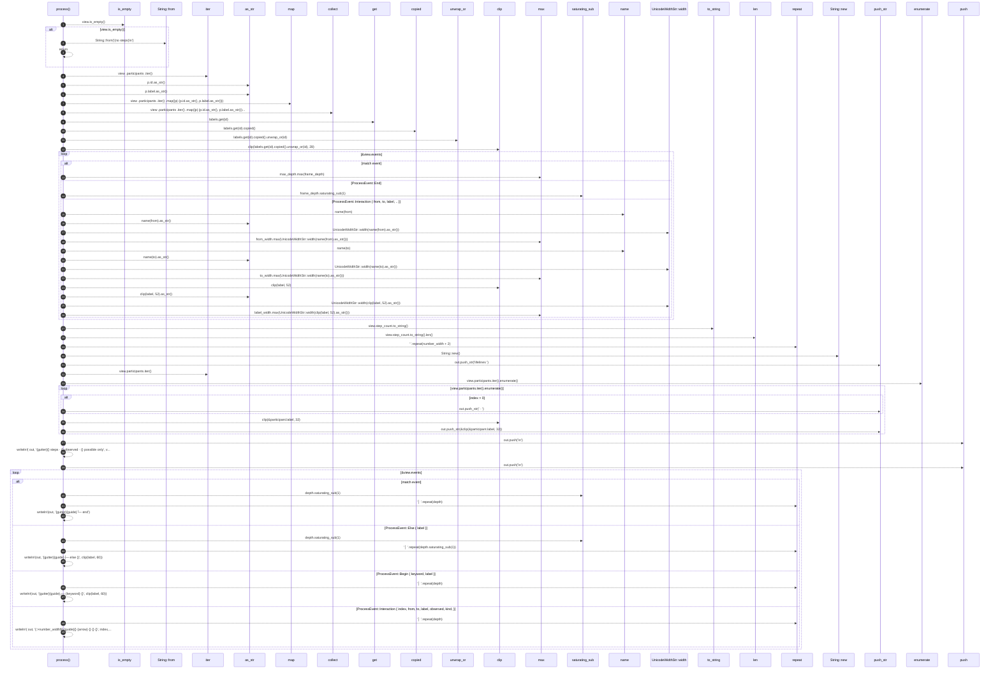

49 steps · 0 observed · 49 possible only

**Edges**

- calls → [`robby_render::view::links::impl LinkGraph::is_empty`](../../view/links/index.md)
- calls → [`robby_ir::kind::impl From<&str> for Kind::from`](../../../robby_ir/kind/index.md)
- calls → [`robby_render::view::comments::impl CommentKind::as_str`](../../view/comments/index.md)
- calls → [`robby_render::view::comments::impl CommentKind::as_str`](../../view/comments/index.md)
- calls → [`robby_render::view::select::collect`](../../view/select/collect.md)
- calls → [`robby_ir::run::RecipeCatalog::get`](../../../robby_ir/run/index.md)
- calls → [`robby_render::render::tui::clip`](clip.md)
- calls → [`robby_render::view::comments::impl CommentKind::as_str`](../../view/comments/index.md)
- calls → [`robby_render::view::comments::impl CommentKind::as_str`](../../view/comments/index.md)
- calls → [`robby_render::render::tui::clip`](clip.md)
- calls → [`robby_render::view::comments::impl CommentKind::as_str`](../../view/comments/index.md)
- calls → [`robby_render::render::tui::impl TuiRenderer::new`](index.md)
- calls → [`robby_render::render::tui::clip`](clip.md)
- calls → [`robby_render::report::impl Report::push`](../../report/index.md)
- calls → [`robby_render::report::impl Report::push`](../../report/index.md)

### `types`

| | |
|---|---|
| kind | `code.method` |
| signature | `fn types(2)` |
| location | [`crates/robby-render/src/render/tui.rs:243`](../../../../../crates/robby-render/src/render/tui.rs#L243) |
| provenance | extractor · confidence 1.00 |

```rust
fn types(&self, view: &TypeModel) -> String {
        let mut out = String::new();
        for class in &view.classes {
            let stereo = match class.stereotype {
                Some(ClassStereotype::Interface) => " «interface»",
                Some(ClassStereotype::Enumeration) => " «enumeration»",
                None => "",
            };
            let _ = writeln!(out, "{}{stereo}", class.name);
            for member in &class.members {
                match member {
                    ClassMember::Field(name) => {
                        let _ = writeln!(out, "  + {name}");
                    }
                    ClassMember::Method(name) => {
                        let _ = writeln!(out, "  + {name}()");
                    }
                    ClassMember::Variant(name) => {
                        let _ = writeln!(out, "  · {name}");
                    }
                }
            }
            out.push('\n');
        }
        for rel in &view.relations {
            let (arrow, label) = match rel.kind {
                crate::view::RelationKind::Implements => ("..|>", "implements"),
                crate::view::RelationKind::Extends => ("--|>", "extends"),
            };
            let _ = writeln!(out, "{} {arrow} {}  {label}", rel.from_id, rel.to_id);
        }
        out
    }
```

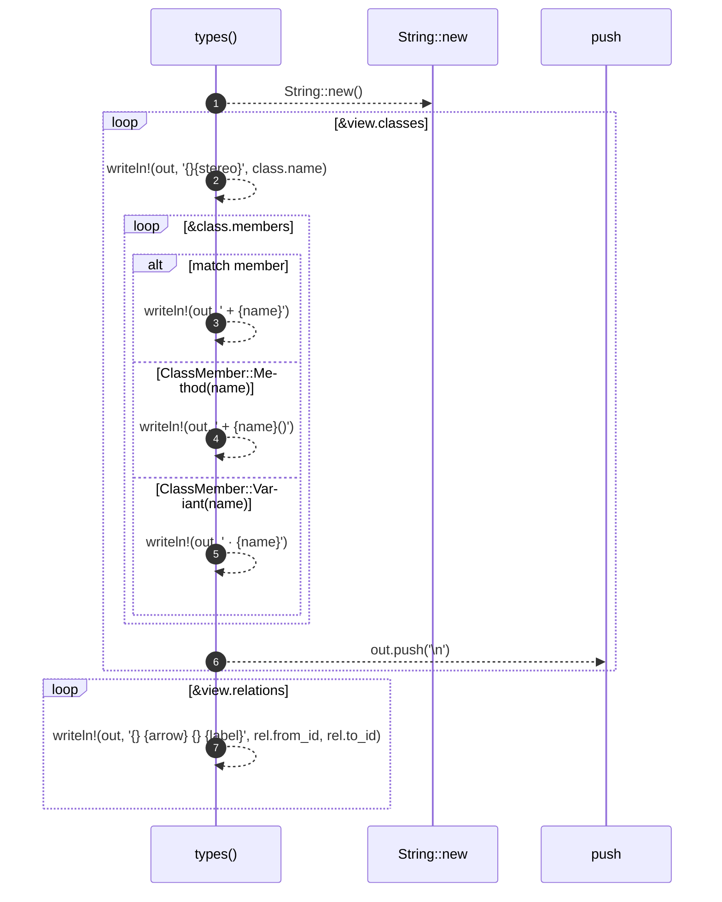

7 steps · 0 observed · 7 possible only

**Edges**

- calls → [`robby_render::render::tui::impl TuiRenderer::new`](index.md)
- calls → [`robby_render::report::impl Report::push`](../../report/index.md)

### `package_deps`

| | |
|---|---|
| kind | `code.method` |
| signature | `fn package_deps(2)` |
| location | [`crates/robby-render/src/render/tui.rs:277`](../../../../../crates/robby-render/src/render/tui.rs#L277) |
| provenance | extractor · confidence 1.00 |

```rust
fn package_deps(&self, view: &PackageStructure) -> String {
        ascii_package_structure(view)
    }
```

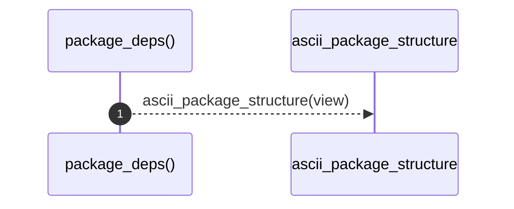

1 steps · 0 observed · 1 possible only

**Edges**

- calls → [`robby_render::render::tui::ascii_package_structure`](ascii-package-structure.md)

### `coupling_deps`

| | |
|---|---|
| kind | `code.method` |
| signature | `fn coupling_deps(2)` |
| location | [`crates/robby-render/src/render/tui.rs:281`](../../../../../crates/robby-render/src/render/tui.rs#L281) |
| provenance | extractor · confidence 1.00 |

```rust
fn coupling_deps(&self, view: &CouplingGraph) -> String {
        ascii_coupling(view)
    }
```

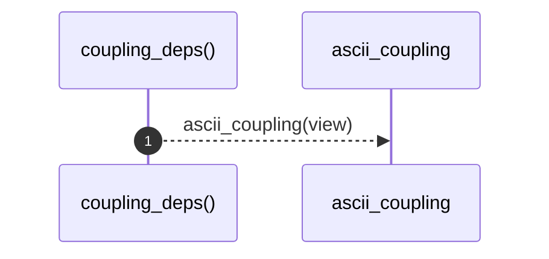

1 steps · 0 observed · 1 possible only

**Edges**

- calls → [`robby_render::render::tui::ascii_coupling`](ascii-coupling.md)

### `dependency_matrix`

| | |
|---|---|
| kind | `code.method` |
| signature | `fn dependency_matrix(2)` |
| location | [`crates/robby-render/src/render/tui.rs:285`](../../../../../crates/robby-render/src/render/tui.rs#L285) |
| provenance | extractor · confidence 1.00 |

```rust
fn dependency_matrix(&self, view: &PackageStructure) -> String {
        crate::render::mermaid::dsm_markdown_table(view)
    }
```

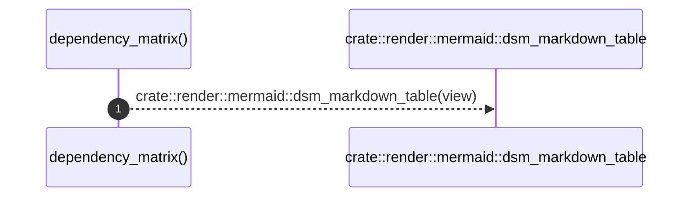

1 steps · 0 observed · 1 possible only

**Edges**

- calls → [`robby_render::render::mermaid::dsm_markdown_table`](../mermaid/dsm-markdown-table.md)

### `externals`

| | |
|---|---|
| kind | `code.method` |
| signature | `fn externals(2)` |
| location | [`crates/robby-render/src/render/tui.rs:289`](../../../../../crates/robby-render/src/render/tui.rs#L289) |
| provenance | extractor · confidence 1.00 |

```rust
fn externals(&self, view: &ExternalsView) -> String {
        let mut out = String::new();
        for entry in &view.entries {
            let importers = entry.importers.join(", ");
            let label = if entry.spec == entry.package {
                entry.package.clone()
            } else {
                format!("{} ({})", entry.package, entry.spec)
            };
            let _ = writeln!(out, "  {label} — imported by {importers}");
        }
        out
    }
```

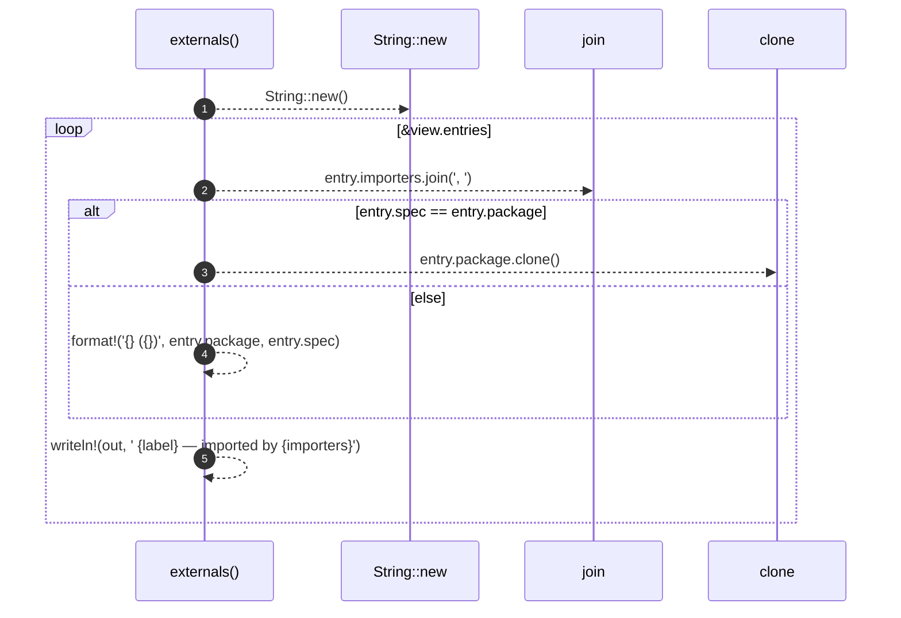

5 steps · 0 observed · 5 possible only

**Edges**

- calls → [`robby_render::render::tui::impl TuiRenderer::new`](index.md)

### `comments`

| | |
|---|---|
| kind | `code.method` |
| signature | `fn comments(2)` |
| location | [`crates/robby-render/src/render/tui.rs:303`](../../../../../crates/robby-render/src/render/tui.rs#L303) |
| provenance | extractor · confidence 1.00 |

```rust
fn comments(&self, view: &CommentsView) -> String {
        use crate::view::apply_highlights;

        let mut out = String::new();
        for entry in &view.entries {
            let loc = entry.location.as_deref().unwrap_or("?");
            if let (Some(note_kind), Some(note)) = (entry.note_kind, entry.note.as_ref()) {
                let _ = writeln!(out, "  {loc} — {}", note_kind.label());
                for line in note.lines() {
                    let _ = writeln!(out, "    {line}");
                }
                if let Some(code) = &entry.code {
                    let marked = apply_highlights(code, &entry.highlights);
                    for line in marked.trim_end().lines() {
                        let _ = writeln!(out, "    │ {line}");
                    }
                }
                out.push('\n');
                continue;
            }
            let kind = entry.kind.as_str();
            let text = clip(&entry.text.replace('\n', " "), 80);
            if let Some(owner) = &entry.owner_fqn {
                let _ = writeln!(out, "  {loc} ({kind}, {owner}): {text}");
            } else {
                let _ = writeln!(out, "  {loc} ({kind}): {text}");
            }
            if let Some(code) = &entry.code {
                let marked = apply_highlights(code, &entry.highlights);
                for line in marked.trim_end().lines().take(8) {
                    let _ = writeln!(out, "    │ {line}");
                }
            }
        }
        out
    }
```

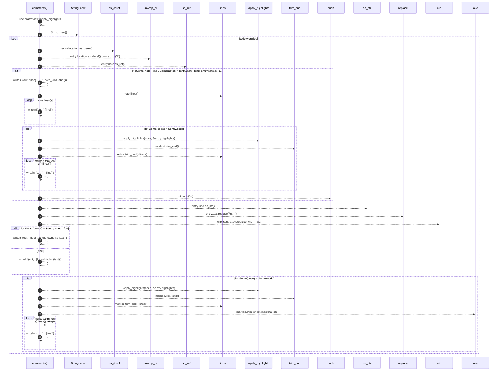

23 steps · 0 observed · 23 possible only

**Edges**

- calls → [`robby_render::render::tui::impl TuiRenderer::new`](index.md)
- calls → [`robby_render::view::comments::apply_highlights`](../../view/comments/apply-highlights.md)
- calls → [`robby_render::report::impl Report::push`](../../report/index.md)
- calls → [`robby_render::view::comments::impl CommentKind::as_str`](../../view/comments/index.md)
- calls → [`robby_render::render::tui::clip`](clip.md)
- calls → [`robby_render::view::comments::apply_highlights`](../../view/comments/apply-highlights.md)

### `hierarchy`

| | |
|---|---|
| kind | `code.method` |
| signature | `fn hierarchy(2)` |
| location | [`crates/robby-render/src/render/tui.rs:340`](../../../../../crates/robby-render/src/render/tui.rs#L340) |
| provenance | extractor · confidence 1.00 |

```rust
fn hierarchy(&self, view: &HierarchyView) -> String {
        fn render(node: &HierarchyNode, prefix: &str, is_last: bool, out: &mut String) {
            let branch = if prefix.is_empty() {
                ""
            } else if is_last {
                "└── "
            } else {
                "├── "
            };
            if node.kind_tag.is_empty() {
                let _ = writeln!(out, "{prefix}{branch}{}", node.name);
            } else {
                let _ = writeln!(out, "{prefix}{branch}{} [{}]", node.name, node.kind_tag);
            }
            let child_prefix = if prefix.is_empty() {
                String::new()
            } else if is_last {
                format!("{prefix}    ")
            } else {
                format!("{prefix}│   ")
            };
            let count = node.children.len();
            for (index, child) in node.children.iter().enumerate() {
                render(child, &child_prefix, index + 1 == count, out);
            }
        }

        let mut out = String::new();
        render(&view.root, "", true, &mut out);
        out
    }
```

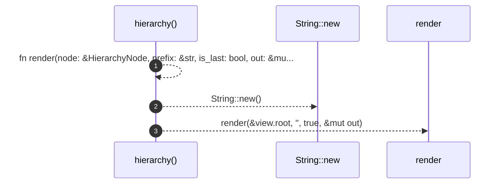

3 steps · 0 observed · 3 possible only

**Edges**

- calls → [`robby_render::render::tui::impl TuiRenderer::new`](index.md)

### `links`

| | |
|---|---|
| kind | `code.method` |
| signature | `fn links(2)` |
| location | [`crates/robby-render/src/render/tui.rs:372`](../../../../../crates/robby-render/src/render/tui.rs#L372) |
| provenance | extractor · confidence 1.00 |

```rust
fn links(&self, view: &LinkGraph) -> String {
        let mut out = String::new();
        if !view.outbound.is_empty() {
            out.push_str("references\n");
            for link in &view.outbound {
                let detail = if link.items.len() <= 4 {
                    format!(" — {}", link.items.join(", "))
                } else {
                    format!(" — {} items", link.items.len())
                };
                let _ = writeln!(out, "  {} → {}{detail}", link.kind_label, link.module_fqn);
            }
            out.push('\n');
        }
        if !view.inbound.is_empty() {
            out.push_str("referenced by\n");
            for link in &view.inbound {
                let kinds = link.kinds.join(", ");
                let _ = writeln!(out, "  {kinds} ← {}", link.caller_fqn);
            }
            out.push('\n');
        }
        out
    }
```

```mermaid
sequenceDiagram
    autonumber
    participant links as links()
    participant String__new as String::new
    participant is_empty as is_empty
    participant push_str as push_str
    participant len as len
    participant push as push
    participant join as join
    links-->>String__new: String::new()
    links-->>is_empty: view.outbound.is_empty()
    alt !view.outbound.is_empty()
    links-->>push_str: out.push_str('references\n')
    loop &view.outbound
    links-->>len: link.items.len()
    alt link.items.len() <= 4
    links-->>links: format!(' — {}', link.items.join(', '))
    else else
    links-->>links: format!(' — {} items', link.items.len())
    end
    links-->>links: writeln!(out, ' {} → {}{detail}', link.kind_label, link.module_fqn)
    end
    links-->>push: out.push('\n')
    end
    links-->>is_empty: view.inbound.is_empty()
    alt !view.inbound.is_empty()
    links-->>push_str: out.push_str('referenced by\n')
    loop &view.inbound
    links-->>join: link.kinds.join(', ')
    links-->>links: writeln!(out, ' {kinds} ← {}', link.caller_fqn)
    end
    links-->>push: out.push('\n')
    end
```

13 steps · 0 observed · 13 possible only

**Edges**

- calls → [`robby_render::render::tui::impl TuiRenderer::new`](index.md)
- calls → [`robby_render::view::links::impl LinkGraph::is_empty`](../../view/links/index.md)
- calls → [`robby_render::report::impl Report::push`](../../report/index.md)
- calls → [`robby_render::view::links::impl LinkGraph::is_empty`](../../view/links/index.md)
- calls → [`robby_render::report::impl Report::push`](../../report/index.md)

### `sibling_graph`

| | |
|---|---|
| kind | `code.method` |
| signature | `fn sibling_graph(2)` |
| location | [`crates/robby-render/src/render/tui.rs:397`](../../../../../crates/robby-render/src/render/tui.rs#L397) |
| provenance | extractor · confidence 1.00 |

```rust
fn sibling_graph(&self, view: &SiblingGraph) -> String {
        if view.nodes.is_empty() {
            return String::from("(no items to lay out)\n");
        }

        let labels: Vec<String> = view
            .nodes
            .iter()
            .map(|node| format!("{} [{}]", clip(&node.name, 22), node.kind_tag))
            .collect();

        let mut graph = Graph::new();
        for (index, label) in labels.iter().enumerate() {
            graph.add_node(index, label.as_str());
        }

        let index_of: BTreeMap<&str, usize> = view
            .nodes
            .iter()
            .enumerate()
            .map(|(index, node)| (node.stable_id.as_str(), index))
            .collect();

        for edge in &view.edges {
            let Some(&from) = index_of.get(edge.from.as_str()) else {
                continue;
            };
            let Some(&to) = index_of.get(edge.to.as_str()) else {
                continue;
            };
            let _ = graph.add_edge(from, to, Some(edge.label));
        }

        graph.set_direction(Direction::TopDown);
        let mut out = graph
            .compute_layout()
            .render_string(&RenderOptions::plain());
        if !out.ends_with('\n') {
            out.push('\n');
        }
        out
    }
```

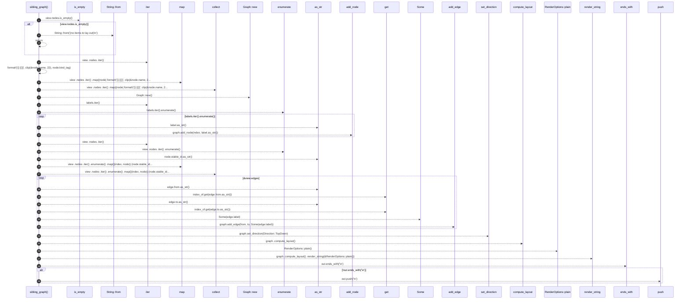

29 steps · 0 observed · 29 possible only

**Edges**

- calls → [`robby_render::view::links::impl LinkGraph::is_empty`](../../view/links/index.md)
- calls → [`robby_ir::kind::impl From<&str> for Kind::from`](../../../robby_ir/kind/index.md)
- calls → [`robby_render::view::select::collect`](../../view/select/collect.md)
- calls → [`robby_render::render::tui::impl TuiRenderer::new`](index.md)
- calls → [`robby_render::view::comments::impl CommentKind::as_str`](../../view/comments/index.md)
- calls → [`robby_render::view::comments::impl CommentKind::as_str`](../../view/comments/index.md)
- calls → [`robby_render::view::select::collect`](../../view/select/collect.md)
- calls → [`robby_render::view::comments::impl CommentKind::as_str`](../../view/comments/index.md)
- calls → [`robby_ir::run::RecipeCatalog::get`](../../../robby_ir/run/index.md)
- calls → [`robby_render::view::comments::impl CommentKind::as_str`](../../view/comments/index.md)
- calls → [`robby_ir::run::RecipeCatalog::get`](../../../robby_ir/run/index.md)
- calls → [`robby_render::report::impl Report::push`](../../report/index.md)

### `source`

| | |
|---|---|
| kind | `code.method` |
| signature | `fn source(2)` |
| location | [`crates/robby-render/src/render/tui.rs:440`](../../../../../crates/robby-render/src/render/tui.rs#L440) |
| provenance | extractor · confidence 1.00 |

```rust
fn source(&self, view: &SourceSlice) -> String {
        let mut out = String::new();
        for line in view.text.trim_end().lines() {
            let _ = writeln!(out, "  {line}");
        }
        out.push('\n');
        out
    }
```

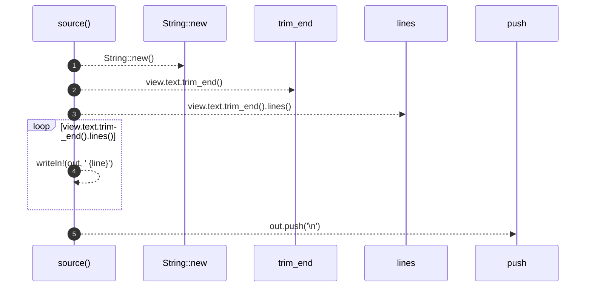

5 steps · 0 observed · 5 possible only

**Edges**

- calls → [`robby_render::render::tui::impl TuiRenderer::new`](index.md)
- calls → [`robby_render::report::impl Report::push`](../../report/index.md)

