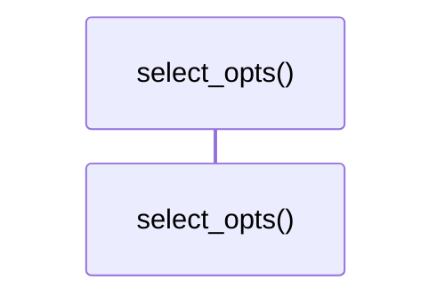

# `robby_render::render::tui::impl ShowOptions`

[Self-model](../../../README.md) · [render::tui](index.md)

| | |
|---|---|
| kind | `code.impl` |
| location | [`crates/robby-render/src/render/tui.rs:56`](../../../../../crates/robby-render/src/render/tui.rs#L56) |
| provenance | extractor · confidence 1.00 |

```rust
impl ShowOptions {
    pub fn select_opts(&self) -> SelectOpts {
        SelectOpts {
            hierarchy: self.tree,
            hierarchy_depth: self.depth,
            hierarchy_all: self.all,
            sibling: self.graph,
            source: self.source,
            types: self.types,
            dependencies: self.dependencies,
            externals: self.externals,
            comments: self.comments,
            links: self.references,
            entry: self.entry,
            process: self.process,
        }
    }
}
```

## Referenced by

- calls ← [`robby_render::render::tui::impl TuiRenderer::show`](index.md)
- calls ← [`robby_render::tui::show_collected`](../../tui/show-collected.md)

### `select_opts`

| | |
|---|---|
| kind | `code.method` |
| signature | `fn select_opts(1)` |
| location | [`crates/robby-render/src/render/tui.rs:57`](../../../../../crates/robby-render/src/render/tui.rs#L57) |
| provenance | extractor · confidence 1.00 |

```rust
pub fn select_opts(&self) -> SelectOpts {
        SelectOpts {
            hierarchy: self.tree,
            hierarchy_depth: self.depth,
            hierarchy_all: self.all,
            sibling: self.graph,
            source: self.source,
            types: self.types,
            dependencies: self.dependencies,
            externals: self.externals,
            comments: self.comments,
            links: self.references,
            entry: self.entry,
            process: self.process,
        }
    }
```



0 steps · 0 observed · 0 possible only

