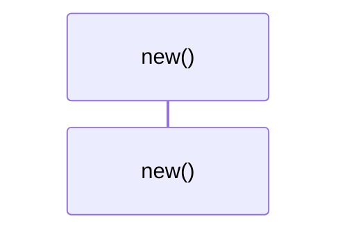
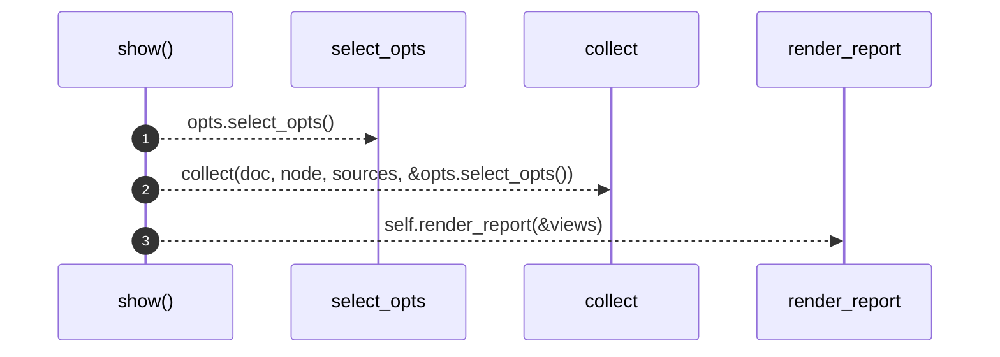
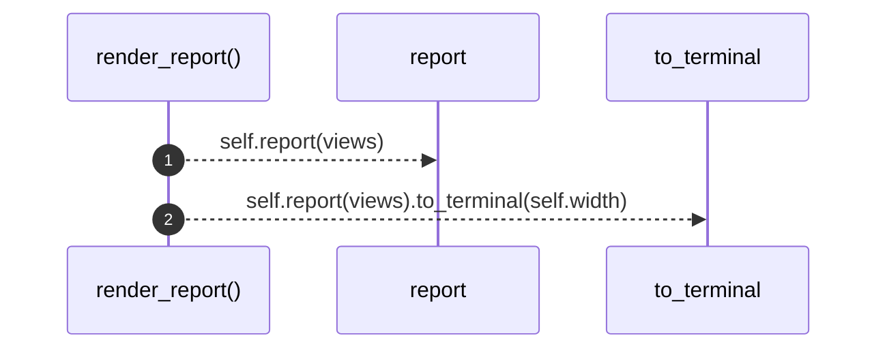

# `robby_render::render::tui::impl TuiRenderer`

[Self-model](../../../README.md) · [render::tui](index.md)

| | |
|---|---|
| kind | `code.impl` |
| location | [`crates/robby-render/src/render/tui.rs:86`](../../../../../crates/robby-render/src/render/tui.rs#L86) |
| provenance | extractor · confidence 1.00 |

```rust
impl TuiRenderer {
    pub fn new(width: usize) -> Self {
        Self { width }
    }

    /// Collect views for a node and render a terminal report artifact.
    pub fn show(
        &self,
        doc: &Document,
        node: &Node,
        sources: Option<&BTreeMap<String, String>>,
        opts: &ShowOptions,
    ) -> String {
        let views = collect(doc, node, sources, &opts.select_opts());
        self.render_report(&views)
    }

    pub fn render_report(&self, views: &NodeViews) -> String {
        self.report(views).to_terminal(self.width)
    }
}
```

## References

- calls → [`robby_render::render`](../index.md) — report
- calls → [`robby_render::render::tui`](index.md) — select_opts
- calls → [`robby_render::report`](../../report/index.md) — to_terminal
- calls → [`robby_render::view::select`](../../view/select/index.md) — collect

## Referenced by

- calls ← [`robby_render::render::mermaid::dsm_markdown_table`](../mermaid/dsm-markdown-table.md)
- calls ← [`robby_render::render::mermaid::impl Renderer for MermaidRenderer::comments`](../mermaid/index.md)
- calls ← [`robby_render::render::mermaid::impl Renderer for MermaidRenderer::coupling_deps`](../mermaid/index.md)
- calls ← [`robby_render::render::mermaid::impl Renderer for MermaidRenderer::dependency_matrix`](../mermaid/index.md)
- calls ← [`robby_render::render::mermaid::impl Renderer for MermaidRenderer::externals`](../mermaid/index.md)
- calls ← [`robby_render::render::mermaid::impl Renderer for MermaidRenderer::hierarchy`](../mermaid/index.md)
- calls ← [`robby_render::render::mermaid::impl Renderer for MermaidRenderer::links`](../mermaid/index.md)
- calls ← [`robby_render::render::mermaid::impl Renderer for MermaidRenderer::meta`](../mermaid/index.md)
- calls ← [`robby_render::render::mermaid::impl Renderer for MermaidRenderer::source`](../mermaid/index.md)
- calls ← [`robby_render::render::tui::ascii_coupling`](ascii-coupling.md)
- calls ← [`robby_render::render::tui::ascii_package_structure`](ascii-package-structure.md)
- calls ← [`robby_render::render::tui::clip`](clip.md)
- calls ← [`robby_render::render::tui::impl Renderer for TuiRenderer::comments`](index.md)
- calls ← [`robby_render::render::tui::impl Renderer for TuiRenderer::externals`](index.md)
- calls ← [`robby_render::render::tui::impl Renderer for TuiRenderer::hierarchy`](index.md)
- calls ← [`robby_render::render::tui::impl Renderer for TuiRenderer::links`](index.md)
- calls ← [`robby_render::render::tui::impl Renderer for TuiRenderer::meta`](index.md)
- calls ← [`robby_render::render::tui::impl Renderer for TuiRenderer::process`](index.md)
- calls ← [`robby_render::render::tui::impl Renderer for TuiRenderer::sibling_graph`](index.md)
- calls ← [`robby_render::render::tui::impl Renderer for TuiRenderer::source`](index.md)
- calls ← [`robby_render::render::tui::impl Renderer for TuiRenderer::types`](index.md)
- calls ← [`robby_render::tui::show_collected`](../../tui/show-collected.md)

### `new`

| | |
|---|---|
| kind | `code.method` |
| signature | `fn new(1)` |
| location | [`crates/robby-render/src/render/tui.rs:87`](../../../../../crates/robby-render/src/render/tui.rs#L87) |
| provenance | extractor · confidence 1.00 |

```rust
pub fn new(width: usize) -> Self {
        Self { width }
    }
```



0 steps · 0 observed · 0 possible only

### `show`

| | |
|---|---|
| kind | `code.method` |
| signature | `fn show(5)` |
| location | [`crates/robby-render/src/render/tui.rs:91`](../../../../../crates/robby-render/src/render/tui.rs#L91) |
| provenance | extractor · confidence 1.00 |

> Collect views for a node and render a terminal report artifact.

```rust
/// Collect views for a node and render a terminal report artifact.
    pub fn show(
        &self,
        doc: &Document,
        node: &Node,
        sources: Option<&BTreeMap<String, String>>,
        opts: &ShowOptions,
    ) -> String {
        let views = collect(doc, node, sources, &opts.select_opts());
        self.render_report(&views)
    }
```



3 steps · 0 observed · 3 possible only

**Edges**

- calls → [`robby_render::render::tui::impl ShowOptions::select_opts`](index.md)
- calls → [`robby_render::view::select::collect`](../../view/select/collect.md)
- calls → [`robby_render::render::tui::impl TuiRenderer::render_report`](index.md)

### `render_report`

| | |
|---|---|
| kind | `code.method` |
| signature | `fn render_report(2)` |
| location | [`crates/robby-render/src/render/tui.rs:103`](../../../../../crates/robby-render/src/render/tui.rs#L103) |
| provenance | extractor · confidence 1.00 |

```rust
pub fn render_report(&self, views: &NodeViews) -> String {
        self.report(views).to_terminal(self.width)
    }
```



2 steps · 0 observed · 2 possible only

**Edges**

- calls → [`robby_render::render::Renderer::report`](../index.md)
- calls → [`robby_render::report::impl Report::to_terminal`](../../report/index.md)

