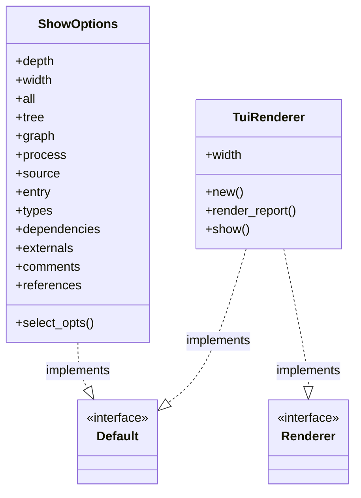
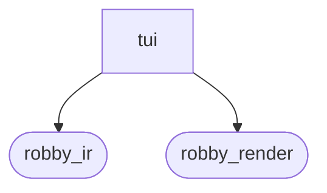
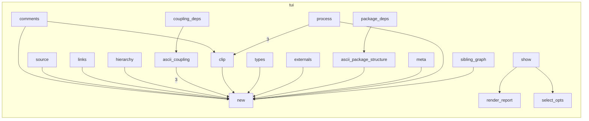

# `robby_render::render::tui`

[Self-model](../../../README.md) · [render](../index.md)

| | |
|---|---|
| kind | `code.module` |
| declared at | [`crates/robby-render/src/render/mod.rs:6`](../../../../../crates/robby-render/src/render/mod.rs#L6) |
| provenance | extractor · confidence 1.00 |
| nodes | 52 |

## Types



## Package diagram



## Module coupling



## Dependency matrix

| | tui | robby_ir | robby_render |
|---|---:|---:|---:|
| **tui** | · | 9 | 49 |
| **robby_ir** | | · | |
| **robby_render** | | | · |

## Comments

- `crates/robby-render/src/render/tui.rs:18:1` (docs, `robby_render::render::tui::ShowOptions`): "Options for one `robby show` invocation."
  ```
  /// Options for one `robby show` invocation.
  #[derive(Debug, Clone)]
  pub struct ShowOptions {
      pub depth: usize,
      pub width: usize,
      pub all: bool,
      pub tree: bool,
      pub graph: bool,
      pub process: bool,
      pub source: bool,
      pub entry: bool,
      pub types: bool,
      pub dependencies: bool,
      pub externals: bool,
      pub comments: bool,
      pub references: bool,
  }
  ```
- `crates/robby-render/src/render/tui.rs:91:5` (docs, `robby_render::render::tui::impl TuiRenderer::show`): "Collect views for a node and render a terminal report artifact."
  ```
  /// Collect views for a node and render a terminal report artifact.
      pub fn show(
          &self,
          doc: &Document,
          node: &Node,
          sources: Option<&BTreeMap<String, String>>,
          opts: &ShowOptions,
      ) -> String {
          let views = collect(doc, node, sources, &opts.select_opts());
          self.render_report(&views)
      }
  ```
## References

- calls → [`robby_ir::kind`](../../../robby_ir/kind/index.md) — from
- calls → [`robby_ir::model`](../../../robby_ir/model/index.md) — get, walk
- calls → [`robby_render::render`](../index.md) — report
- calls → [`robby_render::render::mermaid`](../mermaid/index.md) — dsm_markdown_table
- calls → [`robby_render::report`](../../report/index.md) — push, to_terminal
- calls → [`robby_render::view::comments`](../../view/comments/index.md) — apply_highlights, as_str
- calls → [`robby_render::view::deps`](../../view/deps/index.md) — leaf_nodes, module_by_stable
- calls → [`robby_render::view::links`](../../view/links/index.md) — is_empty
- calls → [`robby_render::view::select`](../../view/select/index.md) — collect

## Referenced by

- calls ← [`robby_render::render::markdown::impl MarkdownRenderer::new`](../markdown/index.md)
- calls ← [`robby_render::render::mermaid::dsm_markdown_table`](../mermaid/dsm-markdown-table.md)
- calls ← [`robby_render::render::mermaid::impl Renderer for MermaidRenderer::comments`](../mermaid/index.md)
- calls ← [`robby_render::render::mermaid::impl Renderer for MermaidRenderer::coupling_deps`](../mermaid/index.md)
- calls ← [`robby_render::render::mermaid::impl Renderer for MermaidRenderer::dependency_matrix`](../mermaid/index.md)
- calls ← [`robby_render::render::mermaid::impl Renderer for MermaidRenderer::externals`](../mermaid/index.md)
- calls ← [`robby_render::render::mermaid::impl Renderer for MermaidRenderer::hierarchy`](../mermaid/index.md)
- calls ← [`robby_render::render::mermaid::impl Renderer for MermaidRenderer::links`](../mermaid/index.md)
- calls ← [`robby_render::render::mermaid::impl Renderer for MermaidRenderer::meta`](../mermaid/index.md)
- calls ← [`robby_render::render::mermaid::impl Renderer for MermaidRenderer::source`](../mermaid/index.md)
- calls ← [`robby_render::report::impl Report::new`](../../report/index.md)
- calls ← [`robby_render::tui::show_collected`](../../tui/show-collected.md)
- calls ← [`robby_render::tui::timeline`](../../tui/timeline.md)

## Items

| Item | Kind | Steps | Location |
|---|---|---:|---|
| [`ShowOptions`](showoptions.md) | `code.struct` | — | `crates/robby-render/src/render/tui.rs:18:1` |
| [`impl Default for ShowOptions`](impl-default-for-showoptions.md) | `code.impl` | — | `crates/robby-render/src/render/tui.rs:36:1` |
| [`impl ShowOptions`](impl-showoptions.md) | `code.impl` | — | `crates/robby-render/src/render/tui.rs:56:1` |
| [`TuiRenderer`](tuirenderer.md) | `code.struct` | — | `crates/robby-render/src/render/tui.rs:75:1` |
| [`impl Default for TuiRenderer`](impl-default-for-tuirenderer.md) | `code.impl` | — | `crates/robby-render/src/render/tui.rs:80:1` |
| [`impl TuiRenderer`](impl-tuirenderer.md) | `code.impl` | — | `crates/robby-render/src/render/tui.rs:86:1` |
| [`impl Renderer for TuiRenderer`](impl-renderer-for-tuirenderer.md) | `code.impl` | — | `crates/robby-render/src/render/tui.rs:108:1` |
| [`ascii_package_structure`](ascii-package-structure.md) | `code.function` | 22 | `crates/robby-render/src/render/tui.rs:459:1` |
| [`ascii_coupling`](ascii-coupling.md) | `code.function` | 24 | `crates/robby-render/src/render/tui.rs:510:1` |
| [`clip`](clip.md) | `code.function` | 11 | `crates/robby-render/src/render/tui.rs:586:1` |
| [`pad`](pad.md) | `code.function` | 3 | `crates/robby-render/src/render/tui.rs:607:1` |
| [`step_tag`](step-tag.md) | `code.function` | 0 | `crates/robby-render/src/render/tui.rs:616:1` |

## Imports

- `use std::collections::BTreeMap;`
- `use std::fmt::Write as _;`
- `use ascii_dag::{Direction, Graph, RenderOptions};`
- `use unicode_width::UnicodeWidthStr;`
- `use crate::view::{`
- [`use robby_ir::{Document, Node, StepKind};`](../../../robby_ir/index.md)
- `use super::Renderer;`

