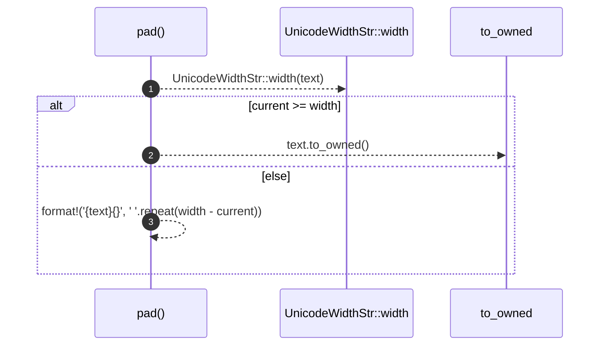

# `robby_render::render::tui::pad`

[Self-model](../../../README.md) · [render::tui](index.md)

| | |
|---|---|
| kind | `code.function` |
| signature | `fn pad(text: &str, width: usize) -> String` |
| location | [`crates/robby-render/src/render/tui.rs:599`](../../../../../crates/robby-render/src/render/tui.rs#L599) |
| provenance | extractor · confidence 1.00 |

```rust
fn pad(text: &str, width: usize) -> String {
    let current = UnicodeWidthStr::width(text);
    if current >= width {
        text.to_owned()
    } else {
        format!("{text}{}", " ".repeat(width - current))
    }
}
```



3 steps · 0 observed · 3 possible only

