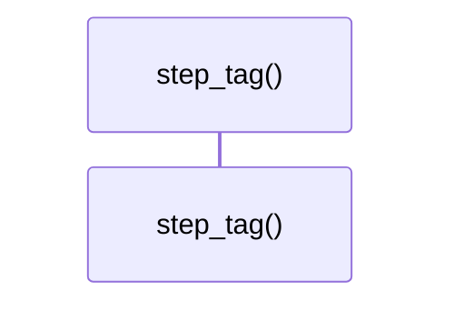

# `robby_render::render::tui::step_tag`

[Self-model](../../../README.md) · [render::tui](index.md)

| | |
|---|---|
| kind | `code.function` |
| signature | `fn step_tag(kind: StepKind) -> &'static str` |
| location | [`crates/robby-render/src/render/tui.rs:616`](../../../../../crates/robby-render/src/render/tui.rs#L616) |
| provenance | extractor · confidence 1.00 |

```rust
fn step_tag(kind: StepKind) -> &'static str {
    match kind {
        StepKind::Call => "call",
        StepKind::Return => "return",
        StepKind::Signal => "signal",
        StepKind::Decision => "decision",
        StepKind::Note => "note",
    }
}
```



0 steps · 0 observed · 0 possible only

